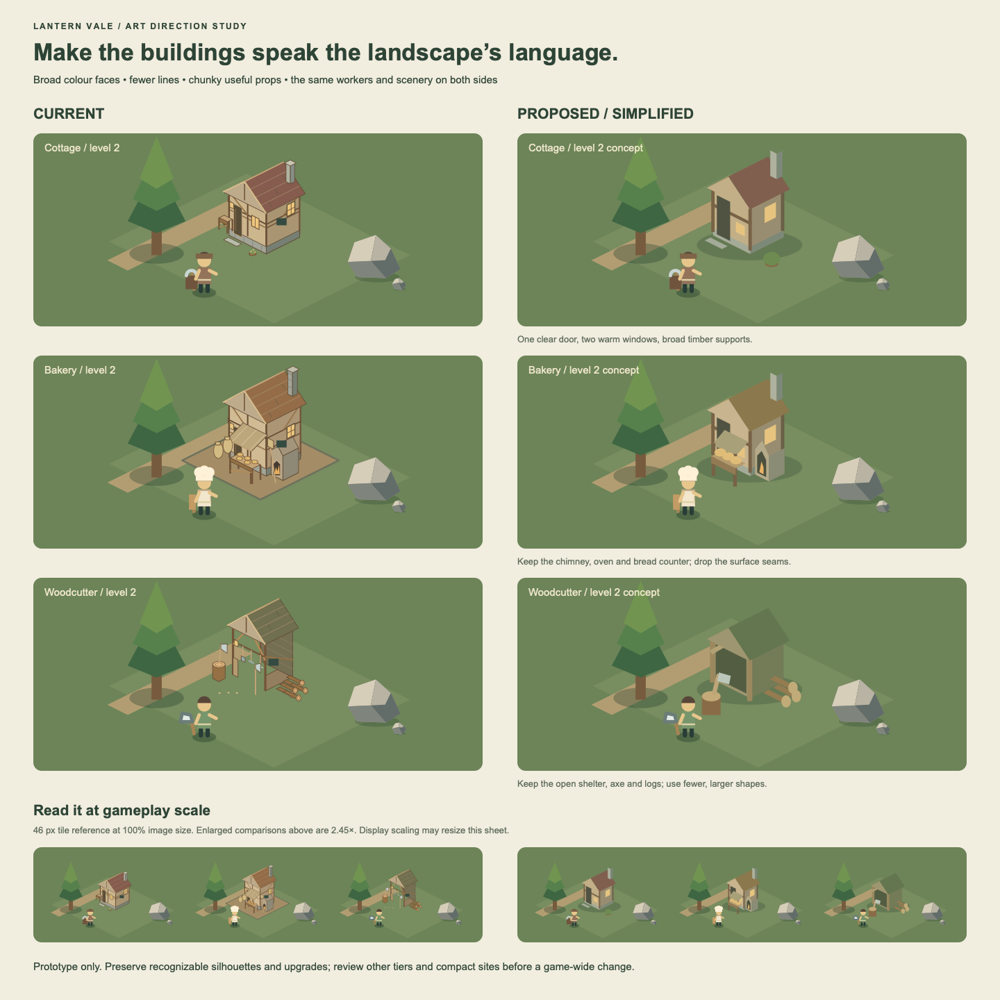
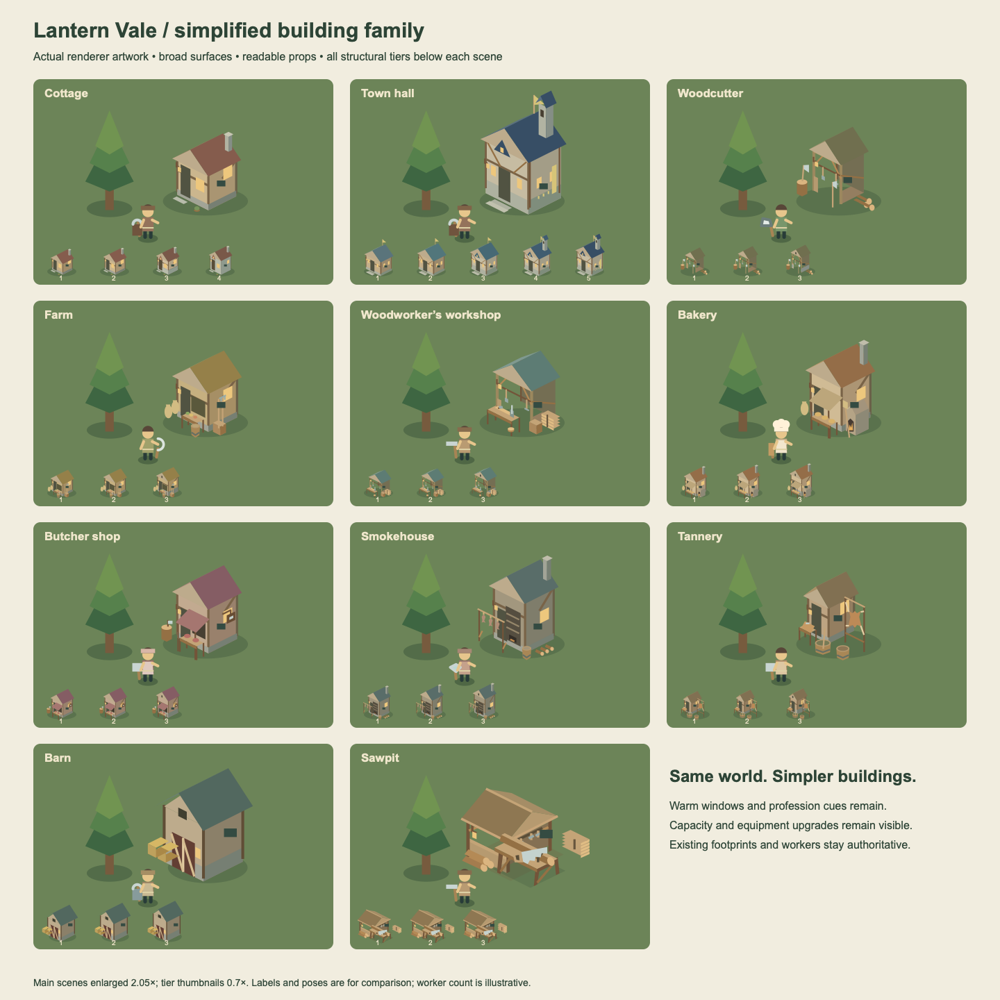
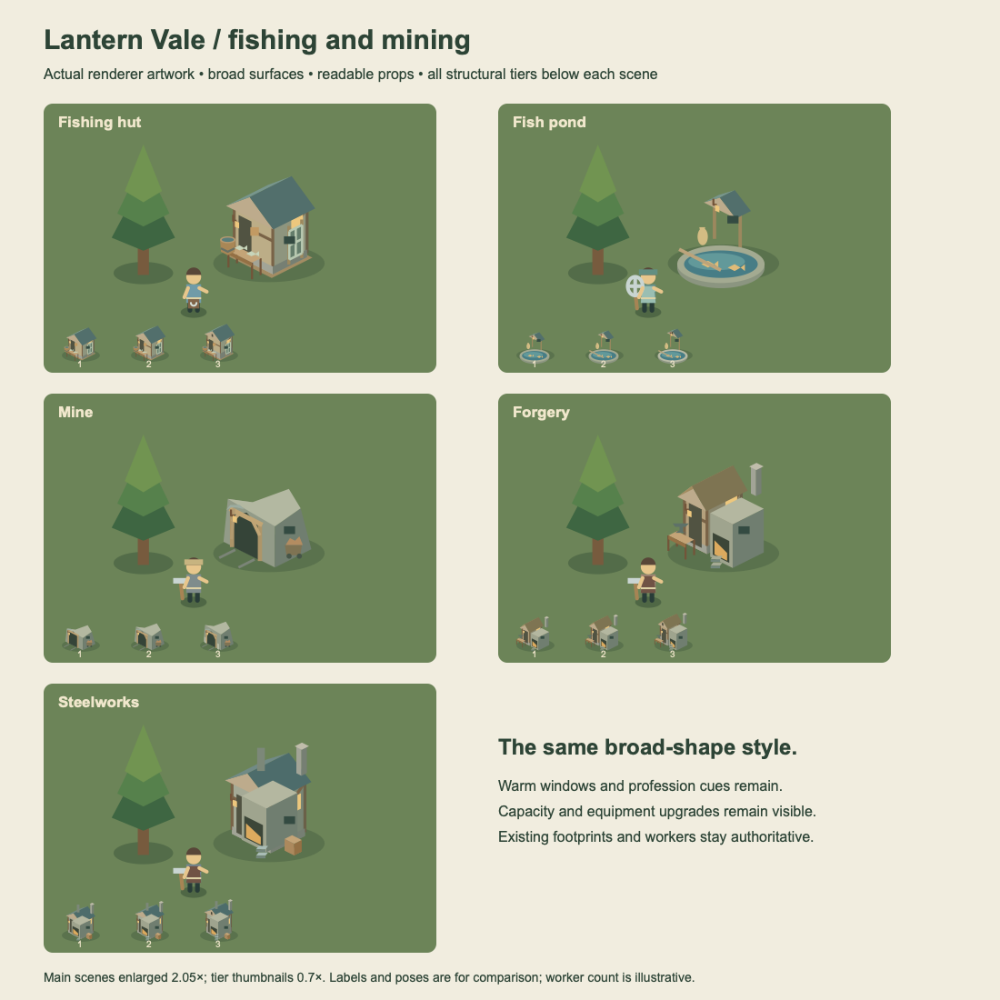
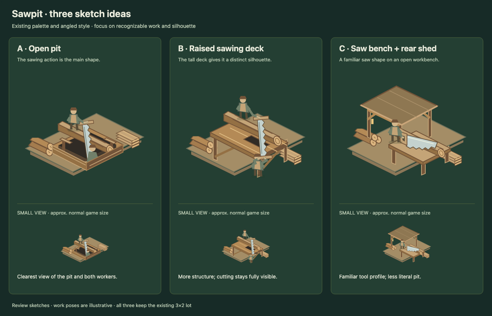
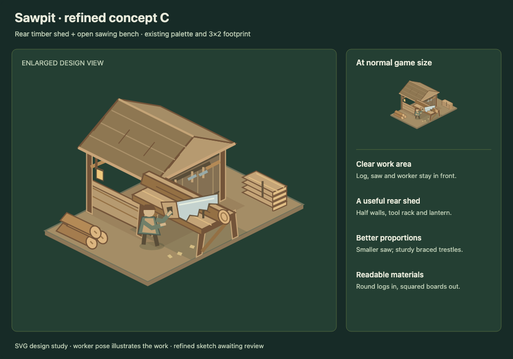
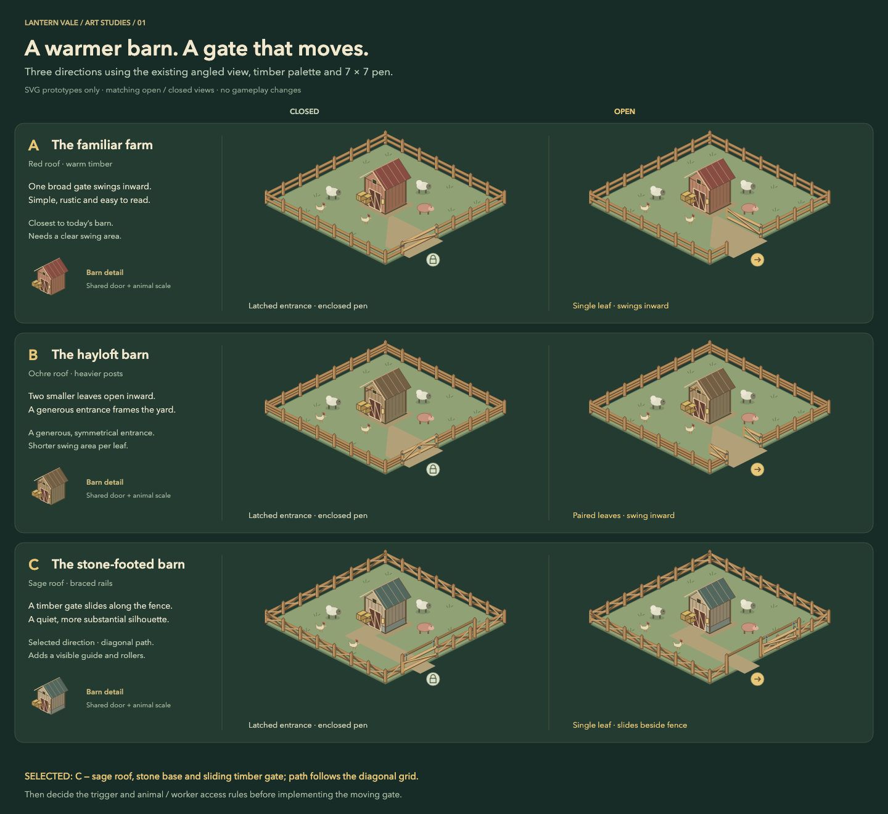
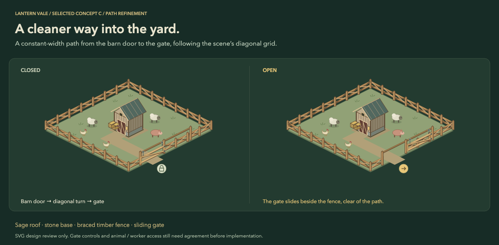
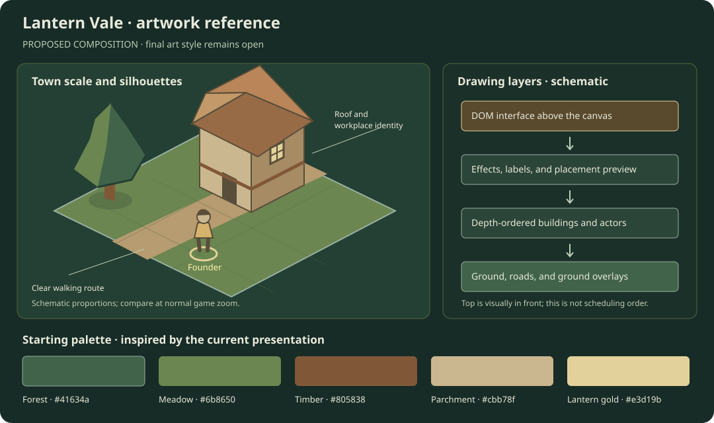

# Artwork improvement reference

[All improvement areas](README.md)

**Confirmed goal:** the game should look nice, support its cozy medieval setting,
and make the world and its rewards appealing. Angled 2D with depth is agreed;
the final choice between pixel art and soft storybook illustration remains open
in [DESIGN.md](DESIGN.md).

## Current foundation and direction

| Area | Current foundation | Improvement direction | Status |
| --- | --- | --- | --- |
| World view | Canvas drawing, angled tile grid, depth-ordered objects | Cohesive scale, silhouettes, lighting, and readable overlaps | Proposed |
| Buildings | Generated geometric shapes, workplace features, and visible upgrades | Make each profession and upgrade recognizable by shape and detail | Proposed |
| Landscape | Biome terrain, trees, water, rocks, crops, and villages | Consistent palettes and a distinct mood for each place | Proposed |
| Characters | Founder marker, workers, locals, outfits, and work animation | Stronger identity through clothing, pose, tools, and expressions | Proposed |
| Interface | Dark green panels, warm gold highlights, SVG icons | Keep information readable and visually connected to the world | Proposed |
| Rewards | Equipment and story keepsakes | Give important rewards memorable shapes and matching icons | Proposed |
| Ambient motion | Existing worker and gameplay animation | Water ripples, smoke, and crop motion are documented as deferred polish | Deferred in DESIGN.md |

Rendering lives in [web/app.js](../web/app.js); interface styling lives in
[web/style.css](../web/style.css). The sketch below is a proposed composition
reference, not a finished asset or a decision about the final art medium.

The enlarged hall, mill, sawpit, and woodworker's workshop keep the established
palette, angled roofs, simple shading, and warm lanterns. Their current refinement
adds connected yards, recognizable work equipment, cut timber, grain bins, and
flour sacks. The sawpit uses the approved concept C: a rear timber shed and an
open front bench with a hand saw; round logs and square-ended boards mark its
input and output.
The workshop has a bench canopy and tool rack, and the hall is wider without
scaling up its doors and windows. Their
existing footprints and visible upgrade conventions remain unchanged.

## Building style cohesion

**Implemented:** the updated building families use the landscape's broad,
mostly unoutlined shapes and the workers' chunky proportions. The original
[comparison sheet](building-style-prototype.svg) shows level-2 cottages, bakeries,
and woodcutters beside the same existing workers, trees, and rocks. The left
column captures the previous Canvas artwork; the right column is a vector
sketch. Enlarged views and a 46px-tile reference strip compare readability.

| Element | Treatment |
| --- | --- |
| Surfaces | Broad light and dark faces; remove roof seams, plank lines, masonry joints, and continuous brown outlines. |
| Structure | A few thick supports and braces, with a clear door and warm window shapes. |
| Profession | Keep a few large cues: the bakery's chimney, oven, and bread counter; the woodcutter's open shelter, axe, and logs. |
| Scale | Use broader doors and fewer, larger props beside the existing workers; retain the fit of compact saved sites. |
| Grounding | Use a restrained green ground shadow rather than relying on a sharply outlined yard pad. |

The accepted direction is implemented for cottages, town halls, woodcutters,
farms, woodworker's workshops, bakeries, butcher shops, smokehouses, tanneries,
barns, and sawpits. The [implemented family sheet](building-style-family.svg)
captures the renderer with existing trees and workers and every structural tier.

The same treatment extends to fishing huts, fish ponds, mines, Forgery, and
steelworks. The [fishing and mining sheet](fishing-mining-building-style.svg)
shows the implemented artwork and structural tiers. Fishing huts have blue-green
roofs, fish counters, and coarse upgraded nets; boat-tier markers remain separate
from their live boats and docks. Ponds are open stone basins with a low feed rack
and fish silhouettes, with the live ripple remaining on the water. Mines use
faceted rock, a dark timbered entrance, ore carts, and a larger steel pickaxe
head after its upgrade. Forgery has a sheltered anvil and furnace; steelworks
has a larger furnace and twin stacks. Footprints and production remain unchanged.

Roofs and masonry use plain shaded faces. Structural levels retain their bracing,
stone bases, dormers, belfry, banners, and stock changes. Profession equipment and
independent capacity plaques remain visible; smoke stays attached to the same
chimney caps. Larger door shapes and fewer, larger goods improve readability.
Completed updated buildings use ground shadows rather than outlined lot pads;
construction sites retain their lot surfaces. Compact saved sites keep their
existing fit and footprints. Their small scale remains a constraint on prop
readability. The host continues to own building footprints, worker positions,
and saved state; the artwork never changes those snapshots.

## Resource and building icons

The interface has dedicated SVG artwork for all 50 resource keys (including coins
and aggregate food) and all 28 building types, including acres, roads, and
decorations. The [complete icon sheet](resource-building-icons.svg) shows each at
an enlarged size and the 30px resource-list size. The artwork uses the existing
32×32 view box, rounded brown outlines, and timber, sage, and lantern-gold palette.

Build buttons and selection headings use the building artwork; the Resources
popup uses the resource artwork. Baked goods, prepared meats, crafting products,
and metals have distinct shapes. Raw and smoked fish retain species-specific
profiles and markings, with warm colors and smoke distinguishing preserved fish.
Existing illustrations for the core buildings and resources are retained where
they already identify their subject. Unknown resource keys use a crate fallback.
Map selection also has artwork for gathering patches, wild horses, treasure,
wilderness buildings, and boats, alongside the existing tree, water, and rock icons.
Definitions live in `iconPaths` in [web/app.js](../web/app.js); the sheet is a
review reference. This completes interface icon coverage; map artwork and the
broader visual improvements below remain open.

## Sawpit artwork

The [SVG concept comparison](sawpit-concepts.svg) explored alternatives to the
previous sawpit, which was difficult to recognize.
Each includes an enlarged view and an approximately normal-size view, using the
current palette and 3×2 lot. Worker poses illustrate the work rather than specify
staffing or animation behavior.

| Concept | Recognition cue | Tradeoff |
| --- | --- | --- |
| A — Open pit | Above/below sawing action over an exposed dark pit | The clearest pit view, with a low silhouette |
| B — Raised sawing deck | A timber platform with workers above and below | A taller silhouette, with more structure |
| C — Saw bench + rear shed | A familiar hand-saw profile on an open workbench | Fits the building family, but is less literal as a pit |

The approved [refined concept C](sawpit-c-refined.svg) is implemented in the canvas
renderer: a pitched rear shed with half walls, a tool rack and lantern, an open
bench on braced trestles, a proportionate hand saw, and separate log and board
storage. The SVG remains the design reference, including a view at approximately
normal game size. The host still owns worker positions and production; the
illustrative worker in the sketch is not baked into the cached building sprite.
Storage tiers add visible board layers, capacity has its own plaque, and the saw
upgrade changes the blade. Older crowded one-tile sites use a compact version
until moved to a clear site with the full 3×2 footprint.

## Barn and gate concepts

The [SVG concept comparison](barn-concepts.svg) shows three proposed barn upgrades,
each with the same 7×7 pen open and closed. The sketches retain the current angled
view, timber palette, and shared door and animal scale. The selected concept C
is implemented: a sage roof, stone base, braced timber fence, and sliding gate.

| Concept | Barn and fence | Gate motion |
| --- | --- | --- |
| A — The familiar farm | Red roof, warm timber, two fence rails | One broad leaf swings inward |
| B — The hayloft barn | Ochre roof, hayloft hood, three fence rails | Two smaller leaves swing inward |
| C — The stone-footed barn | Sage roof, stone base, braced fence rails | A timber leaf slides along a guide beside the fence |

The [refined concept C](barn-c-refined.svg) replaces the tapered yard path with a
constant-width connection from the barn door to the gate. Its bend follows the
isometric grid, so the long edges read as diagonal lines. The comparison sheet
also includes this refinement.

The fence blocks people, and the gate automatically slides open when founders,
workers, or locals head through its entrance, then closes after they leave.
Nearby keepers making rounds leave it closed. Someone occupying the doorway
keeps it open until they clear the entrance. Animals remain within
the existing pen range. Host routes and player collision use the same entrance;
browser prediction follows those boundaries without changing saved snapshots.
The owner's **Fence orientation** selector beside **Move** places the entrance
on any of the four sides for free. Its orientation persists with the barn and
survives moves. At map edges, legacy entrances fall back to an accessible side.
The diagonal path follows the chosen entrance. Level and capacity plaques retain
their existing meaning. The SVG state icons remain diagram labels.

## Composition sketch

| Sketch element | Purpose | Question to settle |
| --- | --- | --- |
| Angled ground tile and cottage | Reference for footprint, roof shape, and scale | How detailed should buildings be at normal zoom? |
| Small founder with a gold marker | Keep the controlled character easy to find | Which outfit shapes and colors distinguish players? |
| Path and restrained landscape detail | Let activity and useful routes remain readable | How much decoration belongs near working buildings? |
| Green, timber, parchment, and lantern gold | Starting palette inspired by the current presentation | Should the final palette be softer, brighter, or more muted? |
| Depth-layer diagram | Keep ground below buildings and actors, with interface above | Which occlusion cases need special treatment? |

## Proposed visual rules

| Rule | Starting direction | Review reference to add |
| --- | --- | --- |
| Silhouette first | Recognize cottage, sawpit, barn, and hall without reading labels. | Side-by-side building silhouettes at normal zoom. |
| Consistent scale | Use doors, characters, tools, and trees as shared scale anchors. | Character beside every building family. |
| Clear lighting | Use one consistent light direction and restrained shadows. | A tile, building, tree, and character under the same light. |
| Readable interaction | Selection, valid placement, and blocked placement use clear shapes as well as color. | Selected, hovered, valid, and invalid versions of one scene. |
| Biome identity | Change vegetation, materials, and palette while retaining a common style. | Forest, swamp, desert, and ice thumbnails. |
| Reward identity | The world object, inventory icon, and cosmetic version share recognizable features. | A lantern reward shown in all three contexts. |
| Detail by zoom | Important shapes remain readable when zoomed out; close views add detail. | Same village at near, normal, and far zoom. |

## Asset and improvement priorities

| Proposed order | Asset group | First reference to produce | Acceptance question |
| --- | --- | --- | --- |
| 1 | Core town and founder | Hall, cottage, woodcutter, sawpit, founder, tree, and road on one sheet | Does the central play scene feel cohesive and readable? |
| 2 | Food and livestock | Farm, barn, bakery, butcher, crops, and animals | Can players identify the chain and its activities? |
| 3 | Locals and story rewards | Moss, Tobin, Flint, keepsakes, and one cosmetic concept | Are characters and rewards memorable? |
| 4 | Biomes and wilderness villages | Small composition for each village | Does each place have identity while belonging to the same world? |
| 5 | Adventure spaces and ambient polish | Quarry scene, courier course, and restrained effect examples | Are hazards clear and motion useful without clutter? |

## Open art decisions

| Decision | Options to compare | Status |
| --- | --- | --- |
| Final medium | Pixel art or soft storybook illustration | Open |
| Amount of stylization | Broad geometric buildings matched to the existing scenery and workers | Building direction implemented |
| Character cosmetics | Outfits, color variants, accessories, or a combination | Open |
| Building identity | Biome material variants, upgrade variants, cosmetic variants | Open |
| Animation scope | Refine existing work actions first; choose ambient additions later | Proposed |

Before replacing game assets, compare a small complete scene in the candidate
styles. Keep the chosen reference here so future artwork follows the same decisions.
