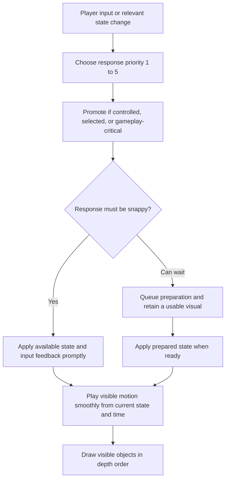
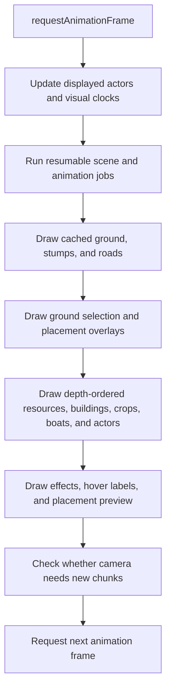

# Backend

[All improvement areas](README.md)

**Confirmed goal:** understand where work happens, how requests reach the host,
and how urgently the game must respond. This reference includes backend work and
the browser rendering it supports; animations are rendered in the browser.

## Snappy response and smooth playback

| Concern | Meaning | Example |
| --- | --- | --- |
| Snappy | Respond quickly to player input or a relevant state change. | Pressing a movement key makes the founder start moving immediately; a new hazard warning appears promptly. |
| Smooth | Keep motion continuous once it is playing. | Walking, sawing, or animal movement progresses without visible jumps. |

An animation can be smooth but respond late, or respond quickly but move in jerky
steps. We need to describe both. **Priority determines how long a response or
new animation state can wait. Playback cadence determines how often we update
the displayed motion.** A low-priority animation can still have smooth playback.

## Response priority levels

The five levels below are the working classification requested for this reference.
Assignments to individual animations are proposals; the engine does not yet
implement these priority levels. Timing descriptions are intended behavior, not
measured latency or new simulation intervals.

| Prio | Level | When to respond | What can wait? |
| --- | --- | --- | --- |
| 1 | Very high / realtime | React to input immediately; show available changes at the next render opportunity. | Do not deliberately queue the response behind background work. |
| 2 | High / almost realtime | Apply relevant updates promptly so interaction feels snappy. | Small scheduling delays; avoid a visible pause before responding. |
| 3 | Medium / annoying if sluggish | Update soon enough that visible activity and feedback stay believable. | Brief deferral under load, but not persistent lag or a backlog. |
| 4 | Low / can be in queue | Prepare the change when more urgent work has been served. | Queued preparation; retain a usable current visual while waiting. |
| 5 | Very low / you don't notice if a second later | Defer changes whose arrival about a second later has no meaningful effect. | Optional detail or background preparation, provided the player does not need it now. |

## Animation categories — proposed

“When to respond” describes starting, stopping, or changing an animation after
input or new information. “Playback” describes motion between those changes.
Draw visible objects in depth order; priority is not a rule for which object
appears in front of another.

| Animation or visual response | Default prio | When to respond | Playback / rendering | When priority changes |
| --- | --- | --- | --- | --- |
| Your founder walking, stopping, turning, riding, or sailing | 1 | React immediately to your movement input; reconcile accepted host positions promptly. | Update displayed motion each animation frame using prediction and reconciliation. | Always 1 while you control the character. |
| Camera follow, panning, and zoom | 1 | React immediately to movement or camera input. | Apply the camera position each animation frame. | Always 1 during interaction. |
| Hazard warnings, strikes, and hit/checkpoint feedback | 1 | Display the latest available state immediately; do not queue actionable danger cues. | Render on relevant state changes; any continuous motion must remain smooth. The courier prototype currently uses a polled DOM board. | Always 1 while the course is active and visible. |
| Hover, selection, and building placement preview | 1 | Follow the pointer, selected tile, or placement change immediately. | Reflect current input on the next map frame; reuse prepared artwork. | Expensive decorative preview detail can be 4; validity feedback stays 1. |
| Other players walking, turning, riding, or sailing | 2 | Accept fresh movement samples promptly. | Interpolate displayed motion each animation frame between network samples. | Offscreen visual preparation can wait; re-entering view needs a current position. |
| Your gathering action or a worker you just assigned/selected | 2 | Show input acknowledgement promptly; start or change work playback when host confirmation arrives. | Play walking and work motion each animation frame, following the confirmed work phase. | Keep input feedback at 1; the ordinary background worker animation is 3. |
| Visible settlers walking, hauling cargo, building, or boating | 3 | Reflect route, cargo, and work-phase changes without annoying lag. | Advance visible movement each animation frame from prepared routes or host playback. | Promote to 2 when selected or directly affected by your command. |
| Visible profession actions: chopping, fishing, farming, sawing, milling, baking, butchery, preserving, and tending | 3 | Start, stop, or switch the work action promptly enough to explain workplace activity. | Advance the action pose each animation frame; reuse the route and work state. | Promote to 2 when selected or manually initiated; completion still requires host confirmation. |
| Construction/completion, sale, assignment, and resource feedback effects | 3 | Show the effect close to the event it describes; discard an effect that would arrive too late to explain it. | Play the short effect smoothly once started. | Promote to 2 for your command's result; button/selection acknowledgement remains 1. |
| Ambient local residents and unselected barn animals roaming | 4 | New ambient routes or routine changes may enter a queue. | Continue smooth visible movement on an existing route while preparation waits. | Promote to 2 for interaction/selection; to 3 when their activity is the player's focus. |
| Decorative workplace motion: mill blades, smoke, and pond ripples | 5 | An optional effect starting about a second later is acceptable. | Animate visible effects smoothly from a visual clock; reduce or omit detail under load. | A cue needed to understand work status becomes 3; keep essential status separate from decoration. |
| Offscreen animation routes and optional distant detail | 5 | Prepare later, or skip visual work until it is needed. | No drawing outside the viewport; resume from current state/time when visible. | On entering view, use the visible category's priority and a usable fallback. |

The default priority follows what the animation communicates, not just its
object type. A butcher's background chopping pose is 3; acknowledging your
manual animal selection is 1, and showing its confirmed work start is 2.
Likewise, decorative ripples are 5 while your boat's movement is 1.

## How to use the categories



For future implementation, queue expensive preparation such as route searches
and optional artwork, while cheap playback can continue from prepared state.
Replacing an obsolete job should keep the latest relevant change rather than
replaying a backlog. Delayed decorative work must not hold up input feedback,
movement, or hazard information. These are scheduling proposals, not code changes.

Host validation, production, rewards, and saves remain authoritative regardless
of visual priority. Input acknowledgement can appear immediately; a success
effect or awarded resource must wait for host confirmation.

## Where work happens today

| Responsibility | Location | What it owns or calculates |
| --- | --- | --- |
| HTTP requests and commands | [server/server.py](../server/server.py), `Handler`, `command()` | Authentication, town ownership, validation, authoritative changes, and exported snapshots. |
| Simulation and saving | [server/server.py](../server/server.py), `tick()`, `simulation()`, `save()` | Three-second simulation cycles and persistent world state. Construction is processed before worker production; haulers are visited before other workers. |
| Progression and balance | [server/progression.py](../server/progression.py) | Recipes, practice, qualifications, efficiency, materials, and unlocks. Imported as `economy` by the host. |
| Production and transport | [server/logistics.py](../server/logistics.py), [server/work_cycles.py](../server/work_cycles.py) | Input delivery, output buffers, hauling, batch completion, animal butchery, and host work phases. |
| Terrain and routes | [server/chunk_world.py](../server/chunk_world.py), [server/navigation.py](../server/navigation.py) | Terrain chunks and host routes around obstacles and across roads. |
| Browser requests and interface | [web/app.js](../web/app.js), `request()`, `act()`, `refresh()`, `render()` | Commands, snapshot refreshes, controls, and DOM panels. `render()` updates the interface; `draw()` paints the map. |
| Derived scene data | [web/scene.js](../web/scene.js), `ClientScene` | Local indexes, collision overlays, reusable geometry, and resumable jobs. |
| Visual worker playback | [web/animations.js](../web/animations.js), worker functions in `app.js` | Browser animation routes and displayed worker phases. These do not award goods or practice. |
| Canvas presentation | [web/app.js](../web/app.js), `updateActors()`, `animate()`, `draw()` | Character prediction/interpolation, camera, visual effects, depth ordering, and map drawing. |

The host owns gameplay and saved state. Browser predictions, indexes, overlays,
animation jobs, and drawing caches must not mutate authoritative snapshots.

## Request and snapshot flow — current

```mermaid
sequenceDiagram
    participant Player
    participant Browser as Browser app.js
    participant Host as Python host
    participant State as Authoritative world
    participant Scene as ClientScene
    Player->>Browser: Build, assign a worker, or choose a recipe
    Browser->>Host: POST /api/command with token and world_id
    Host->>Host: Check identity, ownership, and action requirements
    Host->>State: Apply accepted command under world lock
    Host-->>Browser: Success or error
    Browser->>Host: GET /api/world through refresh()
    Host-->>Browser: World snapshot and requested chunk data
    Browser->>Scene: Prepare indexes and resource artwork in yielding slices
    Scene-->>Browser: Commit prepared scene and replace displayed world
    Browser->>Browser: Update DOM panels; draw map on animation frames
    Note over Host,State: Simulation also updates and saves the world every three seconds
```

This is the ordinary `act()` path. Walking has a separate command path with local
prediction and host reconciliation; adventures have their own browser modules.

| Request/work | Current trigger or cadence | Proposed response priority | Important constraint |
| --- | --- | --- | --- |
| Founder movement command | Pending steps are submitted from `playerSprite()`; at most one walking request in flight. | 1 | Local prediction gives immediate response; the host validates the movement. |
| Ordinary command | Explicit player action | 2 for confirmed result; 1 for local input acknowledgement | Validate on the host; refresh after success or error. |
| World snapshot | Startup, after commands, camera chunk changes, and a two-second interval | 2 for needed command results/visible terrain; 3 for routine updates | `refresh()` shares an in-flight refresh; interval refresh is skipped while a select control has focus. |
| Remote player positions | A 50 ms timer calls `refreshPlayers()` | 2 | Skipped while hidden, without other shared-map players, or while its previous request is running. Timer cadence is not a guaranteed network rate. |
| Courier hazard state | A 100 ms timer polls while the adventure board is open. | 1 for available danger and movement updates | The host owns hazards; the browser currently redraws the DOM board after a response. |
| Scene preparation | After a snapshot arrives | Required visible geometry: 2; optional refinement: 4–5 | About 2 ms of generator work per slice, then yield; individual steps can exceed the slice budget. Current preparation commits the scene together. |
| Host simulation and saving | Every three seconds while the host runs | Fixed host cadence; not an optional animation job | Simulation and command state changes share a lock. An overrun does not replay a backlog of ticks. |

## Frame flow and drawing order — current



`ClientScene.queue.run(2)` gives queued work an approximately 2 ms frame budget.
The queue rotates unfinished jobs; it does **not** currently assign priority levels.
Depth order determines what appears in front of what, independently of scheduling.
DOM panels sit over the canvas through the layout in [web/style.css](../web/style.css).

## Improvement table

| Proposed order | Improvement | Status | Reference or evidence to add |
| --- | --- | --- | --- |
| 1 | Trace one build command and one movement command end to end. | Ordinary command documented; movement detail open | Include validation, acknowledgement, reconciliation, and failure paths. |
| 2 | Document scene/cache invalidation and which work yields. | Open | Table of cache inputs, invalidation triggers, owner, and fallback. |
| 3 | Apply the response priorities to animation preparation when needed. | Categories proposed; scheduler unchanged | Identify delayed reactions separately from jerky playback before changing the queue. |
| 4 | Clarify module boundaries as features grow. | Proposed | Keep host rules, browser playback, and interface responsibilities explicit. |

Performance measurements belong to a concrete performance investigation. This
reference describes the current structure without claiming measured latency or budgets.
