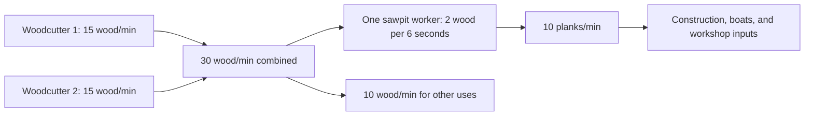
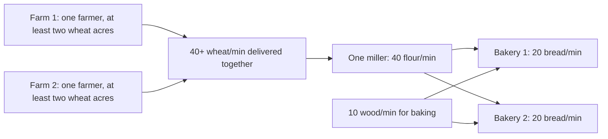

# Balancing theory and reference

[All improvement areas](README.md)

**Confirmed goal:** choose how long progress should take, how production chains
fit together, and how manual tasks such as animal butchery earn satisfying practice.
Current values below come from [server/server.py](../server/server.py),
[server/progression.py](../server/progression.py), and
[server/logistics.py](../server/logistics.py). They are starting references, not final balance.

## Working theory

| Principle | Proposed design rule | What to record when tuning |
| --- | --- | --- |
| Time before numbers | Choose the desired time to a useful milestone, then derive costs and XP. | Active work time and total elapsed time separately. |
| Chains should be understandable | Upstream supply should explain downstream capacity. | Inputs/minute, outputs/minute, worker counts, and spare capacity. |
| Manual attention has value | Manual decisions should give visible progress and a worthwhile result. | Actions per unlock, time per action, feedback, and reward. |
| Skilled villagers matter | Training should create valuable specialists while allowing recovery after a loss. | Time to qualify, time to useful recipes, and replacement time. |
| Waiting should have a purpose | Material shortages and travel should create choices the player can act on. | Why work pauses and what the player can improve or do elsewhere. |

## Shared assumptions and full-chain totals

Neutral talent, practice below 20, no tools or upgrades, and uninterrupted active
work are assumed. Travel, supply regeneration, hauling, food, and storage limits
make actual elapsed time longer. Practice means the game's saved skill points (XP).

Talents apply a 0.75× or 1.25× modifier to output and practice. Every 20 practice
adds another base output multiplier. Processing expertise and the crafted saw
increase batch output **and inputs**; they do not make materials free.

`active minutes to target = remaining practice ÷ practice per active minute`

**Total production time cost** adds the active work needed to produce every
consumed input and complete the final recipe. Totals use **worker-seconds**:
Eight seconds of woodcutting plus six seconds of sawing costs 14 worker-seconds,
even when several workers shorten the elapsed wait. These are ideal production
budgets using the base rates below, not measured end-to-end completion times.

**Total reward** lists the final goods, retained byproducts, and practice earned
across the whole chain. Consumed intermediate goods are not counted again.
Practice totals sum the listed skills for comparison; each worker keeps their
own skill progress. Food value describes the final goods and does not add another
item to the reward.

Workers are already qualified and buildings are available. Building construction,
qualification training, animal purchase/capture, travel, hauling, regeneration,
blocked work, and ongoing settler food consumption are outside these production
totals. Farming assumes no manure fertilization. Livestock tending and feed
production are included in the meat examples. Recalculate for upgrades, talents,
practice, shared barn work, or different recipes.

## Wood

### Current base rates

| Activity                         | Base work                                             | Output or practice                          | Ideal rate                                              |
| -------------------------------- | ----------------------------------------------------- | ------------------------------------------- | ------------------------------------------------------- |
| Settler woodcutting              | Three-second productive cycle                         | 0.75 wood; 0.04 practice                    | 15 wood/minute; 0.8 practice/minute                     |
| One sawpit worker                | Six-second completed batch                            | 2 wood → 1 plank; 0.08 practice             | Uses 20 wood/minute; makes 10 planks/minute             |

### Total production time cost vs total reward

| Full chain | Work breakdown | Total production time cost | Total reward |
| --- | --- | --- | --- |
| Tree → wood → 1 plank | Gather 2 wood: 8s; saw: 6s | 14 worker-seconds | 1 plank; approximately 0.187 practice (0.107 woodcutting + 0.08 woodworking) |

### How many woodcutters for a sawpit?

This drawing shows ideal active rates. Source stock, travel, input delivery, and
output collection still limit the running town.

`required upstream workers = ceil(downstream workers × input/minute ÷ upstream output/minute)`

| Configuration                                             | Ideal wood demand | Ideal supporting woodcutters | Practical implication                                               |
| --------------------------------------------------------- | ----------------- | ---------------------------- | ------------------------------------------------------------------- |
| One base sawpit worker                                    | 20/minute         | 2                            | Leaves 10 wood/minute before downtime and other demand. |
| Both upgraded sawpit slots filled                         | 40/minute         | 3                            | Three woodcutters leave 5 wood/minute before downtime and other demand. |
| One neutral, low-practice worker with crafted saw (+25%)  | 25/minute         | 2                            | Two equipped sawyers consume 50/minute; three base woodcutters supply 45/minute. |

For a real town use observed delivered supply: `effective rate = ideal rate ×
productive fraction`. Add construction and other consumers to demand. A surplus
can cover interruptions; the new base wood rate supplies a margin at the worker
limits, but delivered rates and pacing still need play experience. More workers cannot
solve an exhausted forest or blocked storage.

### Staffing, storage, and crafted items

Woodcutters start with one slot, upgrade to two for 20 wood/30 seconds, then three
for 40 wood/60 seconds. Sawpits start with one slot and upgrade once to two for
20 wood/30 seconds. Woodworker's workshops have one slot and no worker upgrade.
These limits apply to each building, including sandbox buildings.

Building levels increase wood-building storage, input buffers, and production
buffers from 50 to 62.5 to 75 spaces. Resource allocations increase by 25%/50%
too. Storage upgrades use the existing building wood cost times current level
and 30/60 seconds of builder work. Worker capacity upgrades are independent.
Wood-building levels provide no output bonus; skill and equipped tools improve
production. The founder also chops 0.75 wood per base cycle.

The original five workshop recipes and qualification gates remain. Two additional
recipes make useful tools, each yielding one item at neutral talent/low practice:

| Item | Crafting practice required | Inputs | Active work | Equipped effect |
| --- | --- | --- | --- | --- |
| Crafted axe | 2 | 2 planks + 1 tool | 9 seconds | +25% woodcutting output |
| Crafted saw | 3 | 2 planks + 2 tools | 12 seconds | +25% woodworking batch output and ingredient use |

Assign tools through Items or a villager's panel. Each villager carries one tool;
returning or transferring it preserves the item. Produced tools use normal goods
storage, hauling, production caps, and sales until equipped. Returned tools enter
the Items inventory. Workplace axe/saw purchases are replaced by these recipes.

One furniture places a wooden bench; one carved furniture places a carved wooden
statue through Build → Decorations. Placement is immediate on an open tile within
the town's build range. Decorations occupy one tile, provide no gameplay bonus,
and can be moved or removed like buildings; removal gives no refund. Sandbox
placement and upgrades follow the existing free/instant rules.

Existing woodcutters are capped at three. Existing sawpits retain their two spaces
and higher saved tiers are capped at two; workshops are capped at one.
Excess assigned workers rest, retaining skills and
tools. Residents and inventories are preserved. Existing workplace axe/saw bonuses
(including queued upgrades) become crafted tools for retained workers or the Items
inventory, without stacking duplicate bonuses. New sawpits start with one space.

### Training

| Milestone from zero practice | Current neutral requirement | Ideal active time | Limitation |
| --- | --- | --- | --- |
| Qualify for woodworking | 10 woodcutting | 12.5 minutes | Requires productive chopping, not simply assignment. |

## Grains

The implemented [grain flow](GRAINFLOW.md) shifts planning toward **villagers fed**:
one mill and one bakery, each with one worker and equipment throughput upgrades,
support an initial target of 200 working villagers with sufficient supply and
hauling. Meals cost 1.5 food/minute per working villager and 0.6 per idle resident.
Additional bakeries provide recipe variety. Equipment tiers, scaled storage and
producer carrying capacity are implemented.
The base rates below exclude equipment. Larger layouts still need playtesting.

### Current base rates

| Activity                         | Base work                                             | Output or practice                          | Ideal rate                                              |
| -------------------------------- | ----------------------------------------------------- | ------------------------------------------- | ------------------------------------------------------- |
| Two base farms, one farmer and two wheat acres each | Four two-second actions per acre; two 15-second growth periods; one water fill per worker/round | 10 wheat per acre | Target at least 40 wheat/minute delivered together; placement and hauling matter |
| One mill worker                  | Three-second completed batch                          | 2 wheat → 2 flour; 0.04 practice            | Uses 40 wheat/minute; makes 40 flour/minute             |
| One baker, basic bread           | Six-second completed batch                            | 2 flour + 0.5 wood → 2 bread; 0.08 practice | Uses 20 flour + 5 wood/minute; makes 20 bread/minute    |

### Two farms → one miller → two bakeries

The base chain uses two farms with **one farmer and at least two wheat acres per
farm**, one miller, and two bakeries with one bread baker each. A nearby reachable
well, short delivery paths, fuel, and room for finished bread are required.
One acre per farm is too little to support the mill continuously through passive
growth. Add acres or improve delivery when the mill waits for wheat.

The mill and bread recipes already match this staffing ratio; their work times,
ingredients, output, and practice rates stay the same. Together the bakers can
make 40 bread/minute, worth 60 pantry food before settler consumption. One base
woodcutter supplies 15 wood/minute, leaving 5 for other uses before travel and
hauling. Construction, workshops, and other fuel consumers need additional supply.

The deterministic compact host fixture in
[test_grain_chain.py](../tests/test_grain_chain.py) exercises growth, water trips,
harvest delivery, ingredient collection, and output hauling. With neutral,
low-practice farmers and two acres each, the isolated farms supply 50 wheat/minute
over five minutes after a one-minute startup. The connected chain checks at least
80% of the ideal processing rate with fuel and spare bread storage supplied.
This is a placement-specific gameplay check, not a universal delivered rate;
distant water, blocked paths, storage, talents, and other consumers change it.

### Downstream storage and upgrades

| Building | Level 1 | Level 2 | Level 3 |
| --- | --- | --- | --- |
| Mill available wheat / flour, each | 80 | 100 | 120 |
| Mill separate reserved-input buffer / total material storage, each | 160 | 200 | 240 |
| Bakery available flour / each baked good, each | 40 | 50 | 60 |
| Bakery available wood | 10 | 12.5 | 15 |
| Bakery available herbs | 20 | 25 | 30 |
| Bakery separate reserved-input buffer / total material storage, each | 100 | 125 | 150 |

Base wheat and flour allowances at the mill cover two active minutes for one
miller. Each bakery's base flour, wood, and bread allowances cover two active
minutes of basic bread. Every baked good keeps an independent item allowance;
milk, eggs, and fruit each use the same 40/50/60 allowance. Reserved ingredients
have their own buffer and are already withdrawn from available town stock.
Pending output reserves the finished-product allowance until delivery. Full
ingredient storage does not block processing when the output batch fits.

Mill and bakery building upgrades grow storage allocations and both buffers by
25%/50%, with no production bonus. They cost 30/60 wood and take 30/60 seconds
of builder work, following the existing building-upgrade rules. Worker upgrades
remain separate for farms, which have 1/2/4 spaces. Mills and bakeries stay at one
worker. Equipment upgrades multiply mill throughput by 2/4/8 and bakery throughput
by 4/8/16. Item allowances, both buffers, and producer carrying capacity scale by
the same factor, multiplied by any storage-level bonus.
The top neutral mill and bread bakery each handle 320 items/minute before hauling,
providing capacity for 320 working villagers at the lower meal rate. The minimum
for 200 is 200 wheat, flour, and bread plus 50 wood/minute. The compact delivered
chain test sustains 200 residents using 12 farms, 24 acres, and four haulers with
fuel supplied. Eight base farms with 16 acres is an estimate, not a verified layout.
Equipment costs, unlocks, migration, and delivery measurements are in
[Grain flow](GRAINFLOW.md).
Better skills and talents increase real ingredient demand along with output.
Advanced bakery recipes also need their listed milk, herbs, fruit, or eggs;
the base grain ratio does not promise those supplies.

Existing inventories, assignments, partial batches, and crop bonuses are preserved.
Existing mill and bakery levels gain the new allowances automatically; excess
saved stock stays available and production resumes once a complete batch fits.

### Total production time cost vs total reward

| Full chain | Work breakdown | Total production time cost | Total reward |
| --- | --- | --- | --- |
| Wheat → 2 flour | Harvest 10 wheat: 8s; mill 2 wheat: 3s | 11 worker-seconds + water collection/travel | 2 flour + 8 spare wheat; approximately 0.147 practice (0.107 farming + 0.04 milling) |
| Wheat + wood → flour → 2 bread | Harvest 10 wheat: 8s; mill 2 wheat: 3s; gather 0.5 wood: 2s; bake: 6s | 19 worker-seconds + water collection/travel | 2 bread (3 food value) + 8 spare wheat; approximately 0.253 practice (0.107 farming + 0.04 milling + 0.027 woodcutting + 0.08 baking) |

The base farming reference is 10 crops per acre per completed harvest, matching
the old one-crop-per-three-seconds rate to 30 seconds of passive growth. Plowing,
seeding, watering, and harvesting each take two worker-seconds. Seeding waits for
all acres of that farm in the current cycle to be plowed. Workers follow rows
through each pass and finish the oldest cycle before repeating harvested acres.
Each seeded acre sprouts for 15 seconds,
waits for a watering action, then grows for 15 more
seconds. Growth is passive and overlaps work on other acres; it is excluded from
worker-second totals. Each farmer fills the can once per farm watering round
(0.65 seconds), then waters every acre it tends in that round without refilling.
Field/water travel and
delivery add time, and the host confirms progress on its three-second rhythm.
Existing skill, tool, building, and manure yield bonuses still apply, with manure
consumed once per harvest. Crop changes take effect at the next seeding. Bread's
wood input is included even though it comes from another sector.

### Training

Qualifying for milling requires 10 farming practice: 12.5 ideal active minutes
at neutral talent. Baking then requires 2 milling practice: 2.5 ideal active
minutes of flour production, with wheat already supplied.

## Meat

### Current base rates

| Activity                         | Base work                                             | Output or practice                          | Ideal rate                                              |
| -------------------------------- | ----------------------------------------------------- | ------------------------------------------- | ------------------------------------------------------- |
| One butcher, prepared meat       | Six-second completed batch                            | 2 meat → 2 prepared meat; 0.1 practice      | Uses 20 meat/minute; makes 20 prepared meat/minute      |
| Manually ordered animal butchery | 60 seconds at the shop, one animal per shop at a time | 1 butchery practice; meat varies by animal  | One completed animal/minute while continuously supplied |
| Animal maturity                  | 300 fully fed seconds                                 | Young animal becomes eligible for butchery  | Five fed minutes; growth pauses without feed            |

### Total production time cost vs total reward

These examples start with one newly acquired young animal, alone in a barn,
and end after all its raw meat becomes basic prepared meat. Each animal needs
100 successful three-second tending cycles to reach 300 fed seconds. Feed per
cycle is 0.15 for chickens, 0.25 for sheep, 0.4 for pigs, and 0.5 for cows.
Growing vegetables or fodder costs eight active field worker-seconds per harvest
of 10 feed, plus passive growth, water collection, travel, and delivery as described
above. Feeding produces 0.1 manure per animal per
cycle, so each example retains 10 manure. No extra adult tending is included.
Each chicken also yields 25 eggs, each sheep 25 wool, and each cow 25 milk during
growth, in addition to the meat-chain rewards below. These product totals are
fixed regardless of worker skill or talent. Barn animals are free; sending an
adult to the butcher immediately replaces it with a young animal of the same
species, without using another capacity slot. Farm-animal breeding is removed.

| Full chain | Work breakdown | Total production time cost | Total reward |
| --- | --- | --- | --- |
| Feed → young chicken → meat → prepared meat | Harvest 20 feed: 16s; tend animal: 300s; butcher: 60s; prepare: 6s | 382 worker-seconds + water collection/travel | 2 prepared meat (3 food value) + 10 manure + 5 spare feed; approximately 5.313 practice (0.213 farming + 4 husbandry + 1.1 butchery) |
| Feed → young sheep → meat → prepared meat | Harvest 30 feed: 24s; tend animal: 300s; butcher: 60s; prepare: 12s | 396 worker-seconds + water collection/travel | 4 prepared meat (6 food value) + 1 hide + 10 manure + 5 spare feed; approximately 5.52 practice (0.32 farming + 4 husbandry + 1.2 butchery) |
| Feed → young pig → meat → prepared meat | Harvest 40 feed: 32s; tend animal: 300s; butcher: 60s; prepare: 24s | 416 worker-seconds + water collection/travel | 8 prepared meat (12 food value) + 2 hides + 10 manure; approximately 5.827 practice (0.427 farming + 4 husbandry + 1.4 butchery) |
| Feed → young cow → meat → prepared meat | Harvest 50 feed: 40s; tend animal: 300s; butcher: 60s; prepare: 30s | 430 worker-seconds + water collection/travel | 10 prepared meat (15 food value) + 3 hides + 10 manure; approximately 6.033 practice (0.533 farming + 4 husbandry + 1.5 butchery) |

A barn tends all its animals in one shared cycle. For a same-age herd tended by
one worker, count the 300 seconds of tending and its 4 husbandry practice once
for the group; sum feed production,
manual butchery, meat preparation, and byproducts per animal. Mature barn animals
held longer consume no feed and produce no goods or practice. A replacement must
complete its own fed growth cycle before it can be butchered again.

### Training time and manual butcher rewards

| Milestone from zero practice | Current neutral requirement | Ideal active time | Limitation |
| --- | --- | --- | --- |
| Qualify for butchery | 2 husbandry | 2.5 minutes | Requires successful animal tending. |
| Unlock butcher recipe 2 | 2 butchery | Two completed animals, or two minutes of continuous prepared-meat processing | Starts after qualification; animals and ingredients must be available. |
| Reach butcher recipe 5 | 5 butchery | Five completed animals, or five minutes of continuous processing | Manual selections and feeding/growth add elapsed time. |
| First butchery efficiency step | 20 butchery | Twenty completed animals, or twenty minutes of continuous processing | The output multiplier changes at 20; recipe unlocks provide earlier milestones. |

Animal butchery currently gives 25% more practice per credited work second than
standard work: 1 practice per animal before talents (0.75 with a weakness; 1.25
with a strength). The player selects the animal; the worker completes the timed task.
Basic raw meat yields are chicken 2, sheep 4, pig 8, and cow 10. Growth can happen
in parallel, so do not add five growth minutes to every animal when estimating a herd.

| Manual-work question | Starting proposal | Status |
| --- | --- | --- |
| What should one selection feel like? | Each completed animal visibly advances a skill bar and shows its output. | Proposed |
| How soon should a useful recipe unlock? | Start with 2–5 completed animals for early recipe milestones; the neutral current values already match this. | Proposed target; play experience unmeasured |
| Should bigger animals earn more XP? | Compare fixed XP per task with XP reflecting time, feed investment, or output. | Open; current reward is fixed |
| Is 20 manual selections a satisfying efficiency milestone? | Review alongside earlier recipe rewards and the cost of replacing a trained butcher. | Open |

## Fish

### Current base rates

| Activity | Base work | Output or practice | Ideal rate |
| --- | --- | --- | --- |
| Settler fishing, ordinary fish | Three-second productive attempt; 90% catch chance | 1 fish on success; 0.04 practice per supplied attempt, including misses | Expected 18 fish/minute; 0.8 practice/minute |
| One smokehouse worker | Three-second completed batch | 1 raw fish + 0.25 wood → 1 smoked fish of the same species; 0.04 practice | Uses 20 raw fish + 5 wood/minute; makes 20 smoked fish/minute |

Smoking preserves species, adds 0.5 food and 1 coin per fish, and keeps a
one-to-one conversion even in mixed or skill-scaled batches. Smoked ordinary
fish, trout, salmon, and sturgeon respectively provide 1.5, 2, 2.5, and 3.5 food
and sell for 2, 3, 4, and 6 coins. The sale gain covers the 0.25 wood per fish.

### Total production time cost vs total reward

| Full chain | Work breakdown | Total production time cost | Total reward |
| --- | --- | --- | --- |
| Ordinary fish + wood → 1 smoked fish | Catch 1 fish: expected 3.33s; gather 0.25 wood: 1s; smoke: 3s | Expected 7.33 worker-seconds | 1 smoked fish (1.5 food value, 2 coins); expected 0.098 practice (0.044 fishing + 0.013 woodcutting + 0.04 preserving) |

Expected fishing work is `required fish ÷ (fish per successful attempt × catch
probability) × seconds per attempt`. Misses use work time and still earn practice;
an individual batch can take more or fewer attempts. This uses settler fishing,
whose base catch chance differs from the player's manual fishing. Pier movement,
boat voyages, fish-stock recovery, and delivery add elapsed time. Higher-tier
fish, boats, and breeding ponds need their own chain totals.

### Training

Qualifying for preserving requires 10 fishing practice: 12.5 ideal active minutes
at neutral talent. Fish breeding requires 20 fishing practice: 25 ideal active
minutes. Productive supplied attempts earn practice even when they miss.

## Progression pacing to try

These are proposed elapsed-time ranges for a fresh town and a new player. They
are discussion targets, not measured results or implementation requirements.

| Experience | Draft target | What should feel rewarding | What to record |
| --- | --- | --- | --- |
| First completed building | 1–3 minutes | Immediate visible ownership of the town | Time spent discovering controls, gathering, and building. |
| Reliable food and first hall upgrade | 5–10 minutes | A stable town and a clear next choice | Shortages, idle time, and whether the next goal is understood. |
| Two trained basic professions and access to a sawpit | 15–25 minutes | Specialization and a new production chain | Current 10-practice gates need 12.5 active minutes per neutral worker; workers can train in parallel. |
| First meaningful manual butcher recipe progression | 2–5 completed animals after qualification | Effort turns into a useful new option | Selections, waiting, available animals, and player reaction. |

| Proposed order | Improvement                                                     | Decision/evidence still needed                                       |
| -------------- | --------------------------------------------------------------- | -------------------------------------------------------------------- |
| 1              | Record a fresh-town progression timeline.                       | Actual milestone times and reasons for waiting.                      |
| 2              | Expand production ratios to food, livestock, leather, and iron. | Delivered rates, staffing, shared supplies, and competing consumers. |
| 3              | Review manual butcher XP and feedback.                          | Which milestones feel worth the attention and animal investment.     |
| 4              | Tune long-term specialization and replacement training.         | Trade value and whether losing a specialist feels recoverable.       |
