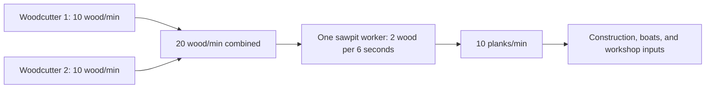

# Balancing theory and reference

[All improvement areas](README.md)

**Confirmed goal:** choose how long progress should take, how production chains
fit together, and how manual tasks such as animal butchery earn satisfying practice.
Current values below come from [server/server.py](../server/server.py),
[server/progression.py](../server/progression.py), and
[server/logistics.py](../server/logistics.py). They are starting references, not final balance.

## Working theory

| Principle | Proposed design rule | What to record when tuning |
| --- | --- | --- |
| Time before numbers | Choose the desired time to a useful milestone, then derive costs and XP. | Active work time and total elapsed time separately. |
| Chains should be understandable | Upstream supply should explain downstream capacity. | Inputs/minute, outputs/minute, worker counts, and spare capacity. |
| Manual attention has value | Manual decisions should give visible progress and a worthwhile result. | Actions per unlock, time per action, feedback, and reward. |
| Skilled villagers matter | Training should create valuable specialists while allowing recovery after a loss. | Time to qualify, time to useful recipes, and replacement time. |
| Waiting should have a purpose | Material shortages and travel should create choices the player can act on. | Why work pauses and what the player can improve or do elsewhere. |

## Current base rates

Neutral talent, practice below 20, no tools or upgrades, and uninterrupted active
work are assumed. Travel, supply regeneration, hauling, food, and storage limits
make actual elapsed time longer. Practice means the game's saved skill points (XP).

| Activity | Base work | Output or practice | Ideal rate |
| --- | --- | --- | --- |
| Settler woodcutting | Three-second productive cycle | 0.5 wood; 0.04 practice | 10 wood/minute; 0.8 practice/minute |
| One sawpit worker | Six-second completed batch | 2 wood → 1 plank; 0.08 practice | Uses 20 wood/minute; makes 10 planks/minute |
| One mill worker | Three-second completed batch | 2 wheat → 2 flour; 0.04 practice | Uses 40 wheat/minute; makes 40 flour/minute |
| One baker, basic bread | Six-second completed batch | 2 flour + 0.5 wood → 2 bread; 0.08 practice | Uses 20 flour + 5 wood/minute; makes 20 bread/minute |
| One butcher, prepared meat | Six-second completed batch | 2 meat → 2 prepared meat; 0.1 practice | Uses 20 meat/minute; makes 20 prepared meat/minute |
| Manually ordered animal butchery | 60 seconds at the shop, one animal per shop at a time | 1 butchery practice; meat varies by animal | One completed animal/minute while continuously supplied |
| Animal maturity | 300 fully fed seconds | Young animal becomes eligible for butchery | Five fed minutes; growth pauses without feed |

Talents apply a 0.75× or 1.25× modifier to output and practice. Every 20 practice
adds another base output multiplier. Processing expertise and the improved saw
increase batch output **and inputs**; they do not make materials free.

## How many woodcutters for a sawpit?

This drawing shows ideal active rates. Source stock, travel, input delivery, and
output collection still limit the running town.

`required upstream workers = ceil(downstream workers × input/minute ÷ upstream output/minute)`

| Configuration | Ideal wood demand | Ideal supporting woodcutters | Practical implication |
| --- | --- | --- | --- |
| One base sawpit worker | 20/minute | 2 | Exactly matches demand; leaves no wood for other uses or downtime. |
| Both initial sawpit slots filled | 40/minute | 4 | Worker count matters more than the number of sawpit buildings. |
| One neutral, low-practice worker with improved saw (+25%) | 25/minute | 3 base woodcutters | Recalculate when woodcutters also have tools, talents, or practice. |

For a real town use observed delivered supply: `effective rate = ideal rate ×
productive fraction`. Add construction and other consumers to demand. A surplus
can cover interruptions, but its desired size remains open; more workers cannot
solve an exhausted forest or blocked storage.

## Training time and manual butcher rewards

`active minutes to target = remaining practice ÷ practice per active minute`

| Milestone from zero practice | Current neutral requirement | Ideal active time | Limitation |
| --- | --- | --- | --- |
| Qualify for woodworking | 10 woodcutting | 12.5 minutes | Requires productive chopping, not simply assignment. |
| Qualify for butchery | 2 husbandry | 2.5 minutes | Requires successful animal tending. |
| Unlock butcher recipe 2 | 2 butchery | Two completed animals, or two minutes of continuous prepared-meat processing | Starts after qualification; animals and ingredients must be available. |
| Reach butcher recipe 5 | 5 butchery | Five completed animals, or five minutes of continuous processing | Manual selections and feeding/growth add elapsed time. |
| First butchery efficiency step | 20 butchery | Twenty completed animals, or twenty minutes of continuous processing | The output multiplier changes at 20; recipe unlocks provide earlier milestones. |

Animal butchery currently gives 25% more practice per credited work second than
standard work: 1 practice per animal before talents (0.75 with a weakness; 1.25
with a strength). The player selects the animal; the worker completes the timed task.
Basic raw meat yields are chicken 2, sheep 4, pig 8, and cow 10. Growth can happen
in parallel, so do not add five growth minutes to every animal when estimating a herd.

| Manual-work question | Starting proposal | Status |
| --- | --- | --- |
| What should one selection feel like? | Each completed animal visibly advances a skill bar and shows its output. | Proposed |
| How soon should a useful recipe unlock? | Start with 2–5 completed animals for early recipe milestones; the neutral current values already match this. | Proposed target; play experience unmeasured |
| Should bigger animals earn more XP? | Compare fixed XP per task with XP reflecting time, feed investment, or output. | Open; current reward is fixed |
| Is 20 manual selections a satisfying efficiency milestone? | Review alongside earlier recipe rewards and the cost of replacing a trained butcher. | Open |

## Progression pacing to try

These are proposed elapsed-time ranges for a fresh town and a new player. They
are discussion targets, not measured results or implementation requirements.

| Experience | Draft target | What should feel rewarding | What to record |
| --- | --- | --- | --- |
| First completed building | 1–3 minutes | Immediate visible ownership of the town | Time spent discovering controls, gathering, and building. |
| Reliable food and first hall upgrade | 5–10 minutes | A stable town and a clear next choice | Shortages, idle time, and whether the next goal is understood. |
| Two trained basic professions and access to a sawpit | 15–25 minutes | Specialization and a new production chain | Current 10-practice gates need 12.5 active minutes per neutral worker; workers can train in parallel. |
| First meaningful manual butcher recipe progression | 2–5 completed animals after qualification | Effort turns into a useful new option | Selections, waiting, available animals, and player reaction. |

| Proposed order | Improvement | Decision/evidence still needed |
| --- | --- | --- |
| 1 | Record a fresh-town progression timeline. | Actual milestone times and reasons for waiting. |
| 2 | Expand production ratios to food, livestock, leather, and iron. | Delivered rates, staffing, shared supplies, and competing consumers. |
| 3 | Review manual butcher XP and feedback. | Which milestones feel worth the attention and animal investment. |
| 4 | Tune long-term specialization and replacement training. | Trade value and whether losing a specialist feels recoverable. |
