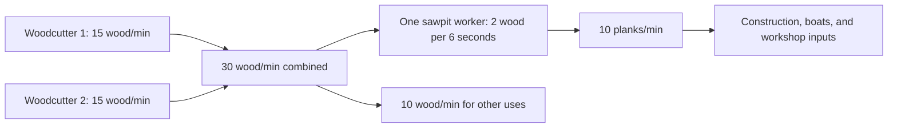

# Balancing theory and reference

[All improvement areas](README.md)

**Confirmed goal:** choose how long progress should take, how production chains
fit together, and how manual tasks such as animal butchery earn satisfying practice.
Current values below come from [server/server.py](../server/server.py),
[server/progression.py](../server/progression.py), and
[server/logistics.py](../server/logistics.py). They are starting references, not final balance.

## Working theory

| Principle | Proposed design rule | What to record when tuning |
| --- | --- | --- |
| Time before numbers | Choose the desired time to a useful milestone, then derive costs and XP. | Active work time and total elapsed time separately. |
| Chains should be understandable | Upstream supply should explain downstream capacity. | Inputs/minute, outputs/minute, worker counts, and spare capacity. |
| Manual attention has value | Manual decisions should give visible progress and a worthwhile result. | Actions per unlock, time per action, feedback, and reward. |
| Skilled villagers matter | Training should create valuable specialists while allowing recovery after a loss. | Time to qualify, time to useful recipes, and replacement time. |
| Waiting should have a purpose | Material shortages and travel should create choices the player can act on. | Why work pauses and what the player can improve or do elsewhere. |

## Shared assumptions and full-chain totals

Neutral talent, practice below 20, no tools or upgrades, and uninterrupted active
work are assumed. Travel, supply regeneration, hauling, food, and storage limits
make actual elapsed time longer. Practice means the game's saved skill points (XP).

Talents apply a 0.75× or 1.25× modifier to output and practice. Every 20 practice
adds another base output multiplier. Processing expertise and the crafted saw
increase batch output **and inputs**; they do not make materials free.

`active minutes to target = remaining practice ÷ practice per active minute`

**Total production time cost** adds the active work needed to produce every
consumed input and complete the final recipe. Totals use **worker-seconds**:
Eight seconds of woodcutting plus six seconds of sawing costs 14 worker-seconds,
even when several workers shorten the elapsed wait. These are ideal production
budgets using the base rates below, not measured end-to-end completion times.

**Total reward** lists the final goods, retained byproducts, and practice earned
across the whole chain. Consumed intermediate goods are not counted again.
Practice totals sum the listed skills for comparison; each worker keeps their
own skill progress. Food value describes the final goods and does not add another
item to the reward.

Workers are already qualified and buildings are available. Building construction,
qualification training, animal purchase/capture, travel, hauling, regeneration,
blocked work, and ongoing settler food consumption are outside these production
totals. Farming assumes no manure fertilization. Livestock tending and feed
production are included in the meat examples. Recalculate for upgrades, talents,
practice, shared barn work, or different recipes.

## Wood

### Current base rates

| Activity                         | Base work                                             | Output or practice                          | Ideal rate                                              |
| -------------------------------- | ----------------------------------------------------- | ------------------------------------------- | ------------------------------------------------------- |
| Settler woodcutting              | Three-second productive cycle                         | 0.75 wood; 0.04 practice                    | 15 wood/minute; 0.8 practice/minute                     |
| One sawpit worker                | Six-second completed batch                            | 2 wood → 1 plank; 0.08 practice             | Uses 20 wood/minute; makes 10 planks/minute             |

### Total production time cost vs total reward

| Full chain | Work breakdown | Total production time cost | Total reward |
| --- | --- | --- | --- |
| Tree → wood → 1 plank | Gather 2 wood: 8s; saw: 6s | 14 worker-seconds | 1 plank; approximately 0.187 practice (0.107 woodcutting + 0.08 woodworking) |

### How many woodcutters for a sawpit?

This drawing shows ideal active rates. Source stock, travel, input delivery, and
output collection still limit the running town.

`required upstream workers = ceil(downstream workers × input/minute ÷ upstream output/minute)`

| Configuration                                             | Ideal wood demand | Ideal supporting woodcutters | Practical implication                                               |
| --------------------------------------------------------- | ----------------- | ---------------------------- | ------------------------------------------------------------------- |
| One base sawpit worker                                    | 20/minute         | 2                            | Leaves 10 wood/minute before downtime and other demand. |
| Both upgraded sawpit slots filled                         | 40/minute         | 3                            | Four woodcutters leave 20 wood/minute before downtime and other demand. |
| One neutral, low-practice worker with crafted saw (+25%)  | 25/minute         | 2                            | Two equipped sawyers consume 50/minute; four base woodcutters leave 10/minute. |

For a real town use observed delivered supply: `effective rate = ideal rate ×
productive fraction`. Add construction and other consumers to demand. A surplus
can cover interruptions; the new base wood rate supplies a margin at the worker
limits, but delivered rates and pacing still need play experience. More workers cannot
solve an exhausted forest or blocked storage.

### Staffing, storage, and crafted items

Woodcutters start with one slot, upgrade to two for 20 wood/30 seconds, then four
for 40 wood/60 seconds. Sawpits start with one slot and upgrade once to two for
20 wood/30 seconds. Woodworker's workshops have one slot and no worker upgrade.
These limits apply to each building, including sandbox buildings.

Building levels increase wood-building storage, input buffers, and production
buffers from 50 to 62.5 to 75 spaces. Resource allocations increase by 25%/50%
too. Storage upgrades use the existing building wood cost times current level
and 30/60 seconds of builder work. Worker capacity upgrades are independent.
Wood-building levels provide no output bonus; skill and equipped tools improve
production. The founder also chops 0.75 wood per base cycle.

The original five workshop recipes and qualification gates remain. Two additional
recipes make useful tools, each yielding one item at neutral talent/low practice:

| Item | Crafting practice required | Inputs | Active work | Equipped effect |
| --- | --- | --- | --- | --- |
| Crafted axe | 2 | 2 planks + 1 tool | 9 seconds | +25% woodcutting output |
| Crafted saw | 3 | 2 planks + 2 tools | 12 seconds | +25% woodworking batch output and ingredient use |

Assign tools through Items or a villager's panel. Each villager carries one tool;
returning or transferring it preserves the item. Produced tools use normal goods
storage, hauling, production caps, and sales until equipped. Returned tools enter
the Items inventory. Workplace axe/saw purchases are replaced by these recipes.

One furniture places a wooden bench; one carved furniture places a carved wooden
statue through Build → Decorations. Placement is immediate on an open tile within
the town's build range. Decorations occupy one tile, provide no gameplay bonus,
and can be moved or removed like buildings; removal gives no refund. Sandbox
placement and upgrades follow the existing free/instant rules.

Existing sawpits retain their two spaces and higher saved tiers are capped at two;
workshops are capped at one. Excess assigned workers rest, retaining skills and
tools. Residents and inventories are preserved. Existing workplace axe/saw bonuses
(including queued upgrades) become crafted tools for retained workers or the Items
inventory, without stacking duplicate bonuses. New sawpits start with one space.

### Training

| Milestone from zero practice | Current neutral requirement | Ideal active time | Limitation |
| --- | --- | --- | --- |
| Qualify for woodworking | 10 woodcutting | 12.5 minutes | Requires productive chopping, not simply assignment. |

## Grains

### Current base rates

| Activity                         | Base work                                             | Output or practice                          | Ideal rate                                              |
| -------------------------------- | ----------------------------------------------------- | ------------------------------------------- | ------------------------------------------------------- |
| One mill worker                  | Three-second completed batch                          | 2 wheat → 2 flour; 0.04 practice            | Uses 40 wheat/minute; makes 40 flour/minute             |
| One baker, basic bread           | Six-second completed batch                            | 2 flour + 0.5 wood → 2 bread; 0.08 practice | Uses 20 flour + 5 wood/minute; makes 20 bread/minute    |

### Total production time cost vs total reward

| Full chain | Work breakdown | Total production time cost | Total reward |
| --- | --- | --- | --- |
| Wheat → 2 flour | Grow 2 wheat: 6s; mill: 3s | 9 worker-seconds | 2 flour; 0.12 practice (0.08 farming + 0.04 milling) |
| Wheat + wood → flour → 2 bread | Grow 2 wheat: 6s; mill: 3s; gather 0.5 wood: 2s; bake: 6s | 17 worker-seconds | 2 bread (3 food value); approximately 0.227 practice (0.08 farming + 0.04 milling + 0.027 woodcutting + 0.08 baking) |

The base farming reference is one wheat per three-second productive cycle;
watering, field occupancy, and delivery add elapsed time. Bread's wood input is
included even though it comes from another sector.

### Training

Qualifying for milling requires 10 farming practice: 12.5 ideal active minutes
at neutral talent. Baking then requires 2 milling practice: 2.5 ideal active
minutes of flour production, with wheat already supplied.

## Meat

### Current base rates

| Activity                         | Base work                                             | Output or practice                          | Ideal rate                                              |
| -------------------------------- | ----------------------------------------------------- | ------------------------------------------- | ------------------------------------------------------- |
| One butcher, prepared meat       | Six-second completed batch                            | 2 meat → 2 prepared meat; 0.1 practice      | Uses 20 meat/minute; makes 20 prepared meat/minute      |
| Manually ordered animal butchery | 60 seconds at the shop, one animal per shop at a time | 1 butchery practice; meat varies by animal  | One completed animal/minute while continuously supplied |
| Animal maturity                  | 300 fully fed seconds                                 | Young animal becomes eligible for butchery  | Five fed minutes; growth pauses without feed            |

### Total production time cost vs total reward

These examples start with one newly acquired young animal, alone in a barn,
and end after all its raw meat becomes basic prepared meat. Each animal needs
100 successful three-second tending cycles to reach 300 fed seconds. Feed per
cycle is 0.15 for chickens, 0.25 for sheep, 0.4 for pigs, and 0.5 for cows.
Growing vegetables or fodder at one unit per three-second productive cycle costs
three worker-seconds per feed unit. Feeding produces 0.1 manure per animal per
cycle, so each example retains 10 manure. No extra adult tending is included.

| Full chain | Work breakdown | Total production time cost | Total reward |
| --- | --- | --- | --- |
| Feed → young chicken → meat → prepared meat | Grow 15 feed: 45s; tend: 300s; butcher: 60s; prepare: 6s | 411 worker-seconds (6m 51s) | 2 prepared meat (3 food value) + 10 manure; 5.7 practice (0.6 farming + 4 husbandry + 1.1 butchery) |
| Feed → young sheep → meat → prepared meat | Grow 25 feed: 75s; tend: 300s; butcher: 60s; prepare: 12s | 447 worker-seconds (7m 27s) | 4 prepared meat (6 food value) + 1 hide + 10 manure; 6.2 practice (1 farming + 4 husbandry + 1.2 butchery) |
| Feed → young pig → meat → prepared meat | Grow 40 feed: 120s; tend: 300s; butcher: 60s; prepare: 24s | 504 worker-seconds (8m 24s) | 8 prepared meat (12 food value) + 2 hides + 10 manure; 7 practice (1.6 farming + 4 husbandry + 1.4 butchery) |
| Feed → young cow → meat → prepared meat | Grow 50 feed: 150s; tend: 300s; butcher: 60s; prepare: 30s | 540 worker-seconds (9m) | 10 prepared meat (15 food value) + 3 hides + 10 manure; 7.5 practice (2 farming + 4 husbandry + 1.5 butchery) |

A barn tends all its animals in one shared cycle. For a same-age herd tended by
one worker, count the 300 seconds of tending and its 4 husbandry practice once
for the group; sum feed production,
manual butchery, meat preparation, and byproducts per animal. Mature animals held
longer require more feed and may provide eggs, wool, milk, or meat. Those extra
cycles and rewards must be counted together.

### Training time and manual butcher rewards

| Milestone from zero practice | Current neutral requirement | Ideal active time | Limitation |
| --- | --- | --- | --- |
| Qualify for butchery | 2 husbandry | 2.5 minutes | Requires successful animal tending. |
| Unlock butcher recipe 2 | 2 butchery | Two completed animals, or two minutes of continuous prepared-meat processing | Starts after qualification; animals and ingredients must be available. |
| Reach butcher recipe 5 | 5 butchery | Five completed animals, or five minutes of continuous processing | Manual selections and feeding/growth add elapsed time. |
| First butchery efficiency step | 20 butchery | Twenty completed animals, or twenty minutes of continuous processing | The output multiplier changes at 20; recipe unlocks provide earlier milestones. |

Animal butchery currently gives 25% more practice per credited work second than
standard work: 1 practice per animal before talents (0.75 with a weakness; 1.25
with a strength). The player selects the animal; the worker completes the timed task.
Basic raw meat yields are chicken 2, sheep 4, pig 8, and cow 10. Growth can happen
in parallel, so do not add five growth minutes to every animal when estimating a herd.

| Manual-work question | Starting proposal | Status |
| --- | --- | --- |
| What should one selection feel like? | Each completed animal visibly advances a skill bar and shows its output. | Proposed |
| How soon should a useful recipe unlock? | Start with 2–5 completed animals for early recipe milestones; the neutral current values already match this. | Proposed target; play experience unmeasured |
| Should bigger animals earn more XP? | Compare fixed XP per task with XP reflecting time, feed investment, or output. | Open; current reward is fixed |
| Is 20 manual selections a satisfying efficiency milestone? | Review alongside earlier recipe rewards and the cost of replacing a trained butcher. | Open |

## Fish

### Current base rates

| Activity | Base work | Output or practice | Ideal rate |
| --- | --- | --- | --- |
| Settler fishing, ordinary fish | Three-second productive attempt; 90% catch chance | 1 fish on success; 0.04 practice per supplied attempt, including misses | Expected 18 fish/minute; 0.8 practice/minute |
| One smokehouse worker | Six-second completed batch | 2 raw fish + 0.5 wood → 2 smoked fish; 0.08 practice | Uses 20 raw fish + 5 wood/minute; makes 20 smoked fish/minute |

### Total production time cost vs total reward

| Full chain | Work breakdown | Total production time cost | Total reward |
| --- | --- | --- | --- |
| Ordinary fish + wood → 2 smoked fish | Catch 2 fish: expected 6.67s; gather 0.5 wood: 2s; smoke: 6s | Expected 14.67 worker-seconds | 2 smoked fish (3 food value); expected 0.196 practice (0.089 fishing + 0.027 woodcutting + 0.08 preserving) |

Expected fishing work is `required fish ÷ (fish per successful attempt × catch
probability) × seconds per attempt`. Misses use work time and still earn practice;
an individual batch can take more or fewer attempts. This uses settler fishing,
whose base catch chance differs from the player's manual fishing. Pier movement,
boat voyages, fish-stock recovery, and delivery add elapsed time. Higher-tier
fish, boats, and breeding ponds need their own chain totals.

### Training

Qualifying for preserving requires 10 fishing practice: 12.5 ideal active minutes
at neutral talent. Fish breeding requires 20 fishing practice: 25 ideal active
minutes. Productive supplied attempts earn practice even when they miss.

## Progression pacing to try

These are proposed elapsed-time ranges for a fresh town and a new player. They
are discussion targets, not measured results or implementation requirements.

| Experience | Draft target | What should feel rewarding | What to record |
| --- | --- | --- | --- |
| First completed building | 1–3 minutes | Immediate visible ownership of the town | Time spent discovering controls, gathering, and building. |
| Reliable food and first hall upgrade | 5–10 minutes | A stable town and a clear next choice | Shortages, idle time, and whether the next goal is understood. |
| Two trained basic professions and access to a sawpit | 15–25 minutes | Specialization and a new production chain | Current 10-practice gates need 12.5 active minutes per neutral worker; workers can train in parallel. |
| First meaningful manual butcher recipe progression | 2–5 completed animals after qualification | Effort turns into a useful new option | Selections, waiting, available animals, and player reaction. |

| Proposed order | Improvement                                                     | Decision/evidence still needed                                       |
| -------------- | --------------------------------------------------------------- | -------------------------------------------------------------------- |
| 1              | Record a fresh-town progression timeline.                       | Actual milestone times and reasons for waiting.                      |
| 2              | Expand production ratios to food, livestock, leather, and iron. | Delivered rates, staffing, shared supplies, and competing consumers. |
| 3              | Review manual butcher XP and feedback.                          | Which milestones feel worth the attention and animal investment.     |
| 4              | Tune long-term specialization and replacement training.         | Trade value and whether losing a specialist feels recoverable.       |
