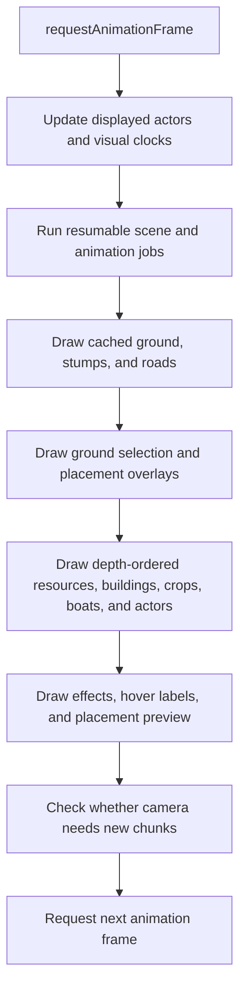

# Development structure and prioritization

[All improvement areas](README.md)

**Confirmed goal:** make the request flow, calculation ownership, rendering flow,
and priorities easy to understand before changing the engine.

## Where work happens today

| Responsibility | Location | What it owns or calculates |
| --- | --- | --- |
| HTTP requests and commands | [server/server.py](../server/server.py), `Handler`, `command()` | Authentication, town ownership, validation, authoritative changes, and exported snapshots. |
| Simulation and saving | [server/server.py](../server/server.py), `tick()`, `simulation()`, `save()` | Three-second simulation cycles and persistent world state. Construction is processed before worker production; haulers are visited before other workers. |
| Progression and balance | [server/progression.py](../server/progression.py) | Recipes, practice, qualifications, efficiency, materials, and unlocks. Imported as `economy` by the host. |
| Production and transport | [server/logistics.py](../server/logistics.py), [server/work_cycles.py](../server/work_cycles.py) | Input delivery, output buffers, hauling, batch completion, animal butchery, and host work phases. |
| Terrain and routes | [server/chunk_world.py](../server/chunk_world.py), [server/navigation.py](../server/navigation.py) | Terrain chunks and host routes around obstacles and across roads. |
| Browser requests and interface | [web/app.js](../web/app.js), `request()`, `act()`, `refresh()`, `render()` | Commands, snapshot refreshes, controls, and DOM panels. `render()` updates the interface; `draw()` paints the map. |
| Derived scene data | [web/scene.js](../web/scene.js), `ClientScene` | Local indexes, collision overlays, reusable geometry, and resumable jobs. |
| Visual worker playback | [web/animations.js](../web/animations.js), worker functions in `app.js` | Browser animation routes and displayed worker phases. These do not award goods or practice. |
| Canvas presentation | [web/app.js](../web/app.js), `updateActors()`, `animate()`, `draw()` | Character prediction/interpolation, camera, visual effects, depth ordering, and map drawing. |

The host owns gameplay and saved state. Browser predictions, indexes, overlays,
animation jobs, and drawing caches must not mutate authoritative snapshots.

## Request and snapshot flow — current

```mermaid
sequenceDiagram
    participant Player
    participant Browser as Browser app.js
    participant Host as Python host
    participant State as Authoritative world
    participant Scene as ClientScene
    Player->>Browser: Build, assign a worker, or choose a recipe
    Browser->>Host: POST /api/command with token and world_id
    Host->>Host: Check identity, ownership, and action requirements
    Host->>State: Apply accepted command under world lock
    Host-->>Browser: Success or error
    Browser->>Host: GET /api/world through refresh()
    Host-->>Browser: World snapshot and requested chunk data
    Browser->>Scene: Prepare indexes and resource artwork in yielding slices
    Scene-->>Browser: Commit prepared scene and replace displayed world
    Browser->>Browser: Update DOM panels; draw map on animation frames
    Note over Host,State: Simulation also updates and saves the world every three seconds
```

This is the ordinary `act()` path. Walking has a separate command path with local
prediction and host reconciliation; adventures have their own browser modules.

| Request/work | Current trigger or cadence | Important constraint |
| --- | --- | --- |
| Ordinary command | Explicit player action | Validate on the host; refresh after success or error. |
| World snapshot | Startup, after commands, camera chunk changes, and a two-second interval | `refresh()` shares an in-flight refresh; interval refresh is skipped while a select control has focus. |
| Remote player positions | A 50 ms timer calls `refreshPlayers()` | Skipped while hidden, without other shared-map players, or while its previous request is running. Timer cadence is not a guaranteed network rate. |
| Scene preparation | After a snapshot arrives | About 2 ms of generator work per slice, then yield; individual steps can exceed the slice budget. |
| Host simulation | Every three seconds while the host runs | Simulation and command state changes share a lock. An overrun does not replay a backlog of ticks. |

## Frame flow and drawing order — current



`ClientScene.queue.run(2)` gives queued work an approximately 2 ms frame budget.
The queue rotates unfinished jobs; it does **not** currently assign priority levels.
Depth order determines what appears in front of what, independently of scheduling.
DOM panels sit over the canvas through the layout in [web/style.css](../web/style.css).

## Proposed priority policy

These are goals for future improvements, not claims about an existing priority scheduler.

| Priority | Request/calculation concern | Presentation concern | Reason |
| --- | --- | --- | --- |
| First | Accepted commands, ownership checks, and state consistency | Input feedback, founder position, camera, and readable selection | Players must trust actions and feel in control. |
| Next | Relevant snapshots and visible scene preparation | Visible actors, obstacles, buildings, and work status | Players need an accurate view of what matters nearby. |
| Later | Preparation that can safely be deferred | Decorative effects and distant detail | Extra polish should fit around interaction and clarity. |

## Improvement table

| Proposed order | Improvement | Status | Reference or evidence to add |
| --- | --- | --- | --- |
| 1 | Trace one build command and one movement command end to end. | Ordinary command documented; movement detail open | Include validation, acknowledgement, reconciliation, and failure paths. |
| 2 | Document scene/cache invalidation and which work yields. | Open | Table of cache inputs, invalidation triggers, owner, and fallback. |
| 3 | Decide whether visible jobs need explicit scheduling priority. | Proposed | Demonstrate a player-visible problem before changing the queue. |
| 4 | Clarify module boundaries as features grow. | Proposed | Keep host rules, browser playback, and interface responsibilities explicit. |

Performance measurements belong to a concrete performance investigation. This
reference describes the current structure without claiming measured latency or budgets.
