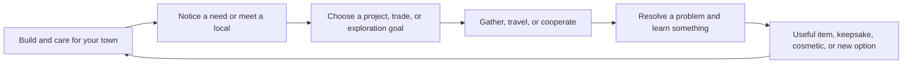
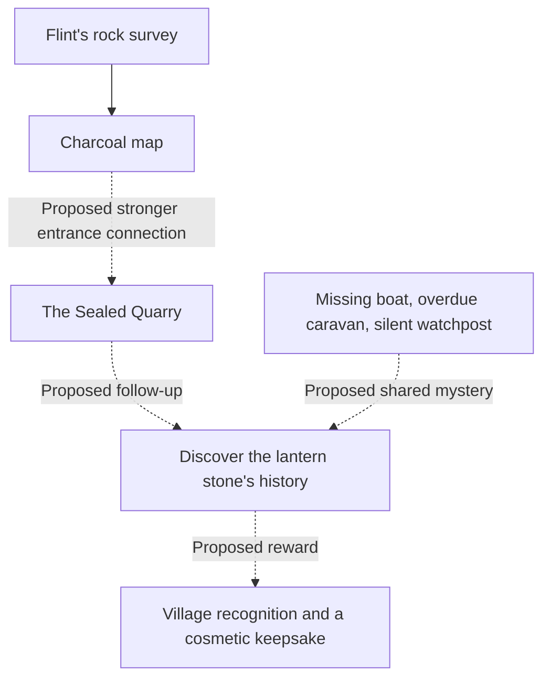

# Game design improvement reference

[All improvement areas](README.md)

**Confirmed goal:** make the game fun through satisfying choices, connected
storylines, rewarding items, and cosmetics. The agreed foundation in
[DESIGN.md](DESIGN.md) is a cozy medieval world with magic, safe player towns,
independent town management, exploration, and cooperation between 2–4 friends.

## Player experience

| Pillar                          | Existing foundation                                                         | Improvement direction                                                               | Status                                 |
| ------------------------------- | --------------------------------------------------------------------------- | ----------------------------------------------------------------------------------- | -------------------------------------- |
| Build a town worth caring about | Movable buildings, workers, skills, upgrades, and food/housing needs        | Make the next useful improvement readable and show how it changes village life.     | Proposed                               |
| Discover people and places      | Biomes, wilderness villages, local dialogue, and three playable NPC stories | Connect requests to characters and places players remember.                         | Proposed                               |
| Do something together           | Town trade offers, The Sealed Quarry, and The Falling Lanterns              | Give friends complementary actions and shared moments, with personal rewards.       | Current foundation; proposed expansion |
| Value the reward                | Equipment perks, coins, keepsakes, and progression unlocks                  | Mix useful items with recognizable cosmetic rewards and story recognition.          | Proposed                               |
| Express identity                | Separate towns, biome settings, and equipped character gear                 | Expand cosmetic character and town choices; choose the style and acquisition rules. | Open                                   |

## Terrain and water

**Implemented in new explorable worlds:** large, coherent regions give places
a recognizable identity. Seeded boundaries vary smoothly in world coordinates
and continue across chunk boundaries.

| Feature | Design direction |
| --- | --- |
| Ice | A smaller northern region around Frostbrook, with groves, pools, and rock outcrops. |
| Swamp | A broad western swamp around Reedhaven, mixing dense willow groves, pools, and narrow channels. |
| Rivers | Winding northern and western rivers with connected tributaries through the surrounding regions. |
| Lakes | A southern lake with wooded islands, smaller fishing lakes near starting towns, and the existing central treasure lake. |
| Desert | A smaller eastern desert around Sunwell, with rocky areas and palm-lined oases. |
| Green terrain | Light grassland has no trees and occasional bushes; darker grassland has sparse trees that do not regrow; forests grow in patches and large woods with regenerating trees. |
| Waterside trees | More trees on riverbanks and lake shores, forming forest strips. |

The regions and water features appear while exploring and on the world map.
Worlds save their terrain generator version; existing saves keep their original
landscape and unexplored terrain. Hosts can regenerate sandbox worlds to try
the latest generator, resetting their towns and progress after confirmation. See the
[working design](DESIGN.md#confirmed-terrain-direction) for sizes and placement.

## Proposed experience loop

This is a design direction. It does not mean every upgrade must require a quest;
whether quests are required for town development remains an open design question.

## Story reference

Current details are in [server/npcs.py](../server/npcs.py),
[server/quests.py](../server/quests.py), and [server/lanterns.py](../server/lanterns.py).

| Story/place | Current player activity | Current reward | Improvement to explore |
| --- | --- | --- | --- |
| Moss — A Remedy Remembered | Bring herbs and food through a local request. | 12 coins and a pressed willow leaf keepsake, once per town. | Show how the remedy changes someone's life and provide a memorable follow-up. |
| Tobin — The Lantern Road | Provide supplies and complete three town road tiles. | 15 coins and a brass lantern token, once per town. | Connect the road to travelers and later village relationships. |
| Flint — Marks Beneath the Stone | Examine three rock outcrops, report back, and provide wood for a map. | 18 coins and a charcoal map, once per town. | Strengthen the discovery and transition into the quarry. |
| The Sealed Quarry | Enter with two founders; solve a gate and rune puzzle. | 20 coins and a lantern-stone keepsake per expedition member, once per world. | Give the lantern stone a later story role. Current prototype entry bypasses Flint's story. |
| The Falling Lanterns | Cooperate on a movement course with warnings, hazards, and a checkpoint. | 25 coins and a courier lantern badge per expedition member, once per world. | Connect the recovered satchel to a character and a visible celebration. |
| Wilderness villages | Meet residents and trade; hear missing-boat, overdue-caravan, and silent-watchpost rumors. | Existing trade offers; rumors have no quest objectives or rewards. | Develop one connected storyline across the villages. |

## Proposed story connection

Solid arrows represent the existing survey reward; dotted arrows are ideas.
The mystery, follow-up, and cosmetic reward are not yet agreed or implemented.

## Reward design

| Reward type | What it gives the player | Existing example | Proposed next reference |
| --- | --- | --- | --- |
| Practical item | A new ability or useful improvement | Worker tools, swamp boots, boats | Table of acquisition, use, perk, and upgrade path. |
| Resources/coins | Freedom to choose the next town improvement | Story coins and island loot | Compare reward size with effort and town progression. |
| Keepsake | A reminder of a character or shared adventure | Pressed willow leaf, charcoal map, lantern stone | Give each a description and a place to display or revisit it. |
| Character cosmetic | Recognizable personal identity | Equipped clothing provides a starting visual foundation | Decide on outfits, colors, and how they are earned. |
| Town cosmetic | A visible history and identity for the settlement | No dedicated cosmetic reward system established here | Consider banners, garden details, lanterns, or building decorations. |
| Story recognition | A sense that the world remembers | Saved story progress | Consider changed dialogue and small visible changes after completion. |

## Improvement priorities and open decisions

| Proposed order | Improvement | Evidence that it worked | Open decision |
| --- | --- | --- | --- |
| 1 | Make short-term goals and rewards clear. | A new player can explain what they want to do next and why. | Which goals should the interface surface first? |
| 2 | Deepen one existing story from introduction to aftermath. | Players remember the character, problem, and resolution. | Which story should establish the pattern? |
| 3 | Add a recognizable cosmetic reward to that story. | Players notice, use, and recognize the reward later. | Character cosmetic, town decoration, or both? |
| 4 | Link a local story to a cooperative adventure. | Friends understand their roles and remember a shared moment. | How should entry, departing players, and follow-up progress work? |
| 5 | Expand specialization and trade identity. | Towns differ for reasons players care about. | How much should location shape a town's economy? |

The two adventure prototypes currently handle departures differently: the quarry
can let one remaining founder finish, while the movement course pauses below two.
Choose future quest rules deliberately rather than assuming one universal behavior.
