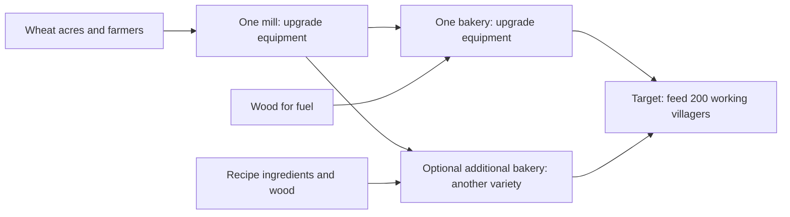

# Grain flow: feeding the village

[Balancing reference](BALANCING.md#grains)

**Confirmed direction:** manage wheat → flour → bread by asking how many
villagers the chain can feed. One mill and one bakery should be sufficient for
the village when upgraded. Add bakeries to produce different varieties at the
same time. Mill and bakery equipment upgrades increase throughput while keeping
one worker in each building. The initial maximum-capacity target is **200 working
villagers**, subject to playtesting.

**Proposed balance change:** lower food consumption per working villager before
setting the equipment tiers. The new meal rate is still open; 200 villagers is
the feeding target, rather than a commitment to today's production requirements.

**Status:** design recorded; equipment upgrades and feeding-capacity displays
remain to be implemented. The current game uses one miller and two bread bakers
for its base grain chain, allows a second mill worker, and only increases storage
with mill and bakery building levels. Current rates are documented in
[Balancing](BALANCING.md#grains).

## The player's decisions

1. **Do I have enough wheat acres?** Check whether harvests and deliveries meet
   the wheat demand of the chain. Acres need enough farmers, reachable water,
   and usable delivery paths.
2. **Is my mill upgraded enough?** Upgrade its equipment when flour capacity
   falls below the bakeries' combined demand.
3. **Is my bakery upgraded enough?** Upgrade its equipment when bread capacity
   falls below the village's food demand.
4. **Do I want more variety?** Add another bakery and select a different recipe.
   Expand wheat supply and mill capacity when the combined demand requires it.

The capacity target includes everyone being fed, including farmers, the miller,
the baker, fuel producers, and haulers. Additional bakeries are optional for basic
survival. Each bakery keeps its own selected recipe; all its production uses that
recipe. Variety does not require a new happiness or nutrition rule in this design.

## Translate production into villagers fed

Current meals use 0.12 food per resident every three seconds, plus 0.18 for each
resident with a job or construction assignment. A working villager therefore
needs **6 food per minute**; an idle resident needs **2.4 food per minute**.
Basic bread supplies 1.5 food per item, so one working villager needs **4 bread
per minute** when bread is the only food source.

`working villagers fed = delivered food per minute ÷ food needed per working villager per minute`

`village food demand per minute = idle residents × idle food rate + working residents × working food rate`

The current idle and working food rates are 2.4 and 6 respectively. Recalculate
both the capacity displays and the chain requirements when meal costs change.
Choose the idle rate and extra worker cost together so resting residents still
eat and assigning a job has a clear, proportionate cost.

### Reference using current consumption

| Part | Current base active rate, one worker | Minimum continuous rate for 200 working villagers |
| --- | --- | --- |
| Wheat supply | Depends on acres, staffing, water, and hauling | 800 wheat/minute delivered to the mill |
| Mill | 40 flour/minute from 40 wheat | 800 flour/minute from 800 wheat |
| Bakery, basic bread | 20 bread/minute from 20 flour and 5 wood | 800 bread/minute from 800 flour and 200 wood |
| Food supplied | One base bakery: 30 food/minute, feeding 5 working villagers | 1,200 food/minute, feeding 200 working villagers |

With current recipes and meal costs, the mill needs at least **20×** its base
throughput and the bakery at least **40×**. These are capacity requirements,
not agreed upgrade tiers. Equipment must increase both ingredient use and output
without creating extra materials. Skills and talents still apply; the target
should be achievable with neutral workers without relying on exceptional skill.

At this consumption rate, fuel alone requires at least 14 base woodcutters
at the current ideal 15 wood/minute, before travel and other uses. This is a
reason to review meal costs before committing to such a large chain.

### Explore lower consumption first

The table below compares possible working-villager meal rates using current
recipes and neutral workers. The lower rates are examples for tuning, not
selected gameplay values.

| Food per working villager per minute | Food/minute for 200 | Bread, flour, and wheat/minute, each | Wood/minute | Mill / bakery throughput vs base |
| --- | --- | --- | --- | --- |
| 6 (current) | 1,200 | 800 | 200 | 20× / 40× |
| 3 (example) | 600 | 400 | 100 | 10× / 20× |
| 1.5 (example) | 300 | 200 | 50 | 5× / 10× |

Prefer a lower meal rate that makes acres, fuel demand, and equipment progression
manageable while keeping reliable food production meaningful. Review other food
chains, stored-food duration, settler arrivals, and shortage pacing when changing
shared meal costs; lowering consumption affects the whole village economy.

All these minimums assume uninterrupted production. Set the final equipment
ceiling with room for hauling and supply interruptions, and validate **delivered**
bread against the chosen consumption rate. A ceiling exactly equal to demand
leaves no recovery margin. Stockpiles cover temporary gaps but cannot fix a
sustained shortfall.

## Acres, equipment, and storage must grow together

The existing compact grain fixture supplies 50 wheat/minute from four acres
and two farmers after startup. Scaling that placement-specific result gives
an illustrative **64 acres and 32 farmers** for 800 wheat/minute under current
consumption, or **16 acres and eight farmers** for the 200 wheat/minute example
at 1.5 food per working villager per minute. This is an initial planning
reference, not a guaranteed yield or a fixed acres-per-villager
rule. Adding acres without enough farming work, water access, or hauling may
not increase delivered supply proportionally. Measure larger layouts before
choosing the final farm balance.

Equipment throughput also needs suitable input buffers, finished-goods storage,
and transport. For example, two minutes at the current-consumption target means
1,600 wheat and 1,600 flour at the mill, and 1,600 flour, 400 wood, and 1,600 bread at the
bakery, with reserved inputs accounted for separately. At the lower 1.5-food
example, those allowances fall to 400 wheat/flour at the mill and 400 flour,
100 wood, and 400 bread at the bakery. Current storage upgrades alone are too
small for either scale. Set storage and hauling requirements after choosing
meal costs and equipment tiers.

## Make the bottleneck visible

Production panels should show the selected recipe's capacity as **“Feeds X
working villagers”**, alongside ingredient demand per minute. Distinguish
capacity with continuous inputs from actual delivered supply, so a bakery
waiting for flour does not appear to be feeding the village at full capacity.
Upgrade previews should show the before/after feeding capacity and input demand.

A grain-flow overview should compare village food demand with wheat supply,
mill capacity, and the combined bakery demand and output. It should make the
next action clear: add or staff acres, improve water or delivery access, upgrade
the mill, upgrade a bakery, supply fuel or recipe ingredients, or free storage.
For variety recipes, use their own food value, work time, and ingredients rather
than assuming the basic-bread ratio. Another variety shares the same mill and
does not add milling capacity.

## Remaining implementation and balance work

- Tune lower working-villager food consumption and the corresponding idle rate,
  checking effects on other food chains and village growth.
- Choose equipment tiers, costs, unlock requirements, and construction times,
  with enough delivered capacity for the 200-villager target.
- Implement one-worker mill and bakery equipment upgrades and define how existing
  two-worker mills migrate while preserving residents, goods, and unfinished work.
- Balance farm supply, fuel, storage, and hauling for the larger chain.
- Add feeding-capacity figures, upgrade previews, and a grain-flow overview.
- Validate a town fed by one upgraded mill and one upgraded bread bakery, then
  test additional bakeries with different recipes and shared flour demand.
