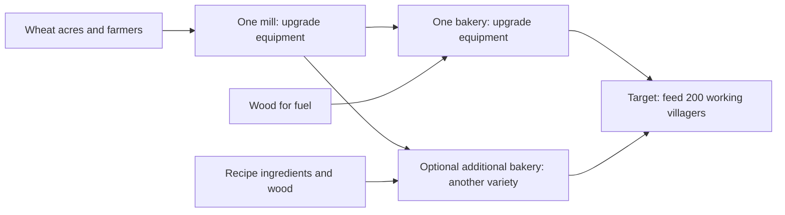

# Grain flow: feeding the village

[Balancing reference](BALANCING.md#grains)

## Goal

**Confirmed direction:** plan wheat → flour → bread around
**how many villagers the chain can feed**.

- One upgraded mill and one upgraded bakery should feed the village.
- Keep one worker per mill and bakery.
- Equipment upgrades increase production capacity.
- Add bakeries to make different varieties at the same time.
- Start with a target of **200 working villagers**. Refine it through playtesting.
- Include everyone in that target: farmers, millers, bakers, fuel producers,
  haulers, and other residents.

**Proposed:** lower food consumption before choosing equipment tiers.
The new meal rate is still open.

**Status:** design recorded. Equipment upgrades and feeding-capacity displays
remain planned.

The current game has different limits:

- The base chain uses one miller and two bread bakers.
- A mill can upgrade to two workers.
- Mill and bakery building levels only increase storage.
- Current rates are listed in [Balancing](BALANCING.md#grains).

## The player's decisions

- **Enough wheat acres?** Check wheat demand against delivered harvests.
  Provide enough farmers, reachable water, and clear delivery paths.
- **Mill upgraded enough?** Compare flour capacity with total bakery demand.
  Upgrade the mill when it cannot keep up.
- **Bakery upgraded enough?** Compare bread capacity with village food demand.
  Upgrade the bakery when it cannot keep up.
- **Want more variety?** Add a bakery and choose another recipe.
  Expand wheat supply and mill capacity if needed.

- One bakery should be enough for basic survival.
- Each bakery makes its own selected recipe.
- Extra bakeries share the mill's flour supply.
- Variety adds no happiness or nutrition rule in this design.

## Translate production into villagers fed

Current meal costs:

- Every resident uses 0.12 food every three seconds.
- A job or construction assignment adds 0.18 food every three seconds.
- A working villager needs **6 food per minute**.
- An idle resident needs **2.4 food per minute**.
- Basic bread supplies **1.5 food per item**.
- A working villager needs **4 bread per minute** on a bread-only diet.

Use these formulas when tuning consumption:

`working villagers fed = delivered food per minute ÷ food needed per working villager per minute`

`village food demand per minute = idle residents × idle food rate + working residents × working food rate`

- Update capacity displays and chain requirements when meal costs change.
- Tune the idle rate and extra worker cost together.
- Resting residents still need food. Working should add a proportionate cost.

### Reference using current consumption

| Part          | Base rate, one worker                          | Minimum rate to feed 200 working villagers     |
| ------------- | ---------------------------------------------- | ---------------------------------------------- |
| Wheat supply  | Varies with acres, farmers, water, and hauling | 800 wheat/min delivered                        |
| Mill          | 40 flour/min; uses 40 wheat/min                | 800 flour/min; uses 800 wheat/min              |
| Bread bakery  | 20 bread/min; uses 20 flour and 5 wood/min     | 800 bread/min; uses 800 flour and 200 wood/min |
| Food supplied | 30 food/min; feeds 5 working villagers         | 1,200 food/min; feeds 200 working villagers    |

- These rates assume uninterrupted production.
- The mill needs at least **20×** its base capacity.
- The bakery needs at least **40×** its base capacity.
- These figures are requirements, not agreed upgrade tiers.
- Equipment must increase ingredient use along with output.
- Skills and talents still apply.
- Neutral workers should reach the target without exceptional skill.
- Fuel needs at least **14 base woodcutters** at 15 wood/minute each.
  Travel and other wood uses increase that requirement.

Lower meal costs could make this chain much smaller.

### Explore lower consumption first

Compare meal rates using current recipes and neutral workers.
The lower rates are tuning examples. No new rate has been chosen.

| Food/worker/min | Food/min for 200 | Bread, flour, wheat/min, each | Wood/min | Mill / bakery capacity vs base |
| --- | --- | --- | --- | --- |
| 6 (current) | 1,200 | 800 | 200 | 20× / 40× |
| 3 (example) | 600 | 400 | 100 | 10× / 20× |
| 1.5 (example) | 300 | 200 | 50 | 5× / 10× |

Choose a rate that keeps acres, fuel, and upgrades manageable.
Reliable food production should still matter.

Check how lower meal costs affect:

- Other food chains.
- How long stored food lasts.
- Settler arrivals and village growth.
- How quickly shortages develop.

Leave spare production capacity:

- Allow for hauling and supply interruptions.
- Test **delivered bread** against consumption.
- Capacity equal to demand leaves no room to recover from shortages.
- Stockpiles cover temporary gaps. They cannot fix a lasting shortfall.

## Supply enough wheat

The compact grain test supplies **50 wheat/minute** after startup.
It uses **four acres and two farmers** in a specific layout.

Scaling that result gives these examples for 200 working villagers:

| Food/worker/min | Wheat/min needed | Illustrative acres | Illustrative farmers |
| --- | --- | --- | --- |
| 6 (current) | 800 | 64 | 32 |
| 1.5 (example) | 200 | 16 | 8 |

- These are planning estimates, not guaranteed yields.
- More acres need enough farmers, water access, and hauling.
- Test larger layouts before choosing the final farm balance.

## Scale storage and hauling

Faster equipment needs larger input buffers and finished-goods storage.
Transport must keep up too.

Example storage for two minutes of production:

| Building | At 6 food/worker/min | At 1.5 food/worker/min |
| --- | --- | --- |
| Mill | 1,600 wheat and 1,600 flour | 400 wheat and 400 flour |
| Bakery | 1,600 flour, 400 wood, and 1,600 bread | 400 flour, 100 wood, and 400 bread |

- Account for reserved inputs separately.
- Current storage upgrades are too small for either example.
- Choose meal costs and equipment tiers first.
- Then set storage and hauling requirements.

## Make the bottleneck visible

Production panels should show:

- **“Feeds X working villagers”** for the selected recipe.
- Ingredient demand per minute.
- Capacity with continuous inputs.
- Actual delivered supply, including pauses and shortages.

Upgrade previews should show feeding capacity and input demand before and after.

A grain-flow overview should compare:

- Village food demand.
- Delivered wheat supply.
- Mill capacity.
- Total bakery demand and output.

Make the next action clear:

- Add or staff acres.
- Improve water access or delivery paths.
- Upgrade the mill or a bakery.
- Supply fuel or recipe ingredients.
- Free storage space.

Use each variety's own food value, work time, and ingredients.
Another bakery adds flour demand. It adds no milling capacity.

## Remaining implementation and balance work

- Tune lower worker and idle meal costs.
- Check effects on other food chains and village growth.
- Choose equipment tiers, costs, unlocks, and construction times.
- Provide enough delivered capacity for 200 working villagers.
- Implement equipment upgrades with one worker per mill and bakery.
- Plan migration for existing two-worker mills.
  Preserve residents, goods, and unfinished work.
- Balance acres, fuel, storage, and hauling.
- Add feeding-capacity figures, upgrade previews, and a grain-flow overview.
- Test a town fed by one upgraded mill and one upgraded bread bakery.
- Test extra bakeries with different recipes and shared flour demand.
