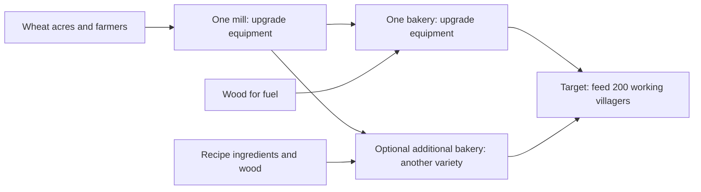

# Grain flow: feeding the village

[Balancing reference](BALANCING.md#grains)

## Goal and status

**Implemented:** plan wheat → flour → bread around **villagers fed**.

- One upgraded mill and one upgraded bakery can feed 200 working villagers.
- Each mill and bakery has one worker.
- Equipment upgrades increase production, ingredient demand, storage, and carrying capacity.
- Extra bakeries make different recipes and share the flour supply.
- The target includes farmers, millers, bakers, haulers, and all other residents.
- Delivered supply depends on acres, water, fuel, hauling, and storage.
- Larger layouts and continuous fuel supply still need playtesting.

## The player's decisions

- **Enough wheat acres?** Compare delivered wheat with bakery demand.
  Add or staff acres. Improve water access and hauling when needed.
- **Mill upgraded enough?** Compare flour capacity with total bakery demand.
  Upgrade its equipment when it cannot keep up.
- **Bakery upgraded enough?** Compare food capacity with village food demand.
  Upgrade its equipment when it cannot keep up.
- **Want more variety?** Add a bakery and choose another recipe.
  Supply its extra ingredients and enough flour.

- One bakery is enough for basic bread.
- Each bakery keeps its selected recipe.
- Variety adds no happiness or nutrition rule.

## Meals and villagers fed

**Current:** food consumption is one quarter of the previous rate.

- Every resident uses **0.03 food per three-second tick**.
- A job or construction assignment adds **0.045 food per tick**.
- A working villager needs **1.5 food per minute**.
- An idle resident needs **0.6 food per minute**.
- One basic bread supplies **1.5 food**.
- One working villager needs **one bread per minute** on a bread-only diet.
- Arrivals still need 20 food after meals and use 10 food.
- The shortage grace period remains 60 seconds.

`working villagers fed = delivered food per minute ÷ 1.5`

`village food demand per minute = idle residents × 0.6 + working residents × 1.5`

## Equipment upgrades

Base recipes keep their ingredients, work time, and practice rewards.
Equipment multiplies batch size and ingredient use together.
Skills and talents still apply.

| Mill equipment | Multiplier | Flour/min | Bread-equivalent villagers fed |
| --- | --- | --- | --- |
| Base | 1× | 40 | 40 |
| Improved millstones | 2× | 80 | 80 |
| Geared millstones | 4× | 160 | 160 |
| Masterwork millstones | 8× | 320 | 320 |

| Bakery equipment | Multiplier | Bread/min | Working villagers fed |
| --- | --- | --- | --- |
| Base | 1× | 20 | 20 |
| Larger oven | 4× | 80 | 80 |
| Double hearth oven | 8× | 160 | 160 |
| Masterwork oven | 16× | 320 | 320 |

- Rates assume neutral talent, low practice, and continuous inputs.
- Mill feeding figures assume enough capacity to bake its flour into basic bread.
- The top tier leaves room above the 200-villager minimum for hauling pauses.
- Other bakery recipes use their own food values, work times, and ingredients.
- Each additional bakery adds flour demand. It adds no milling capacity.

### Costs and unlocks

The mill and bakery each have three equipment upgrades.
Each upgrade after the first requires the previous equipment tier.

| Upgrade | Hall level | Profession practice | Cost | Builder work |
| --- | --- | --- | --- | --- |
| First equipment tier | 4 | 2 milling or baking | 30 wood + 10 planks | 30 seconds |
| Second equipment tier | 5 | 3 milling or baking | 60 wood + 20 planks + 5 tools | 30 seconds |
| Third equipment tier | 6 | 5 milling or baking | 90 wood + 30 planks + 10 tools | 30 seconds |

- Existing profession unlock rules use the town's highest matching practice.
- A worker still needs their own qualifications and recipe practice.
- Sandbox upgrades are free and instant. Training requirements are waived.

## Supply enough wheat

For 200 working villagers fed entirely on basic bread, deliver at least:

- **200 wheat/minute** to the mill.
- **200 flour/minute** to the bakery.
- **50 wood/minute** for fuel.
- **200 bread/minute**, worth 300 food.

The compact farm test supplies **50 wheat/minute** after startup.
It uses **four acres and two farmers** in a specific layout.

Scaling that result gives these planning estimates:

| Food/worker/min | Wheat/min needed | Illustrative acres | Illustrative farmers |
| --- | --- | --- | --- |
| 6 (previous) | 800 | 64 | 32 |
| 1.5 (current) | 200 | 16 | 8 |

- At the current meal rate, this suggests **eight base farms** with 16 acres.
- Each base farm has one farmer and two wheat acres in that estimate.
- Upgraded farms can hold 2 or 4 farmers. Fewer buildings may be sufficient.
- These are estimates, not guaranteed delivered yields.

### Tested 200-resident layout

The host test sustains 200 working residents with:

- One masterwork mill and one masterwork bread bakery.
- **12 farms, 24 wheat acres, and 12 farmers**.
- Nearby wells and a central grain storehouse.
- **Four haulers**.
- Supplied fuel and room for finished bread.

The test runs real crop growth, water trips, production, and worker hauling.
After five minutes of startup, it checks five more minutes of food supply.
The pantry does not shrink and recent bread deliveries cover 300 food/minute.

- Fuel production is outside this test. Provide forestry for a running village.
- At minimum demand, 50 wood/minute needs at least four base woodcutters.
- At full equipment capacity, baking uses 80 wood/minute.
- Longer paths and other consumers need extra supply.

## Storage and hauling

Equipment scales these allowances by its throughput multiplier:

- Available input and finished-good storage.
- The separate reserved-input buffer and total material storage.
- The assigned miller's or baker's carrying capacity.

Building levels add another **25%/50%** storage independently.
They do not add throughput or worker slots.
Dedicated haulers keep their normal skill-based carrying limits.

Top-tier storage at building level 1:

| Building | Available stock | Reserved-input buffer / material storage, each | Producer carrying capacity before hauling skill |
| --- | --- | --- | --- |
| Mill | 640 wheat and 640 flour | 1,280 | 400 |
| Bakery | 640 flour, 160 wood, 320 herbs, and 640 of each baked good, milk, eggs, and fruit | 1,600 | 800 |

- These basic-bread allowances cover two minutes at full equipment capacity.
- Reserved inputs remain separate from available stock.
- Full output storage still pauses production.
- A central storehouse can combine small farm harvests into larger supply loads.

## Feeding-capacity displays

Open a hall, farm, mill, or bakery to see **Village grain flow**:

- Current meal demand for all residents.
- Wheat acres and recent delivered wheat.
- Staffed mill capacity and recent flour deliveries.
- Combined bakery flour and fuel demand at capacity.
- Staffed bakery food capacity and recent delivered food.
- Suggestions for staffing, upgrades, supplies, hauling, or storage.

Mill and bakery panels also show:

- **“Feeds X working villagers”** for the selected recipe.
- Ingredient demand per minute.
- Capacity with the assigned worker, or a neutral worker if unstaffed.
- Recent delivered supply, shown separately from capacity.

Upgrade previews show production, feeding capacity, and ingredient demand
before and after. They use neutral talent and low practice for comparison.

### Recent delivered supply

- The host counts output when it first becomes available after unloading.
- Pending production does not count as delivered food.
- Hauling available stock again does not count it twice.
- Startup uses the average since the first delivery.
- After two minutes, rates use a bounded smoothed average.
- Rates fall during blocked work. They describe recent supply, not guaranteed output.
- Browser displays do not change gameplay or saved stock.

## Existing saves

- Mills and bakeries are capped at one worker.
- Existing extra worker slots become the first equipment upgrade.
- Excess workers rest. They retain skills and tools.
- Their completed cargo stays at the workplace for collection.
- Their partial batches queue at the workplace for the retained producer.
- Queued work resumes when its original recipe is produced.
- Existing stock, reserved inputs, and construction progress are preserved.
- Migration runs once and survives saving and reopening.

## Remaining balance work

- Playtest different farm layouts and town sizes.
- Check continuous forestry supply alongside the grain chain.
- Review equipment costs, unlocks, and progression speed.
- Review other food chains and village growth at the lower meal rate.
- Refine the 200-villager target using delivered supply.
