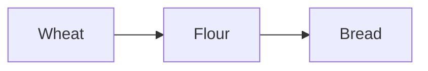

# Writing Markdown documents

Use this guide when writing or updating the project's `.md` files.
[PATHING.md](PATHING.md) is the style reference.

## Write for scanning

- Use short sentences. Give each sentence one main idea.
- Put the main point first.
- Use familiar words and concrete actions.
- Use bullets for rules, choices, requirements, and remaining work.
- Use short paragraphs to explain why something matters.
- Keep each section focused on one topic.
- Preserve technical meaning when simplifying wording.

Prefer:

```markdown
- Keep valid routes across updates.
- Retry blocked routes on a later tick.
- Preserve carried goods while waiting.
```

Avoid combining several rules into one long sentence.

## Headings

- Use one `#` heading for the document title.
- Use `##` for main topics.
- Use `###` for parts of a topic.
- Keep headings short and specific.
- Do not skip heading levels.
- Leave a blank line after every heading.

```markdown
# Pathing decisions

Movement and routing rules for the village.

## Route retention

Keep routes while they remain usable.

### Blocked routes

Retry on a later tick.
```

## Bullet points

- Start unordered items with `- `.
- Leave a blank line before and after the list.
- Keep related items in one list.
- Start comparable items in the same way.
- Use a period when an item is a complete sentence.
- Keep short labels consistent. They can omit periods.

```markdown
Workers follow these rules:

- Retain valid routes.
- Wait when the destination is blocked.
- Resume when access returns.

The host owns these decisions.
```

### Nested bullets and continuation lines

- Nest a bullet only when it belongs to the parent item.
- For `- ` items, indent child bullets by two spaces.
- Use one nesting level where possible.
- Align continuation text with the parent item's text.
- A continuation line stays part of the same bullet.

```markdown
- **Host:** owns gameplay and saved state.
  - Advances movement.
  - Transfers cargo.
- **Browser:** owns presentation.
  It must not change authoritative state.
  - Draws workers.
  - Plays animations.
```

Use a new heading when a nested list becomes too large.

### Numbered lists

Use numbers when order matters. Use bullets when it does not.
Indent continuation text to match the item's text.

```markdown
1. Inspect the current code.
2. Make the change.
3. Run the affected checks.
   Fix relevant failures before committing.
```

## Emphasis and code names

- Use `**bold**` for key labels or important values.
- Use backticks for commands, function names, identifiers, and literal values.
- Keep emphasis selective. Avoid bolding whole paragraphs.
- Use fenced code blocks for commands or longer examples.
- Add a language name to the opening fence.

```markdown
- **Host:** validates movement.
- Cache limit: **256 answers**.
- An unreachable browser route returns `null`.
- Run `python3 tools/check.py --list` to inspect affected checks.
```

To show Markdown syntax, wrap the example in a `markdown` code fence.
Use four backticks for an outer fence when the example contains three:

````markdown
```sh
python3 tools/check.py --list
```
````

## Links and references

- Use descriptive link text: `[Pathing decisions](PATHING.md)`.
- Use relative paths for project files.
- Match the filename's exact capitalization.
- Use `../` to link from `docs/` to another project directory.
- Use a heading anchor for a specific section.
- Check links after renaming a file or heading.

```markdown
[Pathing decisions](PATHING.md)
[Planned work](ROADMAP.md#scalable-villager-pathfinding)
[Host navigation](../server/navigation.py)
```

Follow PATHING.md's reference style for technical claims:

- Put the explanation first.
- Put its code reference on the next rendered line.
- Name the relevant function or class in backticks.
- Use a trailing backslash to force that line break.
- Ordinary wrapped source lines do not force a rendered line break.

```markdown
- **Host:** calculates gameplay routes.\
  Reference: [server/navigation.py](../server/navigation.py): `RouteCache.route`
```

## Status labels

Separate implemented behavior from agreed goals and future work.

- **Current:** checked against the code.
- **Confirmed:** an agreed design direction or user requirement.
- **Proposed:** an idea to try or discuss.
- **Planned:** intended work that remains unfinished.
- **Open:** a decision or measurement is still needed.

Put a shared status above a list. Label individual bullets if their statuses differ.

```markdown
## Scheduling

**Current:**

- Host searches run synchronously.
- Browser searches can yield between steps.

**Planned:** spread host searches across updates.

**Open:** choose the host work budget.
```

## Tables and diagrams

- Use tables to compare values or map rules to behavior.
- Give each column a clear label.
- Include units in labels or values.
- Keep cells short. Put explanations below the table.
- Use bullets when a table would contain long paragraphs.
- Use Mermaid when a small diagram makes a flow easier to understand.

```markdown
| Actor | Owner | Responsibility |
| --- | --- | --- |
| Worker | Host | Gameplay movement |
| Worker sprite | Browser | Animation |
```

The separator row is required. Extra spaces can align the source columns.
They do not change the rendered layout.

````markdown

````

## Document structure

Use the parts that fit the topic. Small documents need fewer sections.

- Title and a short purpose.
- Current behavior or confirmed goal.
- Focused topics with short rules and examples.
- Planned work and open decisions.
- References and relevant verification steps.

Like PATHING.md, separate **Host** and **Browser** responsibilities when relevant.
Code remains the source of truth for implemented behavior.

## Before finishing

- Read the document as a rendered page when a preview is available.
- Check heading levels, blank lines, and list indentation.
- Check that code fences close correctly.
- Check links, anchors, and filename capitalization.
- Confirm that rewriting preserved the facts and decisions.
- Keep current, proposed, planned, and open items distinct.
- Update related references and roadmap entries when the status changes.
- Avoid formatting changes in unrelated documents.
