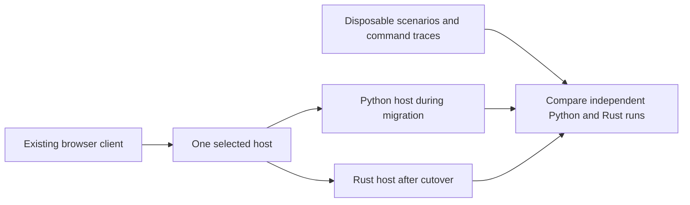

# Rust migration plan

A migration that can be completed one task at a time, with a prompt for each task.

**Status:** R01 contracts/inventory and R02 Python relocation fix complete; Rust implementation has not started.
**Initial plan revision:** `445ddddd675a87eb7adb50442b2dbf3c14ea6c6f`.
**R01 audit revision:** `935db7b95885c101c62dfd6bf9e16f39b6a7a8fe`.
**Scope:** replace the Python host first. Keep the browser playable during that
work. Shared WebAssembly code and a full Rust client are separate later decisions.
This is a proposed implementation sequence, not approval to execute every stage.

## How to use this plan

1. Paste the prompt for the first unfinished stage into Codex.
2. Complete that stage, its checks, documentation, and local Git commit.
3. Record its commit and evidence in the progress table below.
4. Play or review its checkpoint before starting the next stage.

Each prompt authorizes only its named stage. Read this document and `AGENTS.md`
again in each task. Repository state takes precedence over this initial inventory.
Ask about material product or compatibility choices; decide routine internal
details from the code. Use one agent unless the user explicitly requests more.

Large stages contain numbered slices. Complete one slice per prompt invocation
when it is independently testable; record the remaining slices and leave the stage
in progress. A partial implementation must remain behind its experimental boundary.
Do not claim an entire stage is finished because its first slice works.

## Intended migration boundary

**Proposed:** a standalone Rust host, developed alongside the Python host.

- Python remains the normal launch path until the cutover stage passes.
- Early Rust work runs unit tests and disposable scenarios offline.
- An experimental Rust host serves disposable worlds after its HTTP stage.
- Each running world has exactly one authoritative host and one save writer.
- Replay comparisons run independent world copies; they never mutate a live world.
- Keep HTTP and JSON compatible initially. A Rust implementation does not require
  replacing the renderer, introducing WebSockets, or changing balance values.
- Keep the Python implementation available through the rollback period. Normal
  Rust gameplay must no longer need Python after the host migration is complete.

This avoids introducing a permanent Python/Rust subprocess bridge for every
simulation operation. The Python game stays playable while Rust gains features;
the Rust version is not advertised as feature-complete until its coverage is proven.



## Current code to account for

The inspected project has about 8,500 Python host lines, 7,300 browser JavaScript
lines, and 22,000 Python/JavaScript test lines. These indicate scope, not estimates
of Rust output size or delivery time.

| Responsibility | Existing implementation | Important migration constraints |
| --- | --- | --- |
| Commands, host loop, HTTP, world management | `server/server.py` | Authentication, ownership, errors, construction, command ordering, shutdown saves |
| Routes and spatial rules | `server/navigation.py`, `server/spatial.py`, `server/barns.py` | Weighted roads, corners, footprints, fences, bounded searches |
| Worker travel and confirmed playback | `server/work_cycles.py` | Continuous position, phases, water, boats, cargo, work completion |
| Production and transport | `server/logistics.py`, `server/progression.py`, `server/resource_activity.py` | Reservations, capacities, exact-once transfers, recipes, practice, accounting |
| Farms and orchards | `server/farming.py`, `server/orchards.py` | Acre claims, crop passes, watering, harvest cargo, yield limits |
| Terrain and shared worlds | `server/terrain.py`, `server/terrain_regions.py`, `server/chunk_world.py`, `server/shared_world.py` | Existing generator versions, unloaded chunks, town separation, resource regrowth |
| Residents and progression | `server/server.py`, `server/progression.py`, `server/equipment.py` | Housing, arrivals/departures, names, talents, skills, tools, hall unlocks |
| Animals, horses, and local villages | `server/barns.py`, `server/horses.py`, `server/npcs.py`, `server/villages.py`, `server/swamp_village.py`, `server/village_life.py`, `server/trading.py` | Growth, butchery, boat crews, riding, saved routines, gifts and trade |
| Adventures | `server/quests.py`, `server/lanterns.py` | Separate clocks, participants, hazards, rewards, reconnect behavior |
| Player credentials | `server/player_login.py`, HTTP handler | Existing PIN hashes, private tokens, provisioning, host-only world operations |
| Browser presentation | `web/app.js`, `web/animations.js`, `web/scene.js`, `web/quarry.js`, `web/lanterns.js` | Founder prediction, worker playback, terrain loading, panels, overview, animations |
| Verification | `tests/`, `tools/check.py`, `tools/test_selection.py`, performance harnesses | Existing tests are valuable but currently assume Python/JavaScript implementations |

This inventory is not a complete command specification. Stage R01 must enumerate
every endpoint and action, including delegated NPC, trade, equipment, horse, and
adventure commands. Tests and current code are authoritative over older prose.

## Architecture choices to settle early

Stage R01 records decisions and reasons in this document or a linked decision file.
Defaults below are proposals; changes must name the consequence and acceptance test.

| Choice | Proposed default | Evidence needed |
| --- | --- | --- |
| Project layout | Cargo workspace under `rust/`; start with `lantern-core` and `lantern-host` | Core tests run without HTTP, a filesystem, or wall-clock access |
| State ownership | One simulation owner applies commands and results in a defined order | No double application, stale worker result, or concurrent authoritative mutation |
| IDs | Persistent world/town/entity IDs; coordinates are locations, indexes are boundary adapters | Relocation and list reordering preserve identities and references |
| Worker state | Position and carried inventory survive task, route, and animation changes | Move/reassign/block/reload traces preserve continuity and accounting |
| Core clock | Explicit elapsed simulation time supplied by the host | Different legal time subdivisions preserve documented production rates |
| Scheduling | Service commands and navigation independently of three-second production batches | Bounded route waiting and command latency under measured load |
| Rendering | Browser consumes confirmed state; founder prediction remains derived | Client playback cannot award goods or mutate saved state |
| Persistence | Versioned DTOs and explicit conversion, separate from in-memory structures | Imported saves preserve all covered features; unknown data is preserved or rejected explicitly |
| Randomness | Explicit, versioned random streams and stable iteration order | Repeatable traces and unchanged old-world generation |
| Parallel work | Begin with a deterministic single-owner core; add workers only with evidence | A parallel result identifies the request generation and relevant navigation versions |
| Gameplay balance | Preserve documented rates, costs, access, and unlocks | Differences are separately approved behavior changes, not accidental migration changes |

Use separate simulation, navigation, persistence, and API revision counters where
their meanings differ. A whole-world revision on every production change would
invalidate useful route results again. A returned route may remain acceptable after
unrelated world edits if its request and navigation dependencies are still current.

### Libraries

Use libraries for standard infrastructure. Recheck current releases, supported
Rust versions, platform support, licenses, and relevant APIs when adopting them.
Commit the application workspace's `Cargo.lock`; do not pin speculative versions
in this planning document.

| Area | Candidate | Boundary |
| --- | --- | --- |
| HTTP and asynchronous I/O | Axum and Tokio | Keep async/network types out of simulation rules |
| JSON and save DTOs | Serde and serde_json | Serialization does not automatically provide migrations or private-field filtering |
| Basic search | `pathfinding` | Evaluate road costs, determinism, allocations, cancellation, and resumability before adopting |
| Stable storage handles | Standard typed IDs first; evaluate a generational arena if useful | Internal handles must not replace persistent public IDs accidentally |
| Testing | Rust test framework; add property-testing tools where they verify useful invariants | Preserve end-to-end scenarios and independent search/accounting oracles |
| Full Rust client | Evaluate Bevy only at R25 | A renderer/engine decision is separate from the host migration |

The `pathfinding` crate's ordinary `astar` API returns a completed answer. Do not
assume it can pause after a fixed number of expansions. If our measured scheduling
needs require resumable search, use an appropriate library API or keep a small,
isolated incremental solver. Test it against an independent reference algorithm.
The crate's network-flow algorithms are not a ready-made game flow-field system.

## Validation and comparison rules

Every implementation prompt includes these requirements by reference:

- Inspect Git status and relevant code before editing. Preserve unrelated work.
- Add meaningful tests for the migrated contracts and observed failure cases.
- During development, run the targeted failing checks. Validate the affected set
  once after the logical task is complete, following `AGENTS.md`.
- R04 must extend the affected-check runner to understand Cargo before Rust code
  grows. Until then, do not assume `python3 tools/check.py` validates Rust.
- Run formatting and relevant Rust tests/lints for affected crates after R04.
  Keep test output and selection reasons reviewable. Missing tools are blockers
  for the relevant checks, not passes.
- For performance investigation or optimization, record the starting commit before
  edits. Run the required comparison after correctness, without repeating it.
- The existing performance harness imports Python directly. R03/R04 must identify
  this limitation; R23 must support both hosts before claiming Rust-host gains.
  Running the old Python benchmark on a Rust revision does not measure Rust.
- Compare release builds on the same machine and workload. Include warm/cold
  caches, obstacle changes, simultaneous orders, unreachable goals, multiple towns,
  increasing worker counts, and save/HTTP contention.
- Report route queue delay and time until movement starts in milliseconds and
  simulation time, not just CPU time per search or eventual completion.
- Include p50/p95/p99, maximum waits, restarts, queue size, expanded nodes, cache
  reuse, memory, snapshot size, command response, and save duration where applicable.
- Read per-scenario results and absolute budgets. Interrupted, missing, or noisy
  measurements remain inconclusive. Never relax thresholds to make a port pass.
- Review the diff, update the progress table and related roadmap status, stage
  task files explicitly, commit the completed logical task, and verify Git status.

### Behavior comparison

Exact equality is appropriate for IDs, counts, resource ownership, command results,
and rewards. Define field-specific numeric tolerances for positions and fractional
quantities before comparison. Do not blanket-ignore floats, worker states, timers,
or large parts of snapshots. Different optimal routes may be acceptable only when
access, travel cost, arrival, and deterministic tie-breaking contracts allow them.

Inject recorded random draws or reproduce the agreed random algorithm for paired
simulations. Rust's default random generator is not interchangeable with Python's
`random.Random`. Terrain compatibility includes Python's seed conversion, sampling,
ordering, and floating-point behavior, not merely the generator's name.

### Proposed responsiveness targets

R01 must select reference hardware, workloads, and acceptance budgets; these are
starting targets, not measurements or implemented guarantees.

| Scenario | Proposed target |
| --- | --- |
| Command acknowledgement under the agreed four-town workload | Host response p95 below 100 ms; p99 below 250 ms |
| Ordinary reachable local route on the agreed workload | Route available on host p95 below 250 ms; p99 below 1 second |
| Recoverable blocked route | Resume promptly after access returns; measure and set the maximum recovery delay |
| Backlog and saturation | No indefinitely starved actor; explicit bounded memory and a measured maximum wait |
| Browser frame work | Retain the existing 8 ms p95 benchmark budget |
| Visible route reaction | Measure end to end; existing two-second snapshot polling cannot promise subsecond updates |

Unreachable destinations need a bounded response or an explicit continuing search
status. Large detours need their own documented budgets; do not hide them in a
local-route percentile. New budgets need a rationale and fixture, not an unmeasured
promise that all worlds finish every search within a fixed small deadline.

## Saves and rollback

- R01 defines the support matrix for legacy saves and terrain versions. Current
  local credentials, saves, and player provisioning files must not become fixtures.
- Fixture worlds and credentials are synthetic. Keep tokens/PIN hashes out of
  public snapshots, logs, benchmark reports, and committed real-world data.
- Python and experimental Rust use separate data roots and ports. Rust initially
  refuses the normal Python save directory.
- Backup/import includes the world registry, active-world selection, credentials,
  every world's chunk directory, and optional private player provisioning.
- Conversion writes a new destination atomically and leaves the source unchanged.
  Do not run Python load migrations merely to read the user's production save.
- Until cutover, rollback means stop Rust and start Python on its untouched data.
- After Rust accepts new play, switching to an old backup loses that new progress.
  Preserving it requires a tested reverse export for the supported schema.
- At R24, explicitly choose reverse-export support or a one-way conversion with
  that rollback limitation. Do not describe an old backup as lossless rollback.
- Derived caches/frontiers rebuild after reload. Stable position, cargo, task,
  trip progress, and required random-stream state must persist.

## Progress and dependencies

All implementation stages start as **Not started**. Fill commit/evidence cells
only after work is performed. Keep unfinished stages visible in the roadmap.

| Stage | Task | Requires | Status / commit / evidence |
| --- | --- | --- | --- |
| R01 | Contracts, coverage inventory, decisions | This plan | Complete; [contracts and evidence](RUST_CONTRACTS.md), audited at `935db7b`; commit: `docs: define R01 migration contracts` (this change) |
| R02 | Fix current relocation continuity | R01 | Complete; `fix: preserve worker continuity when relocating workplaces` (this change); evidence below |
| R03 | Replay fixtures and comparison oracle | R02 | Not started |
| R04 | Cargo workspace and applicable checks | R03 | Not started |
| R05 | Typed state, IDs, units, and boundary DTOs | R04 | Not started |
| R06 | Legacy import and read-only save inspection | R05 | Not started |
| R07 | Terrain versions and chunk generation | R06 | Not started |
| R08 | Spatial rules and founder movement | R07 | Not started |
| R09 | Search algorithms and library decision | R08 | Not started |
| R10 | Request scheduler and cache invalidation | R09 | Not started |
| R11 | Persistent worker movement and playback | R10 | Not started |
| R12 | Construction and building operations | R11 | Not started |
| R13 | Resource ledger, storage, and progression rules | R12 | Not started |
| R14 | Hauling, delivery, and merchant trips | R13 | Not started |
| R15 | Gathering and processing professions | R14 | Not started |
| R16 | Farming and orchards | R15 | Not started |
| R17 | Fishing, boats, animals, and horses | R16 | Not started |
| R18 | Residents, villages, trade, and adventures | R17 | Not started |
| R19 | Durable Rust saves and recovery | R18 | Not started |
| R20 | HTTP, accounts, and world lifecycle | R19 | Not started |
| R21 | Browser compatibility and playable Rust checkpoint | R20 | Not started |
| R22 | Shared-destination routing | R21 | Not started |
| R23 | Cross-host benchmarks and release readiness | R22, or documented deferral | Not started |
| R24 | Default-host cutover and Python retirement | R23 | Not started |
| R25 | Decide Rust browser/client scope | R24 | Not started; optional |
| R26 | Share selected core rules through WebAssembly | R25 | Not started; optional |
| R27 | Full Rust client prototype and staged replacement | R25; R26 if useful | Not started; optional |

R01-R03 establish trustworthy behavior. R04-R11 establish the Rust core.
R12-R18 cover gameplay. R19-R21 make a complete disposable Rust game playable.
R22-R24 deliver shared routing, measured readiness, and the host transition.
R25-R27 cover a separate client project. Stopping after any completed stage leaves
the existing Python launch available until the explicit cutover.

## R01 — Contracts and decisions

Completed documentation: [migration contracts, coverage, compatibility and decisions](RUST_CONTRACTS.md).
All Rust features remain unported. Recommendations do not approve behavior changes.

**Deliver:** an endpoint/action coverage matrix, save-version matrix, feature/test
mapping, and short architecture decisions. Mark every feature as unported,
implemented, verified, or intentionally deferred. A deferred existing feature blocks
default-host cutover unless the user explicitly accepts its removal.

**Inspect:** `server/server.py`, all delegated command modules, `docs/PATHING.md`,
`docs/BACKEND.md`, existing tests, and the save/chunk implementation.

**Decide:** persistent IDs, quantity/position/time representation, randomness,
supported terrain versions, client compatibility, dependency/toolchain policy,
latency workloads, and save rollback policy. Preserve LAN ownership and account
behavior. Separate game behavior from known bugs; document intentional differences.

**Done when:** no endpoint, command family, saved subsystem, or browser-required
catalog is absent from the matrix. Proposed choices have reasons and testable
consequences. This is a documentation stage; do not start the port.

```text
Read AGENTS.md and docs/RUST_MIGRATION.md. Execute only R01: inspect the current
repository and create the migration contracts, complete endpoint/action/feature
coverage matrix, compatibility matrix, and architecture decisions described there.
Keep recommendations distinct from user-approved behavior. Ask only about material
choices that code and existing requirements cannot resolve. Do not implement Rust.
Validate the documents, update progress and roadmap, and commit this stage.
```

## R02 — Fix relocation continuity in the current game

**Completed:** the original move command deleted the saved animation and orphaned
carried output. Regression tests reproduced both failures at starting revision
`536d3d77507577a3e58bcf9dacadd66ba5601af2`. Relocation now retargets coordinate
references, preserves position/cargo/work at unchanged sources and filled cans,
and replaces obsolete routes. Confirmed browser playback drops obsolete relocation
history without resetting the visible pose. No Rust implementation was added.

Coverage: `tests/test_relocation.py`, `tests/test_path_retention.js`, and
`tests/test_villager_playback.js` exercise moving workers, carried output through
JSON save/reload and migration, a picked-up delivery, unaffected work, linked acres,
filled cans, removed sources/workplaces, and resized browser destinations.
The [pathing reference](PATHING.md#revalidate-or-recover-when-needed) records the
intentional exact-once logistics cancellation and demolition salvage rules. The new
browser playback regression also fails against the starting revision: its obsolete
return remains queued after relocation.

Correctness evidence: the affected runner selected 169 files/cases
(`performance-results/20261016-012045/report.md`). Final targeted checks cover the
new relocation cases and updated cargo expectations; routing, farming, boat,
storage, and playback checks pass. Local-socket/Chromium restrictions required
rerunning the HTTP and pointer checks with sandbox escalation; pointer selection
and 22 of 23 HTTP cases pass. Three unrelated failures were reproduced at the
starting revision and remain unchanged: workshop capacity expects 65 instead of
90 (`test_logistics`), `test_hall_refresh.js` lacks a DOM element, and the chunk
HTTP snapshot is 20,474 bytes against a 20,000-byte assertion. Final targeted
reports: `20261016-012204`, `20261016-012424`, `20261016-012430`, and
`20261016-012544` under `performance-results/` (ignored local artifacts).

Required performance comparison: **inconclusive**. Command:
`python3 tools/check.py --performance-only --baseline 536d3d77507577a3e58bcf9dacadd66ba5601af2 --output performance-results/r02-performance`
(sandbox escalation for local HTTP/Chromium). Baseline is the starting revision;
candidate is that revision plus this change's uncommitted R02 runtime diff, SHA-256
`c01c89c7fec6a3de069679028c53f29f40b64bef170343141f52bd5436bbed9b`.
Hardware/environment: Apple M1 Max, macOS arm64, Python 3.9.6, Node 26.11.1,
headless Chromium 149.0.7827.55, 1280×800 at DPR 1. Both sides' first browser and
host runs passed every scenario check. Maximum scenario frame-work p95 was
4.7 ms baseline / 5.4 ms candidate, below the 8 ms absolute budget in this single
pair. The second candidate browser process could not load Homebrew's
`libsimdutf.36.dylib`; its host scenarios still passed. The five-pair run stopped,
so no aggregate comparison or performance pass is claimed. Read Markdown/JSON and
per-scenario artifacts in `performance-results/r02-performance/`. The earlier
sandboxed attempt (`20261016-012324`) was also inconclusive due to denied sockets.
No thresholds, baselines, or machine dependencies were changed.

**Deliver:** a focused Python/browser fix so migration does not leave the reported
bug in everyday play. A moved workplace may require a new route, but must retain
the worker's position and apply existing cargo and reservation rules exactly once.

**Inspect:** the `move` branch in `server/server.py`, `starting_position` and task
changes in `server/work_cycles.py`, cancellation in `server/logistics.py`, and
browser replanning/playback. Check linked acres, footprint changes, and removed
destinations. Do not generalize this into the Rust architecture prematurely.

**Done when:** tests cover a moving worker, carried output, an active delivery,
relocation followed by save/reload, and an unaffected worker. Any intentional cargo
salvage behavior is explicit. Worker position does not fall back to the hall.
Run applicable correctness and the required pathing performance comparison.

```text
Read AGENTS.md and docs/RUST_MIGRATION.md. Execute only R02. Reproduce the workplace
relocation reset in the current Python/browser game, then preserve worker position
and valid task/cargo progress while replacing obsolete routes. Follow the stage's
cases and existing cancellation semantics. Record the starting revision, validate
the affected tests and required performance comparison, review the diff, update
progress and pathing documentation, and commit the completed fix.
```

## R03 — Replay fixtures and an independent comparison oracle

**Slices:** (1) define trace format and normalization; (2) record representative
Python traces; (3) implement a backend-neutral comparison interface.

**Deliver:** small synthetic scenarios containing initial state, explicit time
advances, commands, controlled random inputs, expected public results, and selected
authoritative state. Preserve realistic terrain generation in terrain scenarios.

Include relocation, blocked/unreachable travel, reload mid-trip, cargo transfers,
workshop queues, food/stock accounting, multiple towns, and an adventure. Record
the Python revision that produced each baseline. The Rust adapter arrives later.
Compare relevant invariants as well as snapshots; existing Python bugs are not
automatically requirements. Keep intentional differences narrow and explained.

**Done when:** traces replay repeatably on Python; deliberately corrupting cargo,
ownership, position, or rewards causes a useful failure. No private save data is
used. The harness clearly reports that Rust and Rust-host benchmarks do not exist yet.

```text
Read AGENTS.md and docs/RUST_MIGRATION.md. Execute the first unfinished slice of
R03 only. Build disposable deterministic replay fixtures and a backend-neutral
comparison contract using the current Python game as a recorded reference. Compare
field-specific values and invariants; do not broadly normalize away differences.
Control randomness and time, protect private save data, and test comparator failures.
Validate applicable tooling tests, record evidence and remaining slices, and commit.
```

## R04 — Rust workspace and applicable checks

**Slices:** (1) toolchain/workspace; (2) check-runner support; (3) Rust replay CLI.

**Deliver:** a minimal `rust/` workspace with core and host packages, pinned
toolchain policy, committed lockfile, ignored build output, and documented commands.
The core must compile and test without creating a network listener.

Extend selection/reporting to run affected Rust packages and reverse dependencies,
including changed manifests and shared fixtures. Preserve existing Python/JS
selection behavior and explicitly detect removed sources. Cover selection with
tests. Connect a small fixture to a Rust CLI without pretending gameplay is ported.
Do not add a game engine, ECS, database, or concurrency framework speculatively.

**Done when:** Rust checks appear in the unified report; failed or missing Rust
commands cannot produce a pass. The existing Python launch remains unchanged.

```text
Read AGENTS.md and docs/RUST_MIGRATION.md. Execute the first unfinished slice of
R04 only. Establish the minimal Rust workspace and extend the repository's affected
check workflow as specified. Keep the simulation core independent of networking.
Use current official library/toolchain documentation, commit Cargo.lock, and keep
build artifacts out of Git. Test selection and failure reporting. Update setup,
progress, and roadmap documentation, validate the affected set, and commit.
```

## R05 — Typed state, IDs, units, and DTOs

**Slices:** (1) IDs and primitive units; (2) actor/building/task model;
(3) public/save DTO conversion and feature coverage.

**Deliver:** stable persisted identities, explicit world/town ownership, independent
actor position and cargo, and typed task/route states. Decide fractional quantity
and movement precision without silently rounding existing stock or changing rates.
Stable ID allocation must survive reload and avoid collisions across imported towns.

Keep protocol/save DTOs separate from internal structures. Existing browser indexes
may be adapted at the boundary, but do not trust an obsolete index after a command
queue delay; define rejection or ID/revision validation for that case.

**Done when:** moves/reorders/reloads preserve references, invalid foreign IDs are
rejected, and public DTOs cannot serialize private credentials or derived search data.

```text
Read AGENTS.md and docs/RUST_MIGRATION.md. Execute the first unfinished slice of
R05 only, following the R01 decisions. Introduce typed persistent IDs and units,
independent actor position/cargo, explicit task/route states, and separate boundary
DTOs. Preserve existing fractional quantities and client contracts. Test identity,
ownership, stale-reference handling, and private-field exclusion. Run applicable
checks, update coverage and progress, and commit the completed slice.
```

## R06 — Legacy save import and inspection

**Slices:** (1) registry/accounts/ordinary worlds; (2) chunked world references;
(3) migration validation and inspection CLI.

**Deliver:** read-only import from synthetic copies of supported Python formats,
including old single-world saves, world registries, active selection, credentials,
optional provisioning, and external chunks. Validate references and report unsupported
versions. Preserve or explicitly reject unrecognized fields; never silently discard
unported gameplay. Keep the source untouched even when import fails.

**Done when:** an inspection command reports capabilities and unsupported fields
without exposing secrets or advancing simulation. IDs and totals are stable on
repeated imports. This stage does not enable production writes or world generation.

```text
Read AGENTS.md and docs/RUST_MIGRATION.md. Execute the first unfinished slice of
R06 only. Implement read-only Rust inspection/import for the supported synthetic
Python save formats and chunk references. Preserve accounts, identities, inventories,
and unported data, or fail explicitly. Never write to a source save or print private
credentials. Validate successful and failed imports, update coverage/progress,
and commit the completed slice.
```

## R07 — Terrain and chunks

**Slices:** (1) chunk reading/loading; (2) supported legacy generators;
(3) new-world creation, starter placement, and regrowth/activation.

**Deliver:** old generator versions produce the same terrain/resources when an old
world explores previously unloaded chunks. Include seed conversion, iteration order,
town-site selection, village placement, boundary sampling, and resource metadata.
Materializing the current camera area alone is not old-world compatibility.

Use golden chunk hashes plus boundary and resource assertions. Keep existing
generator versions reproducible; a new Rust generator requires a new version for
new worlds, with an explicit compatibility decision. Port active/sleeping chunk
behavior, cache bounds, dirty resources, and catch-up rules without offline production.

**Done when:** old-world chunk exploration, chunk unload/reload, new-world town
separation, water boundaries, and resource recovery pass. Unsupported generation
blocks cutover rather than silently changing the landscape.

```text
Read AGENTS.md and docs/RUST_MIGRATION.md. Execute the first unfinished slice of
R07 only. Port terrain/chunk behavior with versioned Python-generator compatibility,
including old seeds and unexplored chunks. Use real generation for terrain tests.
Do not substitute Rust's default RNG or change saved landscapes. Validate golden
chunks, boundaries, activation/regrowth, and new-world placement as applicable.
Update the compatibility matrix and progress, run affected checks, and commit.
```

## R08 — Spatial rules and founder movement

**Slices:** (1) footprints, occupancy, roads, fences; (2) founder collision and access;
(3) shared-town/chunk boundaries and position recovery.

**Deliver:** one authoritative spatial representation and explicit movement profiles.
Preserve farmer acre access, pier/boat exceptions, founder clothing and water rules,
diagonal corner restrictions, collision radius, sliding, substeps, and road timing.
Moving villagers remain nonblocking unless a separate gameplay change is approved.

**Done when:** pure core tests and paired movement traces cover each access profile,
multiple towns, blocked starts, map edges, and unloaded terrain. Spatial caches do
not mutate imported snapshots. Browser prediction remains compatible.

```text
Read AGENTS.md and docs/RUST_MIGRATION.md. Execute the first unfinished slice of
R08 only. Port the authoritative spatial and founder-movement contracts, including
footprints, fences, roads, collision recovery, clothing/water access, and shared-world
boundaries. Preserve the existing movement metric and corner rules. Validate against
targeted Python scenarios and Rust invariants. Update coverage/progress, run the
applicable checks, and commit the completed slice.
```

## R09 — Search and library decision

**Slices:** (1) executable library/custom comparison; (2) selected search backend;
(3) route-cost and access compatibility.

**Deliver:** an internal search interface independent of actor state. Compare the
library candidate with a small incremental implementation only if required. Measure
whole-request setup, allocations, expansion work, and result conversion, not just
the inner heap loop. Use release builds and representative search fixtures.

Preserve exact/perimeter/multiple-goal arrival, diagonal costs and clearance, fences,
bounds, missing terrain, and smooth/departure/arrival road-cost modes. Results must
distinguish already arrived, unreachable, pending, cancelled, and completed.

**Done when:** independent Dijkstra/reference checks agree on costs and reachability;
deterministic tie behavior is documented; the chosen backend can support R10's
bounded service contract. Record the dependency decision and measured limitations.

```text
Read AGENTS.md and docs/RUST_MIGRATION.md. Execute the first unfinished slice of
R09 only. Evaluate and implement the Rust search backend behind a small interface,
using the existing route/access/cost contracts. Check library resumability rather
than assuming it. Compare correctness with an independent reference and measure
release-build search/setup costs on identical fixtures. Record the starting commit,
decision, limitations, coverage, and validation before committing the slice.
```

## R10 — Scheduling and cache invalidation

**Slices:** (1) request identity/cancellation/fair service; (2) bounded caches and
local invalidation; (3) independent navigation service cadence and diagnostics.

**Deliver:** pending request generations, bounded admission/memory, deterministic
fairness, and observable waiting reasons. Distinguish topology/access changes from
road-cost changes. Track relevant regions/edges for cached answers and examined
dependencies for pending searches. Failed results need valid dependencies too.

Retain progress across irrelevant edits. Changed passability/cost in relevant search
dependencies must be handled correctly, including diagonal side tiles and fences.
Keep valid active routes when a new road only offers a better future option. Do
not treat arbitrary obstacle removal as safe for search optimality without proof.

Choose service frequency and work allowance from R01 budgets. Navigation must not
wait exclusively for production ticks. Include graph preparation in CPU/memory
measurements. Reject stale results without clearing the actor's position/cargo.

**Done when:** saturation has no indefinite starvation, cancellation releases work,
distant edits do not repeatedly reset searches, blocked routes recover, and actual
queue waits meet agreed scenarios. Record correctness and performance evidence.

```text
Read AGENTS.md and docs/RUST_MIGRATION.md. Execute the first unfinished slice of
R10 only. Implement bounded deterministic route scheduling and cache validity with
request generations and relevant navigation dependencies. Preserve progress across
irrelevant edits, validate negative-cache and diagonal/fence cases, and separate
navigation service from production cadence. Measure queue waits, restarts, memory,
and CPU under the agreed workloads. Follow performance comparison rules, update
coverage/progress, and commit the completed slice.
```

## R11 — Persistent worker movement and playback

**Slices:** (1) generic travel/wait/arrival state; (2) task changes and blocked recovery;
(3) confirmed movement/playback DTOs and reload continuity.

**Deliver:** actor transform and cargo live outside task/animation state. Route
replacement preserves fractional position and the intended outbound/return leg.
Keep authoritative work events separate from visual samples. Reconstruct derived
searches after reload without replaying completed pickup, unload, or work actions.

**Done when:** move/reassign/block/reload traces preserve position, facing where
appropriate, cargo, destination, and phase. Missed browser updates can reconnect at
walking speed. Waiting and unreachable states have distinct, truthful explanations.

```text
Read AGENTS.md and docs/RUST_MIGRATION.md. Execute the first unfinished slice of
R11 only. Build persistent Rust worker travel and confirmed playback on the route
service. Keep transform/cargo independent of task and animation lifetimes. Cover
relocation, task replacement, fractional positions, blocked return legs, and reload
without duplicate actions. Validate the Rust traces and DTO compatibility, update
coverage/progress, and commit the completed slice.
```

## R12 — Building operations and construction

**Slices:** (1) placement/move/destroy/rotation; (2) builder claims and construction;
(3) upgrades, linked acres, and cancellation interactions.

**Deliver:** all placement/range/ownership checks; footprint and pen protection;
roads, decorations, farms/orchards and linked children; builder priorities, claims,
progress, saved walks, and upgrade helpers. Preserve sandbox costs/timing and current
move fees. Invalid commands must not partially charge, move, or destroy a group.

**Done when:** construction and movement scenarios survive interrupted routes and
reload; moving a workplace preserves actors; removal releases references and applies
existing salvage rules exactly once. Update every covered action in the matrix.

```text
Read AGENTS.md and docs/RUST_MIGRATION.md. Execute the first unfinished slice of
R12 only. Port building/road/decorative operations and construction using stable IDs
and persistent actors. Preserve footprint, ownership, range, linked-child, upgrade,
sandbox, and cancellation rules. Test atomic command failure and relocation during
work/travel. Validate the affected paired scenarios, update coverage/progress,
and commit the completed slice.
```

## R13 — Resource accounting and progression rules

**Slices:** (1) resource/catalog/quantity model; (2) capacities/reservations/caps/flows;
(3) recipes, talents, skills, equipment, and hall requirements.

**Deliver:** one tested accounting model for stored, carried, reserved, pending,
and free stock. Port recipe/crop/fish catalogs and client-required metadata with
their current names, costs, times, storage filters, and unlocks. Copy data through
a reviewed source rather than maintaining two silently divergent catalogs.

**Done when:** no negative stock, duplicate inventory, spendable carried cargo, or
rounding-stranded batch. Resource overview and capacity semantics match. Test the
documented grain chain and relevant progression milestones without changing balance.

```text
Read AGENTS.md and docs/RUST_MIGRATION.md. Execute the first unfinished slice of
R13 only. Port resource accounting, storage/caps/reservations, and the applicable
progression/catalog rules. Preserve fractional stock, client catalog values, and
documented balance. Test conservation, affordability, capacity, skills, and unlocks
with meaningful boundary cases. Update the action/catalog coverage matrix and
progress, run applicable checks, and commit the completed slice.
```

## R14 — Logistics and markets

**Slices:** (1) producer input collection; (2) hauler output/supply trips;
(3) merchant sales/purchases and cancellation/recovery.

**Deliver:** saved trip IDs, source/destination identities, pickup/delivery progress,
reservations, and actual carried cargo. Preserve storage selection, filters, hauling
speed, training, production pauses, buy/sell thresholds, and trade activity totals.

**Done when:** blocked or full destinations retain cargo; moved/deleted endpoints
apply the documented cancellation rule once; reload and retries cannot duplicate
goods or sales. Inputs and outputs transfer only at their authoritative events.

```text
Read AGENTS.md and docs/RUST_MIGRATION.md. Execute the first unfinished slice of
R14 only. Port the applicable producer/hauler/merchant trips onto the Rust accounting
and movement models. Preserve reservations, actual cargo, pickup/drop-off timing,
storage selection, market thresholds, and interruption semantics. Validate blocked,
full, relocated, deleted, and reloaded trip cases with conservation assertions.
Update coverage/progress, run affected checks, and commit the completed slice.
```

## R15 — Gathering and processing

**Slices:** (1) woodcutters and resource claims; (2) basic processors;
(3) workshop queues and advanced recipe families.

**Deliver:** separate tree claims and productive-time accounting, depleted resource
handling, timed batches, input reservations, tools, skill/talent effects, recipe
changes, caps, output buffers, and workshop request queues. Port every processor
listed by the R01 matrix, including species-preserving smoking and advanced goods.

**Done when:** no production or practice while merely waiting/travelling, completed
unloading preserves remaining time, cancellation preserves finished goods, and
documented rates survive the new scheduler. Include multi-worker and stalled chains.

```text
Read AGENTS.md and docs/RUST_MIGRATION.md. Execute the first unfinished slice of
R15 only. Port gathering and the named processor families in the coverage matrix,
preserving target claims, productive time, ingredient reservations, output accounting,
skills/tools, and workshop orders. Do not change balance or silently omit advanced
recipes. Compare targeted rates and interruption traces, update coverage/progress,
run applicable checks, and commit the completed slice.
```

## R16 — Farming and orchards

**Slices:** (1) field cycles and claims; (2) water trips and multi-acre harvest;
(3) orchards, crop changes, relocation, and reload.

**Deliver:** shared field progress, work-pass ordering, row/endpoint selection,
per-round water state, completed-acre access, growth, yield limits, farm capacity,
and orchard harvest/restock behavior. Retain crop cargo across field changes and
deliveries. Playback events must correspond to completed authoritative actions.

**Done when:** independent time subdivisions preserve outputs; farmers cannot
double-claim harvest; moved linked acres remain coherent; water and harvest returns
recover from blockage without repeating completed work or losing carried crops.

```text
Read AGENTS.md and docs/RUST_MIGRATION.md. Execute the first unfinished slice of
R16 only. Port field/orchard state and the applicable farming movement phases,
including acre claims, farm passes, watering rounds, harvest cargo, storage limits,
and relocation/reload. Preserve crop rates and action-aligned playback. Validate
the relevant farming/orchard scenarios and invariants, update coverage/progress,
and commit the completed slice.
```

## R17 — Fishing, livestock, and horses

**Slices:** (1) piers and land fishing; (2) boats, crews, species/cargo/return trips;
(3) barn growth, keepers, and manual butchery; (4) horses and riding.

**Deliver:** connected water/depth rules, saved piers, crew/captain coordination,
boat capacity/upgrades, caught species, barn pens and independent growth clocks,
animal names/counts, butcher pickup/drag/process stages, and horse capture/settlement/
breeding/equipment. Preserve replacement and reward rules for the last animal.

**Done when:** offshore reload, moved huts/barns, blocked dragging, full cargo,
animal growth under paused work, and mounted movement behave correctly. All current
animal/fishing/horse actions are covered, not just their rendering metadata.

```text
Read AGENTS.md and docs/RUST_MIGRATION.md. Execute the first unfinished slice of
R17 only. Port its named fishing/boat/livestock/horse subsystem using persistent
actors, cargo, and explicit clocks. Preserve water access, crew ownership, species,
growth, manual butchery, names, and riding rules as applicable. Validate interrupted
trips, reload, capacity, and exact-once rewards. Update coverage/progress, run the
affected checks, and commit the completed slice.
```

## R18 — Remaining residents, villages, trade, and adventures

**Slices:** (1) population/housing/food/assignments; (2) local villages/routines;
(3) NPC gifts/stories/town trading; (4) quarry/lantern adventures and completeness audit.

**Deliver:** arrivals, departures, loyalty, persistent names/talents, sandbox rules,
village migrations and resident routes, local visits and restocks, trade offers,
player gathering/equipment, story progress, expedition membership, hazards, and
one-time rewards. Reconcile all previously delegated command families in R01.

**Done when:** every existing feature is implemented and verified or explicitly
blocks cutover. Exercise multiple founders, ownership, absent towns, reconnect,
world switching, reward idempotency, and no offline production. Preserve separate
adventure clock semantics when decoupling the host scheduler.

```text
Read AGENTS.md and docs/RUST_MIGRATION.md. Execute the first unfinished slice of
R18 only. Port the listed population, village, NPC/trade/story, or adventure family
from the complete coverage matrix. Preserve persistent identity, ownership, timing,
progression, and one-time rewards. Check reconnect, multiple towns/players, and
save-imported state. Reconcile omitted commands instead of silently deferring them.
Validate targeted scenarios, update coverage/progress, and commit the slice.
```

## R19 — Durable Rust saves

**Slices:** (1) snapshot export/versioned reload; (2) atomic registry/chunk writes;
(3) conversion, recovery, and rollback tools.

**Deliver:** immutable snapshots for save work; a crash-safe generation or equivalent
protocol that keeps registry and chunk references consistent. A main JSON rename
alone does not make separately written chunks atomic. Flush/shutdown/recovery must
be tested. Saving must not hold the simulation owner during slow disk I/O.

Conversion uses explicit source/destination paths, validates the complete supported
save, preserves private accounts, and never overwrites the source. Test current
and legacy versions, malformed data, interrupted writes, missing chunks, and recovery.
Document reverse export support and any progress-loss boundary.

**Done when:** restart at a fractional worker/boat/trip position preserves progress
and goods; injected write failures leave a usable committed generation. Experimental
Rust still uses a separate data root.

```text
Read AGENTS.md and docs/RUST_MIGRATION.md. Execute the first unfinished slice of
R19 only. Implement durable versioned Rust saves and explicit copy-based conversion,
including external chunks, credentials, shutdown, and crash recovery. Keep slow I/O
outside authoritative mutation and protect the Python source data. Test interrupted
writes and mid-action reload. Document exact rollback limitations, update coverage/
progress, run applicable checks, and commit the completed slice.
```

## R20 — HTTP, accounts, and world lifecycle

**Slices:** (1) static assets and snapshot endpoints; (2) accounts/command dispatch;
(3) world administration, schedules, shutdown, and contention.

**Deliver:** Axum/Tokio boundary with the existing URLs, headers, JSON/query contracts,
catalogs, status codes, errors, chunk versions, and simulation clock metadata.
Cover `/api/world`, `/api/players`, `/api/worlds`, `/api/lanterns`, login/join/commands,
and all world create/open/delete/regenerate operations discovered in R01.

Preserve PBKDF2 parameters, salt encoding, name normalization/case folding, token
reuse, per-town authorization, private provisioning, and loopback-only host actions.
Use libraries for cryptography and constant-time verification. Do not trust a client
town ID or forwarded host header as authorization. Keep local validation/confirmation
requirements for destructive world operations.

**Done when:** protocol tests can run against either host; slow serialization/socket
transfer/save does not block founder commands; a bounded queue returns truthful
overload/failure feedback. Rust refuses unsupported saves and missing coverage.

```text
Read AGENTS.md and docs/RUST_MIGRATION.md. Execute the first unfinished slice of
R20 only. Implement the Rust HTTP/account/world-lifecycle boundary matching the
audited existing contracts. Preserve PIN verification, Unicode name normalization,
token privacy, town ownership, host-only administration, catalogs, and chunk queries.
Run both-host protocol tests with disposable roots, including slow-transfer and
ownership failures. Keep Rust experimental, update coverage/progress, and commit.
```

## R21 — Playable Rust browser checkpoint

**Slices:** (1) browser fixtures against Rust HTTP; (2) movement/playback integration;
(3) full disposable-world playthrough and visibility latency.

**Deliver:** the existing browser works with the opt-in Rust host. Verify founding,
login/reconnect, build/move/destroy, assignments, full production chains, map chunks,
overview, boats, animals, trade, stories, adventures, and restart. Fix the appropriate
boundary; do not hide host bugs through visual-only workarounds.

Measure command-to-visible-change and route-available-to-visible-movement. If existing
polling hides timely host results, implement the smallest justified status/event
delivery change and test reconnect/order handling. Do not rewrite transport solely
because the host language changed. Worker visuals remain host-confirmed; founder
prediction retains collision compatibility.

**Done when:** browser scenarios run against both hosts where applicable, two
independent players can play a disposable Rust world, and the coverage matrix has
no unacknowledged missing feature. Python remains the default.

```text
Read AGENTS.md and docs/RUST_MIGRATION.md. Execute the first unfinished slice of
R21 only. Integrate the existing browser with the experimental Rust host and verify
the named features on disposable worlds. Preserve authoritative playback, founder
prediction, controls, catalogs, chunk loading, and reconnect. Measure visible status/
movement delay and address transport only where evidence requires it. Update the
playthrough evidence, coverage, and progress, validate applicable checks, and commit.
```

## R22 — Shared destination routing

**Slices:** (1) measure repeated destinations and prototype; (2) bounded reusable
destination fields; (3) local invalidation and mixed-access integration.

**Deliver:** reuse travel-cost/direction information for proven common wells,
warehouses, and workplaces. Key it by destination set, access profile, road-cost
mode, and relevant navigation dependencies. Keep specific acres/trees and exceptional
trips on individual search where useful. Include movement against directed costs:
reverse search must reverse edges/costs correctly.

Bound memory and work; distinguish reachability changes from cheaper alternatives.
Different access profiles cannot share invalid directions. Do not add hierarchical
routing at the same time unless an independently measured requirement demands it.

**Done when:** paired workloads demonstrate less duplicate search without worse
route correctness or unacceptable field-build latency. If sharing does not help
representative workloads, record the result and defer it explicitly rather than
shipping complexity solely to complete this row.

```text
Read AGENTS.md and docs/RUST_MIGRATION.md. Execute the first unfinished slice of
R22 only. Measure common-destination reuse, then implement or reject bounded shared
fields based on evidence. Preserve access profiles, directed road costs, corner/fence
rules, and local invalidation; retain individual searches where appropriate. Record
baseline and candidate revisions and compare actual queue/movement latency, memory,
and search work. Update the routing decision, coverage/progress, and commit.
```

## R23 — Cross-host performance and release readiness

**Slices:** (1) make existing benchmark scenarios host-selectable; (2) repeated
cross-host correctness/performance comparison; (3) soak, recovery, and packaging.

**Deliver:** the performance runner actually starts and measures the selected
Python or release-built Rust host. Retain equivalent scenario checks and absolute
budgets. Add route-wait and cache-restart measurements where the old harness scored
only update CPU time. Do not quietly compare different worlds, workloads, or policies.

Record source commits, build profile, hardware, toolchain, fixture versions, random
inputs, and intended behavior differences. Test four towns, increasing active-worker
counts, cold/warm caches, blocked goals, obstacle/road edits, queued commands, snapshot
traffic, saving, multiple worlds, and long-running memory use. Build/run instructions
must work on supported Mac targets; test a second LAN client.

**Done when:** correctness coverage is complete, repeated measurements meet agreed
budgets, and soak/restart tests preserve progress. A comprehensive correctness run
is justified here because the entire replacement host is being qualified; document
that reason. Inconclusive measurements leave this gate open.

```text
Read AGENTS.md and docs/RUST_MIGRATION.md. Execute the first unfinished slice of
R23 only. Extend and run the verification harness so Python and release-built Rust
are measured on identical disposable workloads. Include route waiting, restarts,
memory, HTTP/save contention, and existing absolute budgets. Record revisions and
environment, inspect every scenario, and report noisy/unavailable results as
inconclusive. Complete applicable release-readiness checks, update evidence and
remaining work, and commit only the completed logical slice.
```

## R24 — Cutover and Python retirement

**Slices:** (1) release/rollback rehearsal; (2) make Rust the default launcher;
(3) retire replaced Python runtime and update all development/check commands.

**Prerequisites:** R23 passes; every matrix row is verified or its removal has
explicit user approval; save/terrain compatibility and rollback policy are settled.

**Deliver:** one documented host launch, clear data-root selection, copy-based import,
account continuity, backup/recovery instructions, and packaging. Rehearse on disposable
data first. Preparing tooling and changing the default launcher does not authorize
overwriting the user's existing save. Ask only when an actual unresolved destructive
or one-way production operation requires it, after making the result reviewable.

Keep the Python fallback during the agreed validation window. Its later removal is
a separate slice with independent acceptance. Python test/oracle tools may remain;
ordinary Rust gameplay must not require a Python runtime. Never remove coverage
without a replacement. Explain whether rollback preserves or loses post-cutover play.

**Done when:** the documented Rust launch works, supported old worlds import safely,
restart/LAN play passes, rollback is rehearsed, and retired code is no longer on the
runtime path. Update README, pathing/backend references, roadmap, and this ledger.

```text
Read AGENTS.md and docs/RUST_MIGRATION.md. Execute the first unfinished slice of
R24 only after verifying its prerequisites. Rehearse the Rust release/import/rollback
path on disposable data before changing launch defaults or removing runtime code.
Preserve user worlds and credentials, explain post-cutover progress compatibility,
and retain required tests. Do not perform an unapproved destructive or one-way
production conversion. Validate the slice, update launch/setup/docs/roadmap/progress,
and commit the completed migration step.
```

## R25 — Decide client scope

**Optional; documentation/prototype stage.** A completed Rust host is a useful end
point. Full Rust gameplay does not require replacing browser UI code.

Compare: keep the current browser; share selected core rules through WebAssembly;
or build a full Rust client, evaluating an engine such as Bevy. Decide browser-only
versus native distribution, artwork compatibility, DOM/UI requirements, accessibility,
input support, deployment, asset packaging, and expected maintenance cost.

**Done when:** a written decision identifies benefits and costs, and a small
throwaway prototype proves the highest-risk assumption. Record the user's material
platform/product choices before committing to a renderer rewrite.

```text
Read AGENTS.md and docs/RUST_MIGRATION.md. Execute R25 only. Compare retaining the
browser, sharing Rust rules through WebAssembly, and a full Rust client/engine.
Evaluate platform, UI, rendering/assets, accessibility, packaging, and maintenance
requirements using current primary documentation and a bounded prototype if useful.
Ask about material product choices. Record the decision and remaining work; do not
start wholesale client replacement. Validate relevant artifacts and commit.
```

## R26 — Share selected rules through WebAssembly

**Optional; requires the R25 decision.**

**Slices:** (1) deterministic collision/movement module and bindings;
(2) founder prediction integration; (3) parity, build, and load-time verification.

Keep HTTP, disk I/O, host scheduling, and authoritative state outside the shared
browser module. Exchange small explicit inputs; avoid copying the whole world per
frame. Validate JS/Wasm boundary cost and memory. Preserve prediction/reconciliation,
keyboard customization, boats/mounts, and fallback/error behavior. Shared code alone
does not make browsers authoritative or require client work-route searches.

**Done when:** native and browser rule vectors agree; player controls remain prompt;
asset/build instructions work; browser compatibility and frame budgets hold.

```text
Read AGENTS.md and docs/RUST_MIGRATION.md. Execute the first unfinished slice of
R26 only if the client decision authorizes it. Share the selected pure movement/
collision rules through WebAssembly with narrow inputs and native/browser parity
tests. Preserve host authority, prediction/reconciliation, controls, and access rules.
Measure boundary/load/frame costs rather than assuming a benefit. Update browser
setup, coverage/progress, validate the affected set, and commit the completed slice.
```

## R27 — Full Rust client

**Optional; requires explicit R25 scope.** This is a separate project within the
migration, not a single coding prompt. Before implementation, expand this section
into bounded tasks with the same completion and rollback structure.

Suggested slices, each with its own prompt and commit:

1. Engine/build/platform skeleton and read-only connection to a disposable host.
2. Isometric projection, camera, terrain chunks, depth ordering, and existing assets.
3. Founder input/prediction, remote players, selection, placement/move previews.
4. Host-confirmed worker playback, profession/boat/animal/NPC presentation.
5. Build/villager/storage/resource/upgrade/world/account panels and keyboard settings.
6. Trading, stories, equipment, adventures, reconnect, and missing-feature audit.
7. Both-client end-to-end checks, frame/latency comparisons, packaging, and cutover.

Keep the old browser selectable until complete coverage and performance gates pass.
Host APIs stay independent of renderer internals. Preserve artwork and familiar
controls unless a separately reviewed product decision changes them.

**Done when:** all client features and usability requirements are verified on target
platforms, performance is measured, distribution/reconnect works, and an explicit
client cutover has passed. Remove the old client only in a later accepted slice.

```text
Read AGENTS.md and docs/RUST_MIGRATION.md. Execute only planning for R27: expand the
approved full Rust client direction into small independently testable tasks and
copyable prompts covering every existing browser feature. Keep the current client
usable and define parity, performance, packaging, and rollback gates. Do not replace
the renderer yet. Validate the expanded plan, update progress/roadmap, and commit.
```

## Reusable continuation prompt

Use this when resuming a partially completed stage. Replace the placeholders.

```text
Read AGENTS.md and docs/RUST_MIGRATION.md. Resume stage RXX, slice NAME only.
Inspect current files, Git status/diff, recorded decisions, and verification evidence
before assuming earlier work is complete. Preserve unrelated changes. Implement the
smallest coherent slice meeting its acceptance criteria. Run applicable checks and
required performance comparisons; report missing/noisy results honestly. Update the
coverage matrix, progress table, relevant references, and roadmap with exact remaining
work. Review and commit task-only changes, then report the commit and validation.
```

## References

- [Current pathing decisions](PATHING.md) and [backend reference](BACKEND.md).
- [Confirmed game design](DESIGN.md), [balancing](BALANCING.md), and [roadmap](ROADMAP.md).
- [Cargo workspaces](https://doc.rust-lang.org/cargo/reference/workspaces.html)
  describe package organization and the shared lockfile.
- [Serde](https://serde.rs/) describes typed serialization; save migration remains
  an application responsibility.
- [Axum](https://docs.rs/axum/latest/axum/) and
  [Tokio](https://tokio.rs/tokio/tutorial) are candidates for the HTTP/I/O boundary.
- [Rust pathfinding](https://github.com/evenfurther/pathfinding) and its
  [A* API](https://docs.rs/pathfinding/latest/pathfinding/directed/astar/fn.astar.html)
  are the initial algorithm candidates, not a complete navigation service.
- [Factorio's route-cache design](https://www.factorio.com/blog/post/fff-121) and
  [chunk heuristic](https://www.factorio.com/blog/post/fff-317) explain useful reuse
  and separation patterns.
- [Supreme Commander 2 flow-field design](https://www.gameaipro.com/GameAIPro/GameAIPro_Chapter23_Crowd_Pathfinding_and_Steering_Using_Flow_Field_Tiles.pdf)
  explains shared fields, local dirty sectors, and moving destinations.
- [WebAssembly browser bindings](https://wasm-bindgen.github.io/wasm-bindgen/web-sys/index.html)
  and [Bevy](https://bevy.org/) are references for the later client decision.

Library references were checked while preparing the plan on 2026-10-16. Revalidate
them when implementing. No Rust speedup, dependency compatibility, or migration
acceptance result is claimed by this document.
