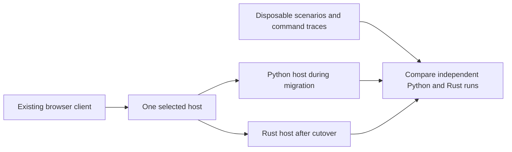

# Rust migration plan

A migration that can be completed one task at a time, with a prompt for each task.

**Status:** R01–R10 complete as experimental migration foundations; all three R11
code slices are implemented at the experimental model boundary. R12 slices 1–2 add
experimental building commands, construction and offline reload; linked groups
and upgrades remain open.
Integrated W2/W3 movement/accounting acceptance remains open. R08 spatial
rules and founder movement is complete as an experimental private-copy foundation. R07 includes saved-first terrain versions 1–7,
nonchunked maps, authored starter/town sites, ordinary/swamp metadata and overlays,
post-overlay water repair, private authoritative chunk lifecycle/resource renewal,
and exact Python integer/float clock arithmetic. See the [completion audit](#r07-slice-3civ-exact-clocks-and-completion-audit).
Python remains the playable default. Rust's transport smoke and read-only copy
inspection CLIs do not load playable gameplay. Platform libm compatibility remains
an R23 release gate, real persistence remains R19, and public wire integration is later work.
**Initial plan revision:** `445ddddd675a87eb7adb50442b2dbf3c14ea6c6f`.
**R01 audit revision:** `935db7b95885c101c62dfd6bf9e16f39b6a7a8fe`.
**Scope:** replace the Python host first. Keep the browser playable during that
work. Shared WebAssembly code and a full Rust client are separate later decisions.
This is a proposed implementation sequence, not approval to execute every stage.

## How to use this plan

1. Paste the prompt for the first unfinished stage into Codex.
2. Complete that stage, its checks, documentation, and local Git commit.
3. Record its commit and evidence in the progress table below.
4. Play or review its checkpoint before starting the next stage.

Each prompt authorizes only its named stage. Read this document and `AGENTS.md`
again in each task. Repository state takes precedence over this initial inventory.
Ask about material product or compatibility choices; decide routine internal
details from the code. Use one agent unless the user explicitly requests more.

Large stages contain numbered slices. Complete one slice per prompt invocation
when it is independently testable; record the remaining slices and leave the stage
in progress. A partial implementation must remain behind its experimental boundary.
Do not claim an entire stage is finished because its first slice works.

## Intended migration boundary

**Proposed:** a standalone Rust host, developed alongside the Python host.

- Python remains the normal launch path until the cutover stage passes.
- Early Rust work runs unit tests and disposable scenarios offline.
- An experimental Rust host serves disposable worlds after its HTTP stage.
- Each running world has exactly one authoritative host and one save writer.
- Replay comparisons run independent world copies; they never mutate a live world.
- Keep HTTP and JSON compatible initially. A Rust implementation does not require
  replacing the renderer, introducing WebSockets, or changing balance values.
- Keep the Python implementation available through the rollback period. Normal
  Rust gameplay must no longer need Python after the host migration is complete.

This avoids introducing a permanent Python/Rust subprocess bridge for every
simulation operation. The Python game stays playable while Rust gains features;
the Rust version is not advertised as feature-complete until its coverage is proven.



## Current code to account for

The inspected project has about 8,500 Python host lines, 7,300 browser JavaScript
lines, and 22,000 Python/JavaScript test lines. These indicate scope, not estimates
of Rust output size or delivery time.

| Responsibility | Existing implementation | Important migration constraints |
| --- | --- | --- |
| Commands, host loop, HTTP, world management | `server/server.py` | Authentication, ownership, errors, construction, command ordering, shutdown saves |
| Routes and spatial rules | `server/navigation.py`, `server/spatial.py`, `server/barns.py` | Weighted roads, corners, footprints, fences, bounded searches |
| Worker travel and confirmed playback | `server/work_cycles.py` | Continuous position, phases, water, boats, cargo, work completion |
| Production and transport | `server/logistics.py`, `server/progression.py`, `server/resource_activity.py` | Reservations, capacities, exact-once transfers, recipes, practice, accounting |
| Farms and orchards | `server/farming.py`, `server/orchards.py` | Acre claims, crop passes, watering, harvest cargo, yield limits |
| Terrain and shared worlds | `server/terrain.py`, `server/terrain_regions.py`, `server/chunk_world.py`, `server/shared_world.py` | Existing generator versions, unloaded chunks, town separation, resource regrowth |
| Residents and progression | `server/server.py`, `server/progression.py`, `server/equipment.py` | Housing, arrivals/departures, names, talents, skills, tools, hall unlocks |
| Animals, horses, and local villages | `server/barns.py`, `server/horses.py`, `server/npcs.py`, `server/villages.py`, `server/swamp_village.py`, `server/village_life.py`, `server/trading.py` | Growth, butchery, boat crews, riding, saved routines, gifts and trade |
| Adventures | `server/quests.py`, `server/lanterns.py` | Separate clocks, participants, hazards, rewards, reconnect behavior |
| Player credentials | `server/player_login.py`, HTTP handler | Existing PIN hashes, private tokens, provisioning, host-only world operations |
| Browser presentation | `web/app.js`, `web/animations.js`, `web/scene.js`, `web/quarry.js`, `web/lanterns.js` | Founder prediction, worker playback, terrain loading, panels, overview, animations |
| Verification | `tests/`, `tools/check.py`, `tools/test_selection.py`, performance harnesses | Existing tests are valuable but currently assume Python/JavaScript implementations |

This inventory is not a complete command specification. Stage R01 must enumerate
every endpoint and action, including delegated NPC, trade, equipment, horse, and
adventure commands. Tests and current code are authoritative over older prose.

## Architecture choices to settle early

Stage R01 records decisions and reasons in this document or a linked decision file.
Defaults below are proposals; changes must name the consequence and acceptance test.

| Choice | Proposed default | Evidence needed |
| --- | --- | --- |
| Project layout | Cargo workspace under `rust/`; start with `lantern-core` and `lantern-host` | Core tests run without HTTP, a filesystem, or wall-clock access |
| State ownership | One simulation owner applies commands and results in a defined order | No double application, stale worker result, or concurrent authoritative mutation |
| IDs | Persistent world/town/entity IDs; coordinates are locations, indexes are boundary adapters | Relocation and list reordering preserve identities and references |
| Worker state | Position and carried inventory survive task, route, and animation changes | Move/reassign/block/reload traces preserve continuity and accounting |
| Core clock | Explicit elapsed simulation time supplied by the host | Different legal time subdivisions preserve documented production rates |
| Scheduling | Service commands and navigation independently of three-second production batches | Bounded route waiting and command latency under measured load |
| Rendering | Browser consumes confirmed state; founder prediction remains derived | Client playback cannot award goods or mutate saved state |
| Persistence | Versioned DTOs and explicit conversion, separate from in-memory structures | Imported saves preserve all covered features; unknown data is preserved or rejected explicitly |
| Randomness | Explicit, versioned random streams and stable iteration order | Repeatable traces and unchanged old-world generation |
| Parallel work | Begin with a deterministic single-owner core; add workers only with evidence | A parallel result identifies the request generation and relevant navigation versions |
| Gameplay balance | Preserve documented rates, costs, access, and unlocks | Differences are separately approved behavior changes, not accidental migration changes |

Use separate simulation, navigation, persistence, and API revision counters where
their meanings differ. A whole-world revision on every production change would
invalidate useful route results again. A returned route may remain acceptable after
unrelated world edits if its request and navigation dependencies are still current.

### Libraries

Use libraries for standard infrastructure. Recheck current releases, supported
Rust versions, platform support, licenses, and relevant APIs when adopting them.
Commit the application workspace's `Cargo.lock`; do not pin speculative versions
in this planning document.

| Area | Candidate | Boundary |
| --- | --- | --- |
| HTTP and asynchronous I/O | Axum and Tokio | Keep async/network types out of simulation rules |
| JSON and save DTOs | Serde and serde_json | Serialization does not automatically provide migrations or private-field filtering |
| Basic search | `pathfinding` | Evaluate road costs, determinism, allocations, cancellation, and resumability before adopting |
| Stable storage handles | Standard typed IDs first; evaluate a generational arena if useful | Internal handles must not replace persistent public IDs accidentally |
| Testing | Rust test framework; add property-testing tools where they verify useful invariants | Preserve end-to-end scenarios and independent search/accounting oracles |
| Full Rust client | Evaluate Bevy only at R25 | A renderer/engine decision is separate from the host migration |

The `pathfinding` crate's ordinary `astar` API returns a completed answer. Do not
assume it can pause after a fixed number of expansions. If our measured scheduling
needs require resumable search, use an appropriate library API or keep a small,
isolated incremental solver. Test it against an independent reference algorithm.
The crate's network-flow algorithms are not a ready-made game flow-field system.

## Validation and comparison rules

Every implementation prompt includes these requirements by reference:

- Inspect Git status and relevant code before editing. Preserve unrelated work.
- Add meaningful tests for the migrated contracts and observed failure cases.
- During development, run the targeted failing checks. Validate the affected set
  once after the logical task is complete, following `AGENTS.md`.
- R04 must extend the affected-check runner to understand Cargo before Rust code
  grows. Until then, do not assume `python3 tools/check.py` validates Rust.
- Run formatting and relevant Rust tests/lints for affected crates after R04.
  Keep test output and selection reasons reviewable. Missing tools are blockers
  for the relevant checks, not passes.
- For performance investigation or optimization, record the starting commit before
  edits. Run the required comparison after correctness, without repeating it.
- The existing performance harness imports Python directly. R03/R04 must identify
  this limitation; R23 must support both hosts before claiming Rust-host gains.
  Running the old Python benchmark on a Rust revision does not measure Rust.
- Compare release builds on the same machine and workload. Include warm/cold
  caches, obstacle changes, simultaneous orders, unreachable goals, multiple towns,
  increasing worker counts, and save/HTTP contention.
- Report route queue delay and time until movement starts in milliseconds and
  simulation time, not just CPU time per search or eventual completion.
- Include p50/p95/p99, maximum waits, restarts, queue size, expanded nodes, cache
  reuse, memory, snapshot size, command response, and save duration where applicable.
- Read per-scenario results and absolute budgets. Interrupted, missing, or noisy
  measurements remain inconclusive. Never relax thresholds to make a port pass.
- Review the diff, update the progress table and related roadmap status, stage
  task files explicitly, commit the completed logical task, and verify Git status.

### Behavior comparison

Exact equality is appropriate for IDs, counts, resource ownership, command results,
and rewards. Define field-specific numeric tolerances for positions and fractional
quantities before comparison. Do not blanket-ignore floats, worker states, timers,
or large parts of snapshots. Different optimal routes may be acceptable only when
access, travel cost, arrival, and deterministic tie-breaking contracts allow them.

Inject recorded random draws or reproduce the agreed random algorithm for paired
simulations. Rust's default random generator is not interchangeable with Python's
`random.Random`. Terrain compatibility includes Python's seed conversion, sampling,
ordering, and floating-point behavior, not merely the generator's name.

### Proposed responsiveness targets

R01 must select reference hardware, workloads, and acceptance budgets; these are
starting targets, not measurements or implemented guarantees.

| Scenario | Proposed target |
| --- | --- |
| Command acknowledgement under the agreed four-town workload | Host response p95 below 100 ms; p99 below 250 ms |
| Ordinary reachable local route on the agreed workload | Route available on host p95 below 250 ms; p99 below 1 second |
| Recoverable blocked route | Resume promptly after access returns; measure and set the maximum recovery delay |
| Backlog and saturation | No indefinitely starved actor; explicit bounded memory and a measured maximum wait |
| Browser frame work | Retain the existing 8 ms p95 benchmark budget |
| Visible route reaction | Measure end to end; existing two-second snapshot polling cannot promise subsecond updates |

Unreachable destinations need a bounded response or an explicit continuing search
status. Large detours need their own documented budgets; do not hide them in a
local-route percentile. New budgets need a rationale and fixture, not an unmeasured
promise that all worlds finish every search within a fixed small deadline.

## Saves and rollback

- R01 defines the support matrix for legacy saves and terrain versions. Current
  local credentials, saves, and player provisioning files must not become fixtures.
- Fixture worlds and credentials are synthetic. Keep tokens/PIN hashes out of
  public snapshots, logs, benchmark reports, and committed real-world data.
- Python and experimental Rust use separate data roots and ports. Rust initially
  refuses the normal Python save directory.
- Backup/import includes the world registry, active-world selection, credentials,
  every world's chunk directory, and optional private player provisioning.
- Conversion writes a new destination atomically and leaves the source unchanged.
  Do not run Python load migrations merely to read the user's production save.
- Until cutover, rollback means stop Rust and start Python on its untouched data.
- After Rust accepts new play, switching to an old backup loses that new progress.
  Preserving it requires a tested reverse export for the supported schema.
- At R24, explicitly choose reverse-export support or a one-way conversion with
  that rollback limitation. Do not describe an old backup as lossless rollback.
- Derived caches/frontiers rebuild after reload. Stable position, cargo, task,
  trip progress, and required random-stream state must persist.

## Progress and dependencies

All implementation stages start as **Not started**. Fill commit/evidence cells
only after work is performed. Keep unfinished stages visible in the roadmap.

| Stage | Task | Requires | Status / commit / evidence |
| --- | --- | --- | --- |
| R01 | Contracts, coverage inventory, decisions | This plan | Complete; [contracts and evidence](RUST_CONTRACTS.md), audited at `935db7b`; commit: `docs: define R01 migration contracts` (this change) |
| R02 | Fix current relocation continuity | R01 | Complete; `fix: preserve worker continuity when relocating workplaces` (this change); evidence below |
| R03 | Replay fixtures and comparison oracle | R02 | Complete: slice 1 `9637eb5`; slice 2 `049fe10`; slice 3 `test: add backend-neutral replay comparison reports` (this change); [protocol and evidence](REPLAY_BACKENDS.md) |
| R04 | Cargo workspace and applicable checks | R03 | Complete: slice 1 `732619a`; slice 2 `c7cf3e2`; slice 3 `feat: add Rust replay transport smoke CLI` (this change); evidence below |
| R05 | Typed state, IDs, units, and boundary DTOs | R04 | Complete: slice 1 `f271ff4`; slice 2 `b5fa931`; slice 3 `508b396`; [boundary/coverage audit](RUST_STATE_DTOS.md), evidence below |
| R06 | Legacy import and read-only save inspection | R05 | Complete: slice 1 `3312d5d`; slice 2 `4513bec`; slice 3 `041caee`; [staging scope/coverage](RUST_LEGACY_IMPORT.md), evidence below |
| R07 | Terrain versions and chunk generation | R06 | Complete as private terrain/chunk foundation; [scope, slice evidence and completion audit](RUST_TERRAIN.md); exact clocks finish 3c.iv; finite platform-math vectors retain the R23 release gate |
| R08 | Spatial rules and founder movement | R07 | Complete as experimental geometry/movement foundation; slices 1–3 and boundary audit below; Python remains default |
| R09 | Search algorithms and library decision | R08 | Complete at experimental core boundary: library/custom decision, bounded no_std backend and actual Python route/access/cost parity; [evaluation/evidence](RUST_SEARCH_EVALUATION.md) |
| R10 | Request scheduler and cache invalidation | R09 | Complete as experimental navigation foundation; slices 1–3 and completion audit below; integrated W1–W6 acceptance retained in R11/R19–R23 |
| R11 | Persistent worker movement and playback | R10 | Slices 1–3 implemented at experimental model boundary; integrated W2/W3 movement/accounting acceptance remains open |
| R12 | Construction and building operations | R11 | Slices 1–2 implemented at explicit synthetic-model boundary; slice 3 upgrades/linked groups/helpers, gameplay accounting and durable integration remain open; evidence below |
| R13 | Resource ledger, storage, and progression rules | R12 | Not started |
| R14 | Hauling, delivery, and merchant trips | R13 | Not started |
| R15 | Gathering and processing professions | R14 | Not started |
| R16 | Farming and orchards | R15 | Not started |
| R17 | Fishing, boats, animals, and horses | R16 | Not started |
| R18 | Residents, villages, trade, and adventures | R17 | Not started |
| R19 | Durable Rust saves and recovery | R18 | Not started |
| R20 | HTTP, accounts, and world lifecycle | R19 | Not started |
| R21 | Browser compatibility and playable Rust checkpoint | R20 | Not started |
| R22 | Shared-destination routing | R21 | Not started |
| R23 | Cross-host benchmarks and release readiness | R22, or documented deferral | Not started |
| R24 | Default-host cutover and Python retirement | R23 | Not started |
| R25 | Decide Rust browser/client scope | R24 | Not started; optional |
| R26 | Share selected core rules through WebAssembly | R25 | Not started; optional |
| R27 | Full Rust client prototype and staged replacement | R25; R26 if useful | Not started; optional |

R01-R03 establish trustworthy behavior. R04-R11 establish the Rust core.
R12-R18 cover gameplay. R19-R21 make a complete disposable Rust game playable.
R22-R24 deliver shared routing, measured readiness, and the host transition.
R25-R27 cover a separate client project. Stopping after any completed stage leaves
the existing Python launch available until the explicit cutover.

## R01 — Contracts and decisions

Completed documentation: [migration contracts, coverage, compatibility and decisions](RUST_CONTRACTS.md).
All Rust features remain unported. Recommendations do not approve behavior changes.

**Deliver:** an endpoint/action coverage matrix, save-version matrix, feature/test
mapping, and short architecture decisions. Mark every feature as unported,
implemented, verified, or intentionally deferred. A deferred existing feature blocks
default-host cutover unless the user explicitly accepts its removal.

**Inspect:** `server/server.py`, all delegated command modules, `docs/PATHING.md`,
`docs/BACKEND.md`, existing tests, and the save/chunk implementation.

**Decide:** persistent IDs, quantity/position/time representation, randomness,
supported terrain versions, client compatibility, dependency/toolchain policy,
latency workloads, and save rollback policy. Preserve LAN ownership and account
behavior. Separate game behavior from known bugs; document intentional differences.

**Done when:** no endpoint, command family, saved subsystem, or browser-required
catalog is absent from the matrix. Proposed choices have reasons and testable
consequences. This is a documentation stage; do not start the port.

```text
Read AGENTS.md and docs/RUST_MIGRATION.md. Execute only R01: inspect the current
repository and create the migration contracts, complete endpoint/action/feature
coverage matrix, compatibility matrix, and architecture decisions described there.
Keep recommendations distinct from user-approved behavior. Ask only about material
choices that code and existing requirements cannot resolve. Do not implement Rust.
Validate the documents, update progress and roadmap, and commit this stage.
```

## R02 — Fix relocation continuity in the current game

**Completed:** the original move command deleted the saved animation and orphaned
carried output. Regression tests reproduced both failures at starting revision
`536d3d77507577a3e58bcf9dacadd66ba5601af2`. Relocation now retargets coordinate
references, preserves position/cargo/work at unchanged sources and filled cans,
and replaces obsolete routes. Confirmed browser playback drops obsolete relocation
history without resetting the visible pose. No Rust implementation was added.

Coverage: `tests/test_relocation.py`, `tests/test_path_retention.js`, and
`tests/test_villager_playback.js` exercise moving workers, carried output through
JSON save/reload and migration, a picked-up delivery, unaffected work, linked acres,
filled cans, removed sources/workplaces, and resized browser destinations.
The [pathing reference](PATHING.md#revalidate-or-recover-when-needed) records the
intentional exact-once logistics cancellation and demolition salvage rules. The new
browser playback regression also fails against the starting revision: its obsolete
return remains queued after relocation.

Correctness evidence: the affected runner selected 169 files/cases
(`performance-results/20261016-012045/report.md`). Final targeted checks cover the
new relocation cases and updated cargo expectations; routing, farming, boat,
storage, and playback checks pass. Local-socket/Chromium restrictions required
rerunning the HTTP and pointer checks with sandbox escalation; pointer selection
and 22 of 23 HTTP cases pass. Three unrelated failures were reproduced at the
starting revision and remain unchanged: workshop capacity expects 65 instead of
90 (`test_logistics`), `test_hall_refresh.js` lacks a DOM element, and the chunk
HTTP snapshot is 20,474 bytes against a 20,000-byte assertion. Final targeted
reports: `20261016-012204`, `20261016-012424`, `20261016-012430`, and
`20261016-012544` under `performance-results/` (ignored local artifacts).

Required performance comparison: **inconclusive**. Command:
`python3 tools/check.py --performance-only --baseline 536d3d77507577a3e58bcf9dacadd66ba5601af2 --output performance-results/r02-performance`
(sandbox escalation for local HTTP/Chromium). Baseline is the starting revision;
candidate is that revision plus this change's uncommitted R02 runtime diff, SHA-256
`c01c89c7fec6a3de069679028c53f29f40b64bef170343141f52bd5436bbed9b`.
Hardware/environment: Apple M1 Max, macOS arm64, Python 3.9.6, Node 26.11.1,
headless Chromium 149.0.7827.55, 1280×800 at DPR 1. Both sides' first browser and
host runs passed every scenario check. Maximum scenario frame-work p95 was
4.7 ms baseline / 5.4 ms candidate, below the 8 ms absolute budget in this single
pair. The second candidate browser process could not load Homebrew's
`libsimdutf.36.dylib`; its host scenarios still passed. The five-pair run stopped,
so no aggregate comparison or performance pass is claimed. Read Markdown/JSON and
per-scenario artifacts in `performance-results/r02-performance/`. The earlier
sandboxed attempt (`20261016-012324`) was also inconclusive due to denied sockets.
No thresholds, baselines, or machine dependencies were changed.

**Deliver:** a focused Python/browser fix so migration does not leave the reported
bug in everyday play. A moved workplace may require a new route, but must retain
the worker's position and apply existing cargo and reservation rules exactly once.

**Inspect:** the `move` branch in `server/server.py`, `starting_position` and task
changes in `server/work_cycles.py`, cancellation in `server/logistics.py`, and
browser replanning/playback. Check linked acres, footprint changes, and removed
destinations. Do not generalize this into the Rust architecture prematurely.

**Done when:** tests cover a moving worker, carried output, an active delivery,
relocation followed by save/reload, and an unaffected worker. Any intentional cargo
salvage behavior is explicit. Worker position does not fall back to the hall.
Run applicable correctness and the required pathing performance comparison.

```text
Read AGENTS.md and docs/RUST_MIGRATION.md. Execute only R02. Reproduce the workplace
relocation reset in the current Python/browser game, then preserve worker position
and valid task/cargo progress while replacing obsolete routes. Follow the stage's
cases and existing cancellation semantics. Record the starting revision, validate
the affected tests and required performance comparison, review the diff, update
progress and pathing documentation, and commit the completed fix.
```

## R03 — Replay fixtures and an independent comparison oracle

**Slices:** (1) define trace format and normalization; (2) record representative
Python traces; (3) implement a backend-neutral comparison interface.

**Slice 1 evidence:** [Replay contract v1](REPLAY_CONTRACT.md), pure comparison and
format-validation primitives in `tools/replay_contract.py`, and the fabricated
`tests/replay/contract_v1.json` format example. Source inspected at
`191daecd2e2cd67f80e124cc65a477911279746b`; the example is explicitly not a recorded
Python baseline. Tests reject corrupt cargo, ownership, positions and rewards,
including a shared reference/candidate cargo bug. Field-specific absolute numeric
tolerances, exact large integers, ordered arrays, null/missing distinctions,
nonnegative stock, and private/nonfinite data checks are covered. No private saves
were read, and no gameplay code changed. Rust and Rust-host benchmarks do not exist;
the CLI reports this explicitly. The existing host benchmark imports Python.

Validation: `python3 tools/check.py` selects only `tests/test_replay_contract.py`
through its module/JSON dependencies; all 12 cases pass. Markdown/JSON reports:
`performance-results/20261016-013120/report.{md,json}` (ignored local artifacts).
Performance checks were not run: this defines new tooling contracts, with no performance
investigation or optimization. The slice 2 evidence below supersedes the earlier
remaining-work status; all three R03 slices are now complete.

**Slice 2 evidence:** [Python replay recipes and evidence](PYTHON_REPLAYS.md),
`tools/python_replay.py`, five recorded JSON fixtures under `tests/replay/python/`,
and `tests/test_python_replay.py`. Baselines were produced from clean Python game
sources at `9637eb5bf982fa2342556feaa4059fcb3f0d4b17`. All five scenarios replay
twice in independent fresh worlds; recording is separately reproducible. They
cover relocation, unreachable delivery/recovery, mid-trip and partial-work reload,
physical cargo conservation, workshop FIFO/invalid requests, food stock accounting,
and a three-town real-terrain quarry scenario with exact-once participant rewards
and an unrewarded spectator. Corrupted cargo/ownership/position/rewards fail with
trace/step/field context. Missing/extra/changed random draws fail. Private saves
were not accessed, and gameplay code is unchanged. Time, reload and projection
limitations are explicit in the evidence. Slice 3 below completes the
backend-neutral replay interface and paired reporting; Rust and Rust-host
benchmarks remain unavailable. This is not HTTP/import/performance acceptance.

Slice 2 validation: `python3 tools/check.py` selected two tooling test modules; all
25 cases pass. Reports: `performance-results/20261016-013951/report.{md,json}`
(ignored local artifacts). Standalone CLI replayed all five traces twice, 61 steps
per pass. Performance checks were not run because this adds semantic replay
coverage, with no performance investigation or optimization. Environment and
measurement limitations are recorded in the linked evidence.

**Slice 3 evidence:** [Protocol v1 and paired reporting](REPLAY_BACKENDS.md),
`tools/replay.py`, the `PythonBackend` adapter in `tools/python_replay.py`, and
`tests/test_replay.py`. Adapters receive no expected observations, invariants or
tolerances. Each run is compared to the recorded baseline and the independent
other run; shape/count/identity validation rejects incomplete results. Existing
Python replay uses the same interface, and recording still reproduces the unchanged
baselines. Synthetic test adapters demonstrate protocol failures, corrupted cargo,
ownership, positions and rewards, and shared bugs rejected by independent invariants.
Rust is explicitly unavailable; missing candidates produce inconclusive comparisons,
not passes. Python/Python is identified as repeatability evidence only. JSON and
Markdown reports retain trace/step/field failures and baseline/runner revisions.
No private save data was used, no gameplay code changed, and no golden was refreshed.
All three R03 slices are complete. Remaining Rust implementation, transport/CLI,
full migration coverage, and release performance acceptance belong to later stages.

Slice 3 validation: `python3 tools/check.py` selected three tooling modules; all
38 cases pass. Reports: `performance-results/20261016-014504/report.{md,json}`
(ignored local artifacts). CLI JSON/Markdown evidence:
`performance-results/r03-slice3-python/` passes all five Python/Python traces;
`performance-results/r03-slice3-rust/` reports Python baselines passing and Rust
unavailable, all paired comparisons inconclusive, exit 2. Both reports identify
runner `049fe101d3a11ffec7d999682dc6e477ce3f83ec` plus the uncommitted slice 3 diff;
fixtures retain producing revision `9637eb5bf982fa2342556feaa4059fcb3f0d4b17`.
Performance checks were not run: this is semantic tooling work, not a performance
investigation or optimization. No Rust or Rust-host measurement is claimed.

**Deliver:** small synthetic scenarios containing initial state, explicit time
advances, commands, controlled random inputs, expected public results, and selected
authoritative state. Preserve realistic terrain generation in terrain scenarios.

Include relocation, blocked/unreachable travel, reload mid-trip, cargo transfers,
workshop queues, food/stock accounting, multiple towns, and an adventure. Record
the Python revision that produced each baseline. The Rust adapter arrives later.
Compare relevant invariants as well as snapshots; existing Python bugs are not
automatically requirements. Keep intentional differences narrow and explained.

**Done when:** traces replay repeatably on Python; deliberately corrupting cargo,
ownership, position, or rewards causes a useful failure. No private save data is
used. The harness clearly reports that Rust and Rust-host benchmarks do not exist yet.

```text
Read AGENTS.md and docs/RUST_MIGRATION.md. Execute the first unfinished slice of
R03 only. Build disposable deterministic replay fixtures and a backend-neutral
comparison contract using the current Python game as a recorded reference. Compare
field-specific values and invariants; do not broadly normalize away differences.
Control randomness and time, protect private save data, and test comparator failures.
Validate applicable tooling tests, record evidence and remaining slices, and commit.
```

## R04 — Rust workspace and applicable checks

**Slices:** (1) toolchain/workspace; (2) check-runner support; (3) Rust replay CLI.

**Deliver:** a minimal `rust/` workspace with core and host packages, pinned
toolchain policy, committed lockfile, ignored build output, and documented commands.
The core must compile and test without creating a network listener.

Extend selection/reporting to run affected Rust packages and reverse dependencies,
including changed manifests and shared fixtures. Preserve existing Python/JS
selection behavior and explicitly detect removed sources. Cover selection with
tests. Connect a small fixture to a Rust CLI without pretending gameplay is ported.
Do not add a game engine, ECS, database, or concurrency framework speculatively.

**Done when:** Rust checks appear in the unified report; failed or missing Rust
commands cannot produce a pass. The existing Python launch remains unchanged.

```text
Read AGENTS.md and docs/RUST_MIGRATION.md. Execute the first unfinished slice of
R04 only. Establish the minimal Rust workspace and extend the repository's affected
check workflow as specified. Keep the simulation core independent of networking.
Use current official library/toolchain documentation, commit Cargo.lock, and keep
build artifacts out of Git. Test selection and failure reporting. Update setup,
progress, and roadmap documentation, validate the affected set, and commit.
```

### R04 slice 1 evidence and remaining work

The dependency-free workspace now contains an empty `no_std` `lantern-core` and
a placeholder `lantern-host` executable with a path dependency on core. No rules,
listener, filesystem access, time source, replay support, or gameplay port were
added. The normal Python launcher is unchanged. Rust 1.99.0 is pinned with
rustfmt/Clippy; Cargo.lock is committed and `rust/target/` is ignored. See the
[setup and toolchain upgrade policy](../README.md#experimental-rust-workspace)
for commands and current official Cargo/rustup references.

Validation passed with installed Homebrew Rust/Cargo 1.99.0 (rustup is unavailable):
offline locked workspace check, formatting, tests, Clippy with warnings denied,
and placeholder execution. Core unit/doc harnesses currently contain zero tests:
there are no gameplay behaviors to exercise. The library compiles independently
with `cargo test -p lantern-core --locked --offline` without networking.
The affected Python/JS runner selected zero tests and reported `not_run`;
`performance-results/r04-slice1/report.md` and `report.json` were inspected. This
report is not Rust validation. Build output was confirmed ignored by Git.
No performance comparison is needed for workspace scaffolding;
the existing harness still does not measure Rust.

Slice 1 was committed as `732619a`. The check-runner limitation above describes
that revision and is superseded by slice 2.

### R04 slice 2 evidence and remaining work

The affected-check runner now reads offline locked Cargo metadata to select
package changes and transitive reverse path dependencies, including renamed,
dev/build, optional, and target-specific declarations. Workspace config, lockfile,
toolchain, runner changes, and unmapped Rust inputs conservatively select all
members. Shared fixture directories and literal Rust include/path references are
covered; Git rename detection is disabled to retain removed and added paths.
Removed files are explicitly labeled in selection reasons. Existing Python/JS
selection remains in place, including shared fixture consumers and explicit cases.

Selected packages run formatting, locked offline tests, and all-target Clippy
with warnings denied from `rust/`. Metadata errors become a failing selection
entry; missing commands, timeouts, and nonzero exits cannot produce a passing
report. JSON and Markdown expose selection reasons, command results, and logs;
JSON also records command arguments, exit codes, and durations. Explicit
`--tests rust:lantern-core`, Rust globs, and `--all` are supported. See the
[setup documentation](../README.md#experimental-rust-workspace) for commands,
fixture placement rules, and official Cargo/Clippy references.

Validation: targeted tooling tests cover package/reverse dependency selection,
manifest/config/fixture changes, removed and renamed paths, metadata failures,
missing Cargo, each failed Rust command, report status/exit codes, explicit/full
selection, and preservation of Python/JS selection. Final affected validation
(`python3 tools/check.py --output performance-results/r04-slice2`) passed all
37 Python cases across three tooling modules and six Cargo commands covering both
packages. The JSON and Markdown reports were inspected; overall status is `pass`
and performance is `not_run`. No performance comparison is needed: this is check-runner
functionality, not a performance investigation; Python-host benchmarks still
cannot measure Rust. The Python launcher and core scaffold are unchanged.

Slice 2 was committed as `c7cf3e2`. Its remaining-work status is superseded by
slice 3 below.

### R04 slice 3 evidence and completion

`lantern-host replay` now accepts a single protocol v1 request on stdin and emits
a validated response on stdout. The small committed transport smoke request uses
seed 0, flat terrain, no draws, and zero-time movement advances. Output explicitly
says `gameplay_ported: false`. It is not a recorded Python baseline and establishes
no gameplay parity. The host alone adds Serde 1.0.229/serde_json 1.0.151, checked
against current official documentation and cached crate MSRV/license metadata;
Cargo.lock includes all transitive dependencies. Core remains dependency-free,
`no_std`, and independent of networking, filesystem, wall-clock, and Python.

The neutral adapter invokes fixed locked/offline Cargo in `rust/`, validates both
sides of the envelope, and never receives expectations or substitutes Python.
Unsupported recipes/time/commands/reload/random draws return exit 2 and produce
inconclusive gameplay comparisons. Invalid requests, missing commands, build/runtime
failures, timeouts, and malformed responses fail. Normal Python launch and all
recorded gameplay baselines remain unchanged. See the
[transport protocol and commands](REPLAY_BACKENDS.md#rust-transport-smoke-r04-slice-3).

Final affected validation: `python3 tools/check.py --output performance-results/r04-slice3`
passed 43 Python cases across four replay modules and all six Cargo commands
(format/test/Clippy for both packages). The host runs three unit and three real CLI
integration tests; the core's empty harness still runs without networking. The
standalone smoke invocation passed. JSON and Markdown correctness reports were
inspected and report `pass` with performance `not_run`.

`python3 tools/replay.py --output performance-results/r04-slice3-gameplay` exited 2:
all five Python references pass their unchanged baselines, and every Rust gameplay
candidate is unsupported with an inconclusive comparison. Both report formats were
inspected. Runner revision is `c7cf3e2bdcb1ad055a161c4f7c89826201b208aa` plus this
slice's uncommitted changes; recorded baseline revision is still
`9637eb5bf982fa2342556feaa4059fcb3f0d4b17`. These are semantic checks, not performance
measurements. No performance comparison is needed for protocol scaffolding; the
current harness measures Python and browser code only. All three R04 slices are
complete; typed state and gameplay remain in R05 and later stages.

## R05 — Typed state, IDs, units, and DTOs

**Slices:** (1) IDs and primitive units; (2) actor/building/task model;
(3) public/save DTO conversion and feature coverage.

**Deliver:** stable persisted identities, explicit world/town ownership, independent
actor position and cargo, and typed task/route states. Decide fractional quantity
and movement precision without silently rounding existing stock or changing rates.
Stable ID allocation must survive reload and avoid collisions across imported towns.

Keep protocol/save DTOs separate from internal structures. Existing browser indexes
may be adapted at the boundary, but do not trust an obsolete index after a command
queue delay; define rejection or ID/revision validation for that case.

**Done when:** moves/reorders/reloads preserve references, invalid foreign IDs are
rejected, and public DTOs cannot serialize private credentials or derived search data.

```text
Read AGENTS.md and docs/RUST_MIGRATION.md. Execute the first unfinished slice of
R05 only, following the R01 decisions. Introduce typed persistent IDs and units,
independent actor position/cargo, explicit task/route states, and separate boundary
DTOs. Preserve existing fractional quantities and client contracts. Test identity,
ownership, stale-reference handling, and private-field exclusion. Run applicable
checks, update coverage and progress, and commit the completed slice.
```

### R05 slice 1 evidence and remaining work

`lantern-core` now provides distinct world/town keys and typed building, actor,
animal and NPC IDs. Existing opaque keys are preserved verbatim. Each entity ID
contains world/town ownership and an exact nonzero `u64` serial. One world-wide
allocator spans all towns and entity kinds; it never reuses serials. Restore
validates every live identity across all kinds/towns against the persisted
high-water mark, rejecting duplicate serials, foreign worlds and stale counters.
Exhaustion fails without wrapping. The high-water mark must persist even after
deleting the highest ID. R06 import must allocate in recorded order through one
allocator, remap all references, and reject collisions rather than merge IDs.
These restoration primitives are not a save reader.

Finite binary64 wrappers distinguish quantity, work, practice, elapsed seconds
and continuous tile coordinates. Amounts/times reject negatives; coordinates
permit negatives. Construction preserves every input bit, including subnormals
and signed zero; no quantization or rates changed. Discrete tiles use `i32`
coordinates; counts and terrain seeds use exact `u64`. Internal types have no
Serde implementation. Slice 3 must provide explicit boundary conversion, encode
new serials as decimal strings without passing through JavaScript numbers, and
test terrain seed compatibility. Existing wire contracts remain unchanged.

**Queued-reference decision:** resolve a legacy index to an owned stable ID at
admission, before queuing, while validating its snapshot's collection revision.
Execute by ID and recheck ownership/existence; deletion is an error, never a
selection of the entity now occupying the old slot. If resolution occurs after
queuing, carry the snapshot collection revision and reject any mismatch before
resolving the index. Never resolve an old index against the current list without
this validation. Revisions track membership/order changes, not unrelated
production. Slice 3 must implement/test this boundary policy; R12/R20 must use it
for queued commands. No Python/browser command behavior changed.

`rust/crates/lantern-core/tests/primitives.rs` covers allocation across imported
town scopes/kinds, exact serials above 2^53, exhaustion, restored/deleted IDs,
foreign ownership, duplicate/stale restore data, bit-preserving fractional units
and nonfinite rejection. A synthetic collection test moves/reorders/removes
entries and reconstructs an ID to check references independently of list slots;
it does not claim real actor/building/save integration. Compile-fail doc tests
check actor/building and quantity/time type separation.

Validation passed (6/6 commands), recorded in the inspected Markdown/JSON reports
at `performance-results/r05-slice1/`: core and reverse-dependent host formatting,
tests and Clippy with warnings denied. Core has eight integration tests and two
compile-fail doc tests; the six existing host tests also pass. Performance
comparison was not run for offline primitives with no performance investigation
or optimization.

**Remaining at slice 1:** slice 2 must add the actor/building model with independent
position/cargo and typed task/route states. Slice 3 must add public/save DTOs,
roundtrip and private-credential/derived-search exclusion tests, actual index
adapter rejection tests and feature coverage. Freeze D05 RNG seed derivation
with golden vectors before RNG adoption (still pending in R05). Gameplay,
legacy import, durable saves, HTTP and client integration remain unported.

### R05 slice 2 evidence and remaining work

`lantern-core::model` adds an owned town collection, building identity/location
and typed construction state, and actor state with independent continuous position
and named fractional cargo. Tasks distinguish idle, move, work, transport and
construction; work phases and transport legs persist separately from pending,
ready, arrived, unreachable, blocked and cancelled route states. Task replacement,
cancellation, route failure and workplace relocation do not clear goods or reset
actor position. No transfers, refunds or production are performed implicitly.

Town reconstruction validates world/town ownership, duplicate serials across
actor/building kinds and all task building references. Lookups and mutations use
stable IDs; reordered records keep their references. Structural building relocation
preserves task phase/elapsed work and actor facts while invalidating routes aimed
at that building. Other paths still need the later navigation dependency checks
for changed footprints/access; this is not the R12 move command or spatial rules.

Separate checked task/request generations prevent counter wrap. Route requests
capture actor identity, both generations, origin, destination/resolved goal and
the relevant navigation revision supplied by the caller. Only the matching pending
request can accept a result, once; reassignment, retry, cancellation, relocation,
position recovery or changed navigation dependencies reject stale results without
mutating facts. Pending and unreachable remain distinct; an empty completed path
is rejected in favor of the explicit arrived outcome. R09–R11 still own legal
goals, arrival policy, path validity, navigation dependencies and actual movement.

`ActorState` is an internal structure, not a DTO. Reconstruction retains its task,
position, cargo and generation counters, rebuilding derived route state as
`NotRequested`. Hosts must retire old simulation jobs before reconstruction,
especially when rolling back to an older snapshot whose counters are also older.
World loading must also validate all town identities against the one world-wide
allocator. No Serde implementation, save reader or client protocol was added.

Ten tests in `rust/crates/lantern-core/tests/model.rs` exercise fractional cargo,
reassignment/cancellation continuity, work/transport references, workplace moves,
reordered reconstruction, route/result lifecycle, stale/duplicate/cross-actor
results, foreign/missing/dangling IDs, duplicate identities and atomic generation
exhaustion. These are offline model invariants, not cross-host gameplay parity.
Applicable validation passed (6/6 commands): core and reverse-dependent host
formatting, tests and Clippy with warnings denied. All 26 tests pass (18 core
integration, two compile-fail doc tests and six host tests). Markdown/JSON reports
at `performance-results/r05-slice2/` were inspected. Performance comparison was
not run: this is model implementation, not a performance investigation/optimization.

**Remaining at slice 2:** slice 3 must implement separate public/save DTO conversion,
fractional/large-ID JSON roundtrips, private credential/derived search exclusion,
the queued-index boundary policy above and an explicit feature coverage audit.
Freeze D05 seed derivation with golden vectors before RNG adoption (still pending
in R05). Models are foundations: catalog fields, resident traits, farm claims,
boats, animals, reservations and feature-specific task payloads remain unported
and cannot be defaulted away during import. Python remains the playable host;
legacy import, durable saves, HTTP and all simulation rules remain later stages.

### R05 slice 3 evidence and remaining work

The host library now provides separate explicit model save/public DTO conversion,
strict duplicate/unknown-field rejection and sanitized path/location diagnostics.
`ModelWorld` validates ownership and all town/entity identities against the
world-wide allocator and preserves synthetic private account/token material in
save conversion. Public projection is a Serialize-only allowlist without private
credentials, allocator/generation counters, route requests, paths or search data.
Internal world/town/credential types have no Serialize implementation.

The model format is deliberately labeled `lantern-model` v1 and the public
observation `lantern-model-observation-v1`. Neither is a Python save importer,
durable store or complete browser response. Unknown gameplay fields are rejected,
never discarded into this minimal schema. Existing Python/HTTP/browser behavior
is unchanged. The [field coverage and remaining-feature audit](RUST_STATE_DTOS.md)
maps every current internal fact and assigns all R01 gameplay gaps to later stages.

All new IDs/counters/seeds use canonical decimal strings. Fractional values remain
finite binary64 without rounding/clamping. New tests exposed bit changes from the
default JSON parser and unknown-field acceptance on tagged unit variants; these
new-boundary failures were fixed with the pinned serde_json `float_roundtrip`
feature and empty struct variants. Externally tagged DTOs with `raw_value` numeric
decoding also reject integer amounts outside the exact binary64 range before
conversion. No new dependency or version/lockfile update was needed. Duplicate
goods/token/account keys cannot silently overwrite earlier data.

Indexed actor/building references now require the expected stable ID at the
observed slot. Admission validates it and the authenticated owner, then queues
only the typed ID. Execution revalidates owner/existence; a reordered collection
keeps the original target, while deletion fails. This implements R05's ID-validation
alternative to the earlier proposed collection revision, as documented in the
audit. Real HTTP/queue/browser integration remains R12/R20–21.

D05 gameplay seed-material v1 is frozen with explicit typed/length-prefixed
big-endian UTF-8 encoding and three independent Python-generated byte goldens.
The audit records reference Python MT19937 draws for future adoption. Rust seed
material tests cover type/namespace/framing/Unicode distinctions; no RNG or terrain
generation is ported or activated by this change.

Validation passed (6/6 commands, 43 tests), recorded in the inspected Markdown/JSON
reports at `performance-results/r05-slice3/`: applicable core and reverse-dependent
host formatting, tests and Clippy with warnings denied. Twelve host boundary tests
cover JSON reload/reorder/relocation, private-field exclusion, all modeled task
phases, 256 representative binary64 samples plus extremes, malformed/foreign IDs,
duplicate/stale allocation data, and before/after-queue index changes/deletion.
Two core seed-material tests and three host compile-fail serialization tests were
added. Performance comparison was not run for boundary/model correctness work;
this is not a performance investigation or optimization.

**R05 is complete as a foundation stage.** R06 must import/inspect copies with
explicit coverage of unsupported data. R07 must implement compatible RNG/terrain
semantics before using the frozen seed material. Simulation, complete feature
DTOs, durable saves and browser/HTTP integration remain unported in their named
later stages. No existing gameplay feature is marked verified or removed.

## R06 — Legacy save import and inspection

**Slices:** (1) registry/accounts/ordinary worlds; (2) chunked world references;
(3) migration validation and inspection CLI.

**Deliver:** read-only import from synthetic copies of supported Python formats,
including old single-world saves, world registries, active selection, credentials,
optional provisioning, and external chunks. Validate references and report unsupported
versions. Preserve or explicitly reject unrecognized fields; never silently discard
unported gameplay. Keep the source untouched even when import fails.

**Done when:** an inspection command reports capabilities and unsupported fields
without exposing secrets or advancing simulation. IDs and totals are stable on
repeated imports. This stage does not enable production writes or world generation.

```text
Read AGENTS.md and docs/RUST_MIGRATION.md. Execute the first unfinished slice of
R06 only. Implement read-only Rust inspection/import for the supported synthetic
Python save formats and chunk references. Preserve accounts, identities, inventories,
and unported data, or fail explicitly. Never write to a source save or print private
credentials. Validate successful and failed imports, update coverage/progress,
and commit the completed slice.
```

### R06 slice 1 evidence and remaining work

`lantern_host::legacy` imports explicit synthetic bytes or reads explicit copies
without invoking Python load/ensure/migration functions. It supports the old
`{world,tokens}` envelope, registries/active selection/inactive worlds, exact
account/token ownership and optional provisioning precedence. Independent and
shared ordinary landscapes remain preserved source records. Missing saves produce
an empty registry; malformed data, ambiguous envelopes, known future versions,
dangling account/building references and chunked inputs fail explicitly.

The result is immutable private staging, not a playable core world or the R05 model
save format. Original source/provisioning bytes retain all inventories, fractional
positions/cargo, large integers, IDs and unported fields without rounding, clock
advancement, defaults or migration. An ordered private JSON reader rejects
duplicate keys/nonfinite values without exposing raw parser messages. A separate
allowlisted report returns only counts, public world IDs, layouts and safe ordinal
preservation paths; archives and imported worlds have no Debug/Serialize.

One allocator per world assigns building/villager/founder IDs in recorded order
across towns. A sidecar overlay binds assignments and farm/orchard links to typed
owned IDs while the raw records remain unchanged. Other gameplay references and
NPC/animal identity remain preserved, not hydrated or claimed validated. All
references must be mapped before raw entities may be reordered for playable use.
The [staging audit](RUST_LEGACY_IMPORT.md) lists exact accepted schemas/version
bounds, privacy behavior and remaining coverage.

Nine integration tests use three committed synthetic fixtures and disposable
read-only copies. They cover repeated import identity, source-order/world scope,
stock/cargo preservation, credential/provisioning precedence, missing active IDs,
old/ordinary shared maps, safe reports/errors, malformed references/versions,
duplicate/nonfinite/deep JSON and unchanged source bytes/mtime/directory contents
after success and failure. A compile-fail doc test guards archive serialization.
Applicable checks passed (3/3 commands: host formatting, 31 tests and Clippy with
warnings denied). Markdown/JSON reports at `performance-results/r06-slice1/` were
inspected. Performance comparison was not run for read-only import correctness,
with no performance investigation or optimization.

**Remaining at slice 1:** slice 2 must handle external chunk references/metadata and preserve
edited chunk copies without loading/generating/catching up terrain. Slice 3 must
complete broader migration/reference validation, capability diagnostics and the
inspection CLI. No source/destination writes, production-save inspection or new
generation are enabled. Core feature hydration, terrain/RNG parity, durable
destination conversion and runtime authentication remain later stages.

### R06 slice 2 evidence and remaining work

External chunk staging now requires explicit typed per-world seed-directory copies
for every chunked world, including inactive entries. It validates Python boolean/
integer chunk flags, 40-tile chunks, 480/1920 dimensions, safe integer/string seed
namespaces, historical offset 880 and version-1 defaults, current offset 160,
optional clocks, canonical bounded keys and resource/stump ownership. Known future
versions, malformed records, mismatched/duplicate/foreign bindings, shared directory
aliases, symlinks and unexpected entries fail with sanitized schema paths.

All supplied files, including edited sleeping/evicted chunks, remain exact private
bytes with unknown data and fractional quantities intact. No Python loader,
generator, migration, repair, catch-up, simulation, source write or output creation
runs. Separate public reports expose numeric metadata/counts and sparse coverage,
never seeds, paths, raw resources or credentials. Required-key declarations detect
missing copied files; without a manifest, other absent sparse chunks remain
explicitly unverified. Details and supported shapes are in the [staging audit](RUST_LEGACY_IMPORT.md).

Nine chunk integration tests supplement the ordinary-save tests with one committed
synthetic registry and disposable generated records. They check versions 1–7,
metadata defaults, unchanged resource/stump timers, exact large/fractional lexemes,
repeatable IDs/reports despite directory argument order, ownership, all-file
preservation, missing/corrupt copies, private output and unchanged filesystem
bytes/mtime/entries on success/failure. A second compile-fail doc test prevents raw
chunk serialization. Applicable checks passed (3/3 commands: host formatting,
41 tests including doc tests, and Clippy with warnings denied). Markdown/JSON
reports at `performance-results/r06-slice2/` were inspected. Performance comparison
was not run for read-only import correctness; there is no performance investigation
or optimization.

**Remaining at slice 2:** R06 slice 3 must complete broader migration/reference validation,
capability diagnostics and the read-only inspection CLI. Sparse-copy completeness
needs an external manifest; imported raw records are not a playable world. Terrain
hydration/generation, resource/animal identities, migration effects, durable
copy-based destination writes and runtime authentication remain later stages.

### R06 slice 3 evidence and remaining work

`lantern-host inspect-copy --source FILE` now stages and inspects explicit synthetic
copies, with optional `--provision FILE`, repeated `--chunks WORLD SEED_DIRECTORY`
and caller-declared `--require-chunk WORLD X Y`. No production/default root or
sidecar discovery occurs. Success emits one allowlisted JSON report; argument,
read and validation failures emit sanitized diagnostics and a nonzero exit without
raw input, credential data, unknown names or private paths. Missing CLI sources
fail instead of using the library's empty-registry initialization behavior. Replay
transport behavior remains available and separately tested.

Reports list capabilities, preserved-only/unvalidated categories, identity counters,
reference counts, unsupported field locations and explicit known version markers.
Older migration markers are reported without running their effects; accepted
legacy terrain versions never become an implicit upgrade. Missing markers retain
unverified applicability. Unknown field diagnostics now also cover direct world
and shared-map fields, using ordinals rather than arbitrary private names. Raw
inventories, timers, construction, trip/position/cargo, NPCs, IDs and unknown data
remain exact private bytes. Typed bindings/quantities are not rewritten or inferred
from unsupported gameplay.

Additional validation checks canonical same-world trade targets and adventure
member ownership, plus nonempty/unique offer and per-building craft request IDs.
Other task, coordinate, claim and NPC/animal references are explicitly reported
as preserved/unvalidated until their feature hydration stages. The inspector does
not claim playable import, phase/accounting parity or completed migrations.

Seven integration tests add a committed synthetic migration/gameplay fixture and
end-to-end CLI coverage for both envelopes, provisioning, sparse/required chunks,
private output on success/failure, malformed inputs/arguments, future versions,
cross-world/dangling references, duplicate IDs, stable identities/counts/totals,
exact fractional/large stocks and unchanged bytes/mtime/directory contents.
Applicable checks passed (3/3 commands: host formatting, 48 tests including doc
tests, and Clippy with warnings denied). Markdown/JSON reports at
`performance-results/r06-slice3/` were inspected. Performance comparison was not
run for read-only import/inspection correctness, with no performance investigation
or optimization.

**R06 is complete as an inspection/staging foundation.** R07 starts terrain loading
and generator parity. Gameplay feature hydration and full reference bindings remain
R08–18, durable copy-based destination writes/crash recovery R19, and runtime
accounts/HTTP R20–21. Sparse completeness still requires an external key manifest.
No production writes, world generation or simulation are enabled by this stage.

## R07 — Terrain and chunks

**Slices:** (1) chunk reading/loading; (2) supported legacy generators;
(3a) Python `generate_map` and ordinary/independent/shared nonchunked terrain-only
hydration; (3b) authored starter reconstruction, new-world town-site selection and
separation, village/swamp layouts, post-overlay v7 tiny-water repair including
neighbor seams (bounded subparts: 3b.i pure authored 120×120 starter and town
sites; 3b.ii typed-seed saved-first reconstruction integration; 3b.iii village/
swamp placement/overlays and post-overlay water repair, subdivided below); (3c) authoritative
active/sleeping and dirty resource state,
bounded decoded/snapshot caches, eviction/reload, supplied simulation-time catch-up
and versioned regrowth without offline production. All slices are complete as a
private migration foundation; the audit below records scope and release limits.

**Deliver:** old generator versions produce the same terrain/resources when an old
world explores previously unloaded chunks. Include seed conversion, iteration order,
town-site selection, village placement, boundary sampling, and resource metadata.
Materializing the current camera area alone is not old-world compatibility.

Use golden chunk hashes plus boundary and resource assertions. Keep existing
generator versions reproducible; a new Rust generator requires a new version for
new worlds, with an explicit compatibility decision. Port active/sleeping chunk
behavior, cache bounds, dirty resources, and catch-up rules without offline production.

**Done when:** old-world chunk exploration, chunk unload/reload, new-world town
separation, water boundaries, and resource recovery pass. Unsupported generation
blocks cutover rather than silently changing the landscape.

```text
Read AGENTS.md and docs/RUST_MIGRATION.md. Execute the first unfinished slice of
R07 only. Port terrain/chunk behavior with versioned Python-generator compatibility,
including old seeds and unexplored chunks. Use real generation for terrain tests.
Do not substitute Rust's default RNG or change saved landscapes. Validate golden
chunks, boundaries, activation/regrowth, and new-world placement as applicable.
Update the compatibility matrix and progress, run affected checks, and commit.
```

### R07 slice 1 evidence and remaining work

`lantern_host::legacy::ChunkReader` now loads immutable decoded saved-chunk views
from explicit R06 archives, with typed tile/resource/stump reads and optional saved
clocks. A 49-record LRU bounds decoded views; eviction/reload keeps original saved
bytes. Tile reads distinguish outside-world, unloaded and saved terrain. Missing
copies explicitly refuse unported generation/starter reconstruction; no latest
version or random-generator substitution is possible. Unsupported decoded terrain
and optional resource fields fail without evicting valid views or changing sources.
The R06 inspection CLI and its preserved-only readiness remain unchanged.

Four Rust integration tests use 58 frozen **real Python-generated** records covering
versions 1–7, existing v1/v2 golden hashes, legacy dimensions, text/arbitrary-size
negative seeds, every tile/ordered resource, adjacent water, LRU overflow/reload,
edited resource quantities, exact private extensions, saved/missing clocks, stump
timers and sanitized failure paths. The fixture verifier regenerates all records
and hashes with the actual Python generator. [Reader contract and golden workflow](RUST_TERRAIN.md)
describe the distinction between saved decoding and generator compatibility.

Validation: targeted `loaded_chunks` tests pass (4/4); the real Python fixture
`generate.py --check` matches all 58 records and hashes. `tools/check.py --list`
selects only `rust:lantern-host`; the affected run passes 3/3 commands (formatting,
47 host tests plus six compile-fail doctests, and Clippy), report
`performance-results/20261016-045537/report.md`. No unknown runtime files or broader
Python/browser tests were selected. Performance checks were not run: this ports a
compatibility boundary, not a performance problem, and no runtime speedup is claimed.

**Remaining:** slice 2 must implement Python-compatible generation for unexplored
chunks and all old seeds/versions. Slice 3 must implement new-world/starter/village
placement, tiny-water repair after overlays, activation/sleeping/dirty resources,
and regrowth/catch-up. Ordinary/nonchunked hydration is still unported. The reader
is experimental, read-only and not a playable authoritative world; R07 is not complete.

### R07 slice 2 evidence and remaining work

Pure `no_std` core raw generators now match Python versions 1–7, exact formatted
seed namespaces, variable-length BLAKE2b coordinate noise, Python SHA-512/MT19937
seeding/draw order and regional/river/habitat/resource rules. CPython float floor
division is reproduced explicitly; straightforward `floor(x / scale)` changed a
real biome boundary. Raw v6/v7 generation intentionally matches. An opt-in
`ImportedWorld::raw_chunk` selects original saved bytes first and generates only
missing nonstarter raw chunks. It refuses missing authored starter terrain and
never applies overlays, supplies, catch-up, writes or snapshot mutation.

Five new generator/RNG tests compare all cells and ordered resources across 226
real Python raw records (168 new distinguishing/seed/boundary cases plus original
58), six integer/text RNG vectors through a complete twist, rejection/bit APIs,
choice/shuffle, and the frozen D05 byte-material reference draws. A sixth new
adapter test checks saved version selection, repeated deterministic generation,
world bounds, immutable archives and saved precedence inside the unported starter.
The real Python verifiers independently recheck both fixture files. Dependencies
and platform math limits are recorded in [terrain compatibility](RUST_TERRAIN.md).

Validation: both real Python fixture verifiers pass. `tools/check.py --list`
selects only `rust:lantern-core` and its dependent `rust:lantern-host`, with no
unknown runtime files. The affected run passes 6/6 commands: formatting, 20 core
and 53 host tests plus eight compile-fail doctests, and Clippy. Report:
`performance-results/20261016-065334/report.md`. An initial run caught an
explicit-auto-deref lint in the new generator; it was corrected before the passing
run. Performance checks were not run because this is a compatibility port, not a
performance investigation or optimization.

**Remaining:** slice 3 owns starter/new-world town/village placement and separation,
post-overlay tiny-water repair, activation/sleeping/dirty resources and resource
regrowth/catch-up. Slice 3 also owns ordinary/shared nonchunked terrain hydration and `generate_map`,
which remain unimplemented. Gameplay
RNG stream adoption and serialized state remain later subsystem work. Python stays
the playable default; the inspection CLI remains `preserved_only`.

### R07 slice 3a evidence and remaining work

Completed bounded terrain-only slice: pure legacy `generate_map`, explicit
nonchunked hydration for ordinary/registry and independent/shared landscapes,
world-scoped town bindings and exact private source retention. Saved ground wins;
missing/wrong-height ground regenerates deterministically with void→grass,
**without replacing or creating saved resources**. Unknown metadata, exact numeric
lexemes, quantities and stump timers remain private and unchanged. Missing
resources or reconstruction seeds fail explicitly. This is not full gameplay
`ensure_resources`/`prepare_landscapes`, a shared-world conversion, clock advance,
production, persistence or HTTP integration. Python remains the playable default.

Eight new Rust tests compare 35 real Python map goldens and six paired
`ensure_terrain` cases, independent/shared identity, all version markers,
arbitrary-size integer and distinct text seeds, saved precedence, optional fields,
source extensions/immutability and explicit invalid-input/chunked-world refusal.
The independent real Python verifier checks the frozen file without refreshing.
[Terrain compatibility](RUST_TERRAIN.md) records exact scope and supported bounds.

Validation: `generate_maps.py --check` matches all frozen records. The affected
selection contains only `rust:lantern-core` and reverse-dependent
`rust:lantern-host`, with no unknown runtime files. The final affected run passes
6/6 commands (formatting, tests and Clippy with warnings denied); Markdown/JSON
reports at `performance-results/r07-slice3a/` were inspected. The eight targeted
new tests pass. No application-code check failures remain. Performance checks
were not run: this is a compatibility port, not a performance investigation or
optimization, and no performance gain is claimed.

**Remaining:** 3b owns complete authored starter reconstruction and new-world
terrain/town/village placement with post-overlay tiny-water seams; 3c owns active,
sleeping and dirty resource authority, bounded caches, saved edits after eviction,
catch-up/regrowth using supplied simulation time and no offline production. Full
subsystem gameplay preparation remains assigned to R08–18; R07 is not complete.

### R07 slice 3b.i evidence and remaining work

Completed bounded pure authored starter geometry: exact town-site RNG/shuffle,
versioned 120×120 base assembly and authored clearing/path/timber/pond/lake/island
terrain and ordered resources. Explicit `MapSeed` retains integer/text semantics;
no entropy, NPC gameplay, archive mutation or runtime Python bridge is introduced.
49 real Python `shared_world.new_world` goldens cover seven seed types/values for
all versions 1–7. Two targeted Rust tests pass full cell/resource/site parity,
separation, hall/chest invariants, integer canonicalization and invalid inputs.
Validation: `generate_starters.py --check` independently matches all 49 frozen
records. `python3 tools/check.py --list` selects only `rust:lantern-core` and
reverse-dependent `rust:lantern-host`, with no unknown runtime files. The final
affected run passes 6/6 commands (formatting, tests and Clippy with warnings
denied). Markdown/JSON reports at `performance-results/r07-slice3bi/` were
inspected; no correctness failures remain. See
[terrain compatibility](RUST_TERRAIN.md) for exact boundaries.

**Remaining:** 3b.ii must integrate absent-starter reconstruction with exact typed
registry seeds, saved-first selection and legacy/current dimensions/offsets.
3b.iii must port village/swamp placement and multi-version terrain overlays then
v7 tiny-water repair including neighbor seams. 3c still owns active/sleeping/dirty
resource authority, bounded caches, eviction/reload and supplied-time catch-up/
regrowth. Existing raw imported starter refusal remains explicit until 3b.ii;
R07 is in progress. No performance checks were run: this is a compatibility port,
not a performance investigation or optimization.

### R07 slice 3b.ii evidence and remaining work

Completed explicit immutable `ImportedWorld::raw_chunk` starter reconstruction.
Private metadata retains the original validated registry integer/text seed kind;
numeric-looking namespaces never determine seed type. Saved bytes/edits win
before generation. Missing starter chunks crop the authored 120×120 base,
replace void with grass and translate ordered resources using the saved offset.
Legacy 1920 and current 480 dimensions retain missing-offset default 880;
regional bases still sample current 480 terrain at 160 regardless of placement.
No overlay, gameplay preparation, activation or source write is introduced.

86 frozen actual Python `ChunkMap._read` cases cover versions 1–7, six typed
integer/text seeds (numeric, leading-zero, Unicode, arbitrary negative integer),
all nine starter positions, current/legacy dimensions, missing version and absent
versus explicit offsets. Rust compares full rows and ordered resource/species
metadata, repeated reads, partial saved siblings, saved starter edits, bounds and
source/archive/file immutability. The saved-only reader and inspection capability
reports retain their saved-only/preserved-only behavior; the missing-record
error now accurately names the saved-only boundary. See
[terrain compatibility](RUST_TERRAIN.md).

Validation: `generate_starter_chunks.py --check` matches all 86 frozen records.
`python3 tools/check.py --list` selects only `rust:lantern-host`; the final
`python3 tools/check.py --output performance-results/r07-slice3bii` run passes
3/3 commands: formatting, host tests and Clippy with warnings denied. The
Markdown/JSON reports were inspected; no correctness failures remain. The
initial new test Clippy warning was corrected before this final run.

**Remaining:** 3b.iii owns village/swamp placement/versioned overlays and
post-overlay v7 tiny-water repair including neighbor seams; 3c owns authoritative
lifecycle, resources and regrowth. R07 remains incomplete. Performance checks were
not run because this is a compatibility integration, not a performance problem.

### R07 slice 3b.iii.a evidence and remaining work

Completed the **ordinary village phase only**, matching Python
`villages._apply_villages` through explicit private
`OrdinaryVillageOverlay::materialize`. It accepts an already selected/versioned
village array and a real raw/saved record. Version 0 establishes the biome circle
and approaches; version 1 adds expanded layouts; version 2 adds life geometry;
version 3 preserves subsequent saved edits. Life structures/plantings retain
Python order, theme landmarks, palm species and barn animal metadata. Surviving
resources/stumps/clock/extensions retain values, list order and scalar numeric
lexemes; the exact original source bytes remain separate. This is not village
placement, `apply_villages`, `ChunkMap.read` or an authoritative gameplay load.
It is not connected to `ImportedWorld::raw_chunk`, the saved-only reader, or the
inspection CLI. No source, archive, cache or gameplay snapshot is mutated.
Relevant unknown versions, unsupported themes/biomes, invalid record shape and
out-of-chunk positions fail with sanitized ordinal schema paths.

150 frozen actual Python `_apply_villages` pairs begin with real generation,
including genuinely earlier overlay states then synthetic player edits. They
cover absent/0–3 record markers, absent/1/2 layouts, absent/0/1 life markers,
all three themes, complete neighboring chunks, circular clipping, overlapping
village order (including mixed-layout pending terrain-buffer behavior), four
already organic saved chunks with `p/w/c`, current/legacy bounds, ordered quantities/extensions and repeated
materialization. Additional Rust tests verify exact huge-integer/float lexemes,
completed-marker edits and malformed inputs. The frozen verifier
`generate_village_overlays.py --check` recomputes actual Python without refreshing.

Validation: four targeted Rust integration tests and all 150 Python fixture
comparisons pass. Affected selection contains only `rust:lantern-host`; final
formatting, host tests and Clippy validation is recorded in
`performance-results/r07-slice3biiia-verified` (Markdown/JSON). Performance checks are not
needed: this is a compatibility port, not a performance problem.

**Next bounded tasks, in order:**

1. **3b.iii.b:** legacy swamp-v1 phase and saved `p/w/c` decoding are complete
   in 3b.iii.b.i below. Organic v2 geometry and record upgrades are complete
   in 3b.iii.b.ii. Ordinary obstacle-safe placement/dialogue/layout/life metadata is
   complete in 3b.iii.b.iii. **3b.iii.b.iv** below completes `swamp_village.ensure`
   world metadata, obstacle/bounds protection, NPC homes/routines and moved visit keys
   with explicit deferred cache effects.
   Preserve player-built obstacles and private imported state; compare actual Python.
2. **3b.iii.c:** integrate a complete saved-first, immutable post-overlay terrain
   materialization boundary and v7 tiny-water repair. Sample neighbors **after**
   starter/village/swamp edits, preserve record precedence and validate real seams,
   missing chunks and legacy dimensions/offsets. Never call the partial ordinary
   phase complete `ChunkMap.read` behavior.
3. **3c:** authoritative active/sleeping/dirty resource state, bounded caches,
   eviction/reload, supplied simulation-time catch-up and versioned regrowth.

R07 and 3b.iii remain incomplete. No next stage, HTTP, live save or cutover work
is authorized by this bounded implementation.

### R07 slice 3b.iii.b.i evidence and remaining work

Completed the independent private `LegacySwampOverlay` phase for already selected
swamp-v1 metadata. It matches Python `swamp_village.apply`, including its first
eligible village's immediate return, retained center/named resources and ordered
legacy structures/decor. It preserves source bytes and retained scalar lexemes;
v2 records/metadata explicitly fail with ordinal paths, even on no-op records.
No imported archive, authoritative state or cache is mutated. This is a bounded
part of 3b.iii.b, not placement, full swamp overlays or `ChunkMap.read`.

43 frozen actual Python pairs use real terrain versions 1–7, typed seeds,
current/legacy bounds, saved edits, repeated materialization, neighboring chunks,
overlap and no-touch-first order. The saved-only reader now decodes valid `p/w/c`,
verified against four genuine Python organic saved records with tile queries and
unload/reload. Three Rust swamp tests also cover exact scalar/source retention and
sanitized unsupported metadata/shape failures. Both frozen Python verifiers
recompute actual Python without refreshing. Affected selection is only
`rust:lantern-host`; formatting, host tests and Clippy all pass. Evidence is in
`performance-results/r07-slice3biiibi` (Markdown/JSON). No performance comparison:
this is a compatibility port, not a performance problem.

**Remaining at this checkpoint:** organic v2 geometry and record upgrades
(now complete in 3b.iii.b.ii below), then obstacle-safe village placement/
layout/life/swamp world metadata migrations and moved visit keys. 3b.iii.c must subsequently integrate complete saved-first immutable
post-overlay materialization and neighbor-aware v7 tiny-water repair. 3c retains
authoritative lifecycle/cache/activation/regrowth. R07 remains incomplete; Python
remains the playable default, with no HTTP, live-save writes or cutover.

### R07 slice 3b.iii.b.ii evidence and remaining work

Starting revision: `7bc00815396efef4d100d348d905399f653d1dd0`. Completed independent
private `SwampOverlay::materialize` for already selected metadata, including the
full supported v1/v2 apply phase and missing/zero/v1-to-v2 record upgrades.
BFS neighbor/path insertion order, causeway widening, home/tavern access,
canal/bridges/courtyards, decor reservations and footprint match actual Python.
The original record marker stays captured throughout the loop; first eligible
v1 metadata returns even outside the chunk. Mixed v2→v1 metadata can downgrade a
record marker and require another pass, exactly as Python does. No claimed
blanket idempotence hides this behavior. Saved center progress, quantities,
stumps, extensions, numeric lexemes and original source bytes survive.
Unknown versions/malformed data fail with sanitized paths even on no-op records.
The v1 helper shares its existing geometry without changing its v2 refusal.

100 frozen real Python full-cell/ordered-resource pairs cover real generators
1–7, typed seeds, neighboring chunks, current/legacy bounds and clipped corners,
missing/0/1/2 record markers, eligible/ineligible metadata, saved edits and mixed/
overlapping/no-touch-first order. Repeated calls match Python, including four
non-idempotent mixed cases; a separate frozen oracle checks exact ordered roads,
decor, footprint and water. Rust additionally checks private scalar/source
retention and sanitized rejection. The ordinary, legacy-swamp and organic-swamp frozen verifiers recompute actual
Python without refreshing. Affected selection is only `rust:lantern-host`;
formatting, host tests and Clippy pass. Evidence:
`performance-results/r07-slice3biiibii` (Markdown/JSON). Performance comparison was
not run: this is compatibility work, not a performance investigation.

**Remaining:** obstacle-safe village placement/layout/life/swamp **world metadata**
migrations and moved visit keys remain 3b.iii.b. Record upgrades here do not
implement `ensure(world)`. Then 3b.iii.c must integrate complete saved-first
immutable post-overlay materialization and neighbor-aware v7 tiny-water repair;
3c retains lifecycle/cache/activation/regrowth. R07 remains incomplete. Python
remains the playable default; no HTTP, live-save writes or cutover.

### R07 slice 3b.iii.b.iii evidence and remaining work

`OrdinaryVillageMetadata::materialize(world_bytes)` is an independent private
copy boundary for the ordinary part of Python `ensure_villages`: original trader
dialogue refresh, deterministic village placement, `expand_villages`, and
`ensure_village_life`. It explicitly stops before `swamp_village.ensure`; it is
not a partially prepared ImportedWorld or automatic gameplay load. No terrain,
resource, NPC routine, visit-key or authoritative cache mutation is enabled.

Placement preserves preferred-site then row-major fallback order, absent-offset
880, strict world/starter bounds, inclusive 26-tile obstacle margins and strict
52-tile settlement separation. Saved building/road/NPC footprints match Python's
occupied tiles, including empty dimensions. Own-village NPCs do not block expansion;
other residents and earlier expansions do. Blocked layout marker 1 and life marker
0 remain final on repeated calls. Existing residents are not silently deduplicated.
Layout 0 follows Python's old-layout expansion path. Explicit unknown versions,
unsupported themes/biomes and malformed relevant metadata fail at ordinal paths,
even on completed/no-op metadata. Shared sizes 120/480/1920 are supported; worlds
without shared_map and runtime `_chunks` managers are explicitly rejected rather
than converted or partially migrated. Private quantities, credentials, unknown
extensions, object/list order and original numeric lexemes/source bytes survive.

105 frozen actual Python ordinary-phase worlds compare complete output plus
repeat behavior. A separate raw-JSON comparison verifies object and array insertion
order. Fixtures cover old/current dimensions, absent/explicit offsets, typed seeds,
terrain versions 1–7, exact obstacle boundaries/footprints, marker combinations,
life footprints, expansion order, saved edge villages and private state. Ordinary
selection never samples terrain or RNG; its metadata rule fixtures need neither.
One actual generated v7 chunk is retained unchanged as opaque world terrain.
`generate_village_metadata.py --check` independently recomputes the Python phase
(with only the subsequent swamp call intercepted) and the production text catalog;
it does not refresh frozen data. Four Rust integration tests cover these oracles,
private scalar/source preservation and sanitized rejection. Independent Python
`--check` passed. Affected checks selected only `lantern-host`; formatting, all
host tests/doc tests and Clippy with warnings denied passed (3/3 commands).
Markdown and JSON reports at `performance-results/r07-slice3biiibiii` were
inspected: correctness pass, performance explicitly not_run. Starting revision
was `016177e`; the report records its dirty candidate worktree.

**Subsequent bounded task 3b.iii.b.iv (completed below):** implement `swamp_village.ensure` world metadata,
organic touched-footprint/legacy-square obstacle and bounds checks, new/existing
NPC home and ambient-stop movement, routine repair and `local_visits` key transfers.
Its active/camera cache effects must be explicitly separated or integrated only at
an authoritative boundary; do not silently drop them. Then 3b.iii.c integrates the
complete saved-first overlays and v7 repair sampling post-overlay neighbors; 3c
retains authoritative lifecycle/resources/regrowth. R07 remains incomplete and
Python remains the playable default. No performance comparison: this is a bounded
compatibility port, not a performance investigation.

### R07 slice 3b.iii.b.iv evidence and remaining work

Starting revision: `37f2a84` (ordinary metadata); previous organic overlay baseline:
`016177e`. The explicit private `SwampVillageMetadata` now matches Python
`swamp_village.ensure` after the ordinary phase. It protects the actual organic
footprint/water, old-square swamp-v1 touched tiles and world bounds against saved
player buildings/roads and foreign NPC footprints. It moves existing/missing named
locals to organic homes/ambient stops, preserves existing roles/dialogue/extensions,
creates sleepers, repairs other resident routines and transfers local visit keys
without losing saved progress. Python name deduplication, road insertion-order ties,
ties-to-even rounding, visit destination overwrite/pop order, repeat behavior and
sequential repeated villages are preserved. Untouched scalar lexemes, arbitrary
private quantities/credentials/extensions, source bytes and all JSON order survive.

Relevant malformed/future metadata fails before mutation at sanitized ordinal paths,
including completed/no-op worlds. Routine coordinates require finite rounded i32
values; unsupported numbers reject explicitly. Shared 120/480/1920 sizes work;
independent maps/runtime `_chunks` objects explicitly reject. No imported archive,
source snapshot, decoded cache or authoritative state is changed. The returned
ordinal-only `SwampCachePlan` explicitly requires, per upgraded village in order,
single-village overlays on active AND camera records, active-resource/stump rebinding,
then membership/resource-index invalidation. Actual mutable effects remain deferred
to the authoritative lifecycle boundary (3c), never silently discarded.

264 frozen actual Python full-world pairs compare exact insertion order, repeated
outputs and actual manager-call trace plans. They cover ordinary-phase composition,
old/current sizes, typed seeds/versions 1–7, touched shape/holes/legacy corners,
obstacle/empty footprints, saved bounds, new/existing/duplicate NPCs, fractional
routine rounding/nearest-road ties, visit collisions/equal keys/chaining, and private
state. Geometry-only metadata rules do not sample terrain/RNG; one real generated
v7 record is preserved unchanged. Four Rust integration tests cover these oracles,
private scalar/source preservation and sanitized no-op rejection. Independent
`generate_swamp_metadata.py --check` verifies the frozen Python oracle without writes.

Both frozen Python verifiers passed (264 swamp worlds and 105 ordinary worlds
plus catalog). Affected selection chose only `lantern-host`; formatting, all host
tests/doc tests and Clippy with warnings denied passed (3/3 commands). Markdown
and JSON reports at `performance-results/r07-slice3biiibiv` were inspected:
correctness pass, performance explicitly not_run. Candidate evidence records
`37f2a84` plus the dirty task worktree.
Performance comparison was not run: this is a bounded compatibility port, not a
performance investigation. No gameplay/browser benchmark is applicable.

**Next bounded task 3b.iii.c:** integrate complete saved-first metadata and
ordinary/swamp overlays, carrying and honoring the ordered cache plan at the
immutable integration boundary, then v7 tiny-water repair using post-overlay
neighbors. Slice 3c retains actual authoritative plan consumption (active/view
writes, rebinding and invalidation), active/sleeping/dirty/cache/catch-up/resource regrowth.
R07 remains incomplete, Python remains the playable default, and no next stage,
HTTP, live save discovery/writes or cutover is included.

### R07 slice 3b.iii.c evidence and remaining work

Starting revision: `7feec7b`. `ImportedRegistry::materialize_chunked(world, resident_copies)`
now composes private ordinary/swamp metadata, typed-seed saved-first raw/starter
selection, ordinary then swamp record overlays, and v7 tiny-water repair. It is
an immutable pre-catch-up terrain boundary, not a live `ChunkMap` or playable load.
Neighbor samples select resident/saved/generated records after overlays without
recursive repair. Local three-tile bodies avoid neighbor loading; smaller bodies
use cardinal connectivity across edges/corners and strict world bounds. Versions
1–6 do not trim water, and absent version/offset retain defaults 1/880.

Optional explicitly owned resident copies model active/camera precedence. Each
single-village swamp upgrade is applied to those copies in the recorded plan
order; residents bypass fresh-read ordinary overlays and repair. The plan remains
available for later authoritative writes/rebinding/invalidation. No actual active
cache, aggregate landscape resource list, source, archive, inspection report,
clock, stock, cargo or authoritative snapshot is mutated. Returned records are
private owned values, never automatically installed. No supply/industry defaults,
resource catch-up, production, lifecycle cache or persistence is introduced.
Foreign/duplicate resident keys, malformed relevant records/metadata and unsupported
markers reject explicitly; bad saved neighbors never silently regenerate.

35 frozen actual Python worlds exercise real terrain generation and the actual
`ensure_villages`, `ChunkMap._read`, overlays and `ChunkMap.read` water path, with
only catch-up explicitly excluded. Five Rust integration tests check complete
records and insertion order, versions 1–7, typed seeds, absent defaults, current/
legacy dimensions, saved edits, active/camera precedence, ordered overlapping
swamp upgrades, local/edge/corner and outer-world water, post-overlay added/removed
connections, unknown quantities/extensions, stable repeated reads, sanitized errors
and unchanged source bytes/mtime/directory contents. Exact comparison caught and
fixed prior phase output ordering for swamp addition fields and village barn
animal maps; resource values/list order and existing phase semantics remain intact.
Two compile-fail doctests protect the new private boundaries. The independent
Python `generate_materialized.py --check` recomputes the oracle without refreshing.
The independent Python verifier passed all 35 cases. `tools/check.py --list`
selected only `rust:lantern-host`, with no unknown runtime files or broader
Python/browser checks. The affected run passed 3/3 commands: formatting, 89 host
tests plus 14 compile-fail doctests, and Clippy with warnings denied. Markdown/JSON
reports at `performance-results/r07-slice3biiic/` were inspected (candidate
`7feec7b` plus dirty task worktree). Performance comparison was not run: this is a
compatibility port, not a performance investigation or optimization.

**Remaining:** R07 slice 3c must consume actual authoritative cache effects and
implement active/sleeping/dirty state, bounded caches, eviction/reload and supplied
simulation-time catch-up/versioned regrowth without offline production. R07 remains
in progress; R08, HTTP, live-save writes and cutover are outside this slice.

### R07 slice 3c.i evidence and remaining work

Starting revision: `6c4bbe9`. The first bounded lifecycle prerequisite is private
`CaughtUpChunk::prepare`: an explicit owned implementation of the chunk-local
Python `ChunkMap.catch_up` rules. It accepts a supplied simulation-clock JSON
scalar, generator version, chunk bounds and already expanded occupied footprint
tiles. It never reads a wall clock, installs records, mutates an imported archive,
changes production/cargo, or writes source files. The caller must supply building,
road and NPC footprints plus Python-rounded founder tiles exactly as Python does;
world extraction/authority ownership remains the lifecycle integration task.

Preparation applies mineral/industry migrations before invalid-tree filtering,
keeps captured horse thinning/version markers, tests new horse occupancy before
stump removal, applies v1–5 versus v6–7 resource/stump terrain rules, and defaults
and caps individual sleeping resource supplies. Swamp/ancient trees have maximum
40, ordinary trees 8, and all trees have zero regeneration. Elapsed time is clamped
to zero for future stored clocks while the record clock is still replaced with
the supplied clock. Sleeping stumps use decimal `round(value, 9)` and the Python
`3 * .9` minimum; they never become trees during catch-up. Source bytes and
untouched ordered fields/numeric lexemes/extensions remain private and exact.
Unsupported kinds/versions, malformed fields and foreign chunk positions reject
with sanitized structural paths. Known nonsupply resources, including authored
chests and village structures/decor, are retained.

At completion of 3c.i, the accepted clock domain was finite nonnegative clocks
at most 2^53, with larger integer lexemes rejected before float conversion. Slice
3c.iv below removes this historical restriction using exact integer arithmetic.
JSON float spellings retain Python binary64 semantics. Arbitrary private extension/
quantity integers remain lossless and are not subject to that former clock bound.

65 frozen actual Python `ChunkMap.catch_up` cases cover real generated terrain
versions 1–7, typed seeds, 480/1920 dimensions, authored starter chunks containing
chests, migration markers, depleted/default supplies, invalid saved trees/stumps,
occupied horse spawns, absent/future clocks, long supplied-clock jumps, decimal
rounding boundaries and repeated preparation. The oracle verifies that world
production/cargo stay unchanged. Three Rust integration tests compare complete
records, source preservation, huge private integers, clock lexemes and sanitized
rejections; a compile-fail doctest protects the private result. The independent
`generate_catch_up.py --check` recomputes actual Python without updating fixtures.
The independent verifier passed all 65 cases. The affected selection contained
only `rust:lantern-host`, with no unknown runtime files. The final affected check
passed 3/3 commands: formatting, 92 host tests plus 15 compile-fail doctests, and
Clippy with warnings denied. Markdown/JSON reports at
`performance-results/r07-slice3ci/` were inspected (candidate `6c4bbe9` plus dirty
task worktree); performance is explicitly `not_run`.

**Remaining at completion of 3c.i (subsequent integration below):** a single authoritative host owner; active/sleeping/dirty state;
world-derived desired chunks and obstacle extraction; ordered actual swamp-plan
application to active/camera records followed by resource/stump rebind and
membership/index invalidation; bounded derived views/snapshots; promotion,
eviction and reload preserving edited records, quantities, stumps and metadata
through an in-memory archive/write intents; integration of this explicit
catch-up boundary; exact large integer clocks; and active versioned regrowth with
paired lifecycle traces. R19 owns persistence destinations/crash recovery. R07 is
incomplete, Python remains the playable default, and R08, HTTP, live-save writes
and cutover have not started. Performance comparisons are not needed for this
compatibility port; no performance problem or optimization was investigated.

### R07 slice 3c.ii evidence and remaining work

Starting revision: `725e089`. `ChunkLifecycle::prepare` creates one explicit private
owner over immutable registry materialization and supplied active/camera copies.
It installs the ordered single-village swamp cache-plan results exactly once,
preserving active insertion order for that aggregate rebind. Constructor bootstrap
always establishes aggregate ownership from active records, even without upgrades:
R06 archives omit runtime resource arrays. This is an explicit ownership bootstrap,
not a change to Python `ChunkMap.read` or permission to accept inline chunk payloads.

The owner extracts desired chunks from town origins/founders or fallback sites,
expands building/road/NPC footprints and uses Python ties-to-even founder rounding
for catch-up occupancy. Coordinates use the existing finite i32 tile domain;
only in-world obstacle footprint tiles can affect generation. Active reads and an
unchanged desired set bypass catch-up. Camera hits update LRU order and catch up
only at a changed/missing record clock; promotion consumes the existing record.
Activation flushes before eviction, loads new keys in Python lexical order and
rebinds active aggregates. Explicit full-record host edits validate before install.
No alias-based membership/resource index is retained; rebinding invalidates derived
snapshot copies. All fallible operations publish owned state only after success.

Flush retains edited resources, stumps, ground, clocks, metadata and extensions in
an in-memory archive plus explicit private write intents. Reload selects that archive
before imported saved bytes or generation, with live resident precedence for water
neighbors. Untouched full supplies do not acquire a new clock each flush. Repeated
unchanged flushes emit no duplicate intent. No file write/acknowledgement, durable
conversion or crash recovery is implemented; R19 owns those contracts. Camera views
are bounded to 49; derived private snapshots retain only active keys plus the current
request's at-most-49 camera keys. Snapshot/read outputs are independent copies, not
public/client DTOs. Total authority/archive memory is not claimed to be bounded to 49.

19 frozen actual Python lifecycle traces compare complete records and aggregates
through versions 1–7, 480/1920 dimensions, typed seeds/default offsets, promotion,
unchanged-set behavior, active versus sleeping clocks, edited flush/evict/reload,
ordered overlapping swamp upgrades with nonlexical active insertion order,
constructor binding without upgrades, site/edge selection and absent camera clocks.
The Python harness establishes real manager ownership and invokes actual methods;
all terrain/world traces use real generation. Four Rust integration tests additionally
check 49-view LRU eviction, active-plus-camera snapshot bounds, independent copies,
source/huge-integer/scalar-lexeme retention, duplicate flush suppression and sanitized
failed-read/edit/clock/movement/activation atomicity. Fixture payload references only
deduplicate frozen oracle data; they are never game JSON. The independent verifier is
`python3 rust/crates/lantern-host/tests/fixtures/terrain/generate_lifecycle.py --check`.

Validation passed the independent frozen oracle check (19 traces), affected
formatting, 96 host tests plus 16 compile-fail doctests, and Clippy with warnings
denied. The final Markdown/JSON reports at `performance-results/r07-slice3cii/`
were inspected: candidate `725e089` plus the task worktree, correctness pass and
performance `not_run`. No unknown runtime files selected unrelated checks.

**At completion of 3c.ii (resolved by 3c.iii–iv below):** exact clocks above 2^53 and active versioned renew/regrowth with
paired traces. Supplied clocks still reject outside the existing catch-up domain;
active reads never simulate sleeping recovery. Public wire snapshot filtering/version
protocol, real persistence, HTTP and playable-host integration remain their later
stages. Python stays playable/default and R07 remains incomplete. No performance
comparison was run: this is compatibility work, not a performance investigation.

### R07 slice 3c.iii active renewal evidence and remaining work

Starting revision: `4fbd2eec91e799c057a18875a70cbf728e8fcdc1`.
`ChunkLifecycle::renew_active` explicitly runs one three-second renewable-resource
batch over owned active records, matching `prepare_landscapes` invalid-tree cleanup,
`progression.renew`, and immediate chunk membership sync. It neither advances
`chunk_clock` nor runs production; Python advances the clock after this phase.
Active reads, snapshots, clock updates and activation never invoke active renewal.

Version 1–5 legacy stump eligibility and version 6–7 forest/swamp-only eligibility,
Python decimal round-to-nine timer boundaries, occupied stump retention, ordered
conversion with metadata retention, and aggregate append order are preserved.
Connected water groups span active chunk seams; coordinate insertion order, duplicate
water overwrite semantics and lexical stock-root choice match Python. Trees retain
swamp/ancient limits and supply-cap rescaling; other resources retain current caps
and per-batch regeneration. Active obstacles use building/road/NPC origins and
floor(x+.5) founders, matching active Python renewal rather than sleeping catch-up's
expanded footprints/ties-to-even founders. No supply index is retained across batches.

Renewal is transactional, synchronously repartitions resource/stump membership,
invalidates private snapshot copies, and leaves dirty records for existing flush/
write-intent handling. Imported archives, unrelated private data, town inventory,
workers and production remain unchanged. R19 still owns durable writes/recovery.
Fourteen new actual Python traces (33 lifecycle traces total) use real generation
for versions 1–7, 480/1920 dimensions, typed seeds and offsets, then author isolated
rule cells for groups, duplicate coordinates, caps, swamp/ancient trees, timer
boundaries, obstacle/resource conflicts and retained stump metadata. They compare
complete aggregates/records through repeated batches, passive reads, flushes,
eviction, sleeping catch-up and reactivation. A fifth Rust test checks transactional
renewal failure, scalar/private integer retention, snapshot invalidation, no clock/
production changes and duplicate-intent suppression. Frozen oracle verification
remains `generate_lifecycle.py --check`; it never updates expected data.

**At completion of 3c.iii:** exact integer clocks above 2^53 still rejected.
Slice 3c.iv below resolves this final known R07 compatibility gate. Finite libm platform/release coverage also
remains gated as documented. No whole R07 completion, playable host, HTTP, public
wire snapshots or persistence readiness is claimed. Python remains default.
Performance comparison was not run because this compatibility port did not
investigate a performance problem or optimization.

Validation passed the independent frozen oracle check (33 actual Python traces;
all original 19 traces unchanged), affected formatting, 97 host tests plus 16
compile-fail doctests, and Clippy with warnings denied. The final Markdown/JSON
reports at `performance-results/r07-slice3ciii-final/` were inspected: candidate
`4fbd2ee` plus the task worktree, correctness pass, performance `not_run`.
The affected set selected only `rust:lantern-host`; it was rerun after a final
rule-field validation refinement. No unknown runtime files selected unrelated checks.

### R07 slice 3c.iv exact clocks and completion audit

Starting revision: `7ba9bd00b187f3ca442c6660b20bebdd3559e2c4`. Private clocks now
preserve JSON integer versus float semantics without a 2^53 limit. Integer elapsed
subtraction is exact before conversion; `elapsed / 3` rounds the exact quotient
once. Mixed subtraction uses Python's integer-to-float conversion and exact
integer/float equality controls camera hits. Supplied scalar lexemes survive reads
and flushes. Enormous close integer clocks work even when their absolute values
cannot convert to binary64; conversions that Python cannot perform reject with
sanitized errors before publishing state. Unused elapsed values and active reads
never trigger eager conversion. Saved loading offers exact private clock bytes and
an explicitly fallible binary64 inspection view. No new dependency was added.

The independent actual-Python evidence adds 3,096 arithmetic vectors (every
binary64 exponent, int/3 ties, >u64, 400-digit close/equal/future clocks, mixed
operands, signed zero and overflow), 18 catch-up cases (83 total, original 65
unchanged), and nine clock lifecycle traces alongside the existing 33 traces.
Rust checks exercise raw clock retention, active bypass, camera equality/catch-up,
flush/source immutability, explicit inspection overflow and transactional failure.
Frozen `--check` scripts recompute Python results without refreshing baselines.

The R07 done criteria were audited against current code and tests:

| Criterion | Implemented boundary and evidence |
| --- | --- |
| Old-world unvisited chunks and old seeds | Saved-first `raw_chunk`/`PostOverlayTerrain::read`, typed seeds and generators 1–7; `generated_chunks.rs`, `legacy_chunks.rs`, `materialized_terrain.rs` compare real Python cells and ordered resources, current/legacy bounds and offsets |
| Chunk unload/reload | Immutable `ChunkReader` and private `ChunkLifecycle`; `loaded_chunks.rs` and 33 original lifecycle traces cover 49-view eviction, active promotion, edited flush/eviction/reload and archive precedence |
| New-world town separation | `generate_starter`; `authored_starters.rs` compares 49 real Python starters/sites and verifies every pair is at least 40 tiles apart |
| Water boundaries | Versioned overlays plus post-overlay cardinal neighbor sampling; `materialized_terrain.rs` checks seam/corner/world edges, added/removed connections and v1–6 versus v7 thresholds |
| Resource recovery | Explicit sleeping `CaughtUpChunk` and active `renew_active`; 83 Python catch-up cases, 33 original lifecycle traces and nine clock traces cover supplies, round-nine timers, versioned regrowth, blocked stumps, group roots/caps, boundaries and no offline production |
| Unsupported versions fail | Generator, import, overlay, materialization and lifecycle tests reject future/mismatched markers before writes; saved records never silently fall back to new generation |

**R07 is complete as the terrain/chunk migration foundation. R08 is next.** This
is not playable-host completion: full nonchunked gameplay preparation belongs to
its feature stages, real durable writes/recovery to R19, and public/client protocol
integration to later stages. Python stays default. Finite libm/float/fmod/pow/round
vectors on this development host do not prove every seed on every supported platform;
R23 must resolve any platform threshold difference before that platform's cutover.
No tolerance, generator upgrade or baseline refresh hides a mismatch. Performance
comparison was not run because this is compatibility work, not a performance problem.


Validation: all four independent frozen Python checks passed (3,096 arithmetic
cases, 83 catch-up cases, nine clock traces and the unchanged 33 lifecycle traces).
The affected selection contained only `rust:lantern-host`; formatting, 101 host
tests plus 16 compile-fail doctests, and Clippy with warnings denied passed.
Markdown/JSON reports at `performance-results/r07-slice3civ/` were inspected:
candidate `7ba9bd0` plus this task's worktree, correctness pass, performance `not_run`.

## R08 — Spatial rules and founder movement

**Slices:** (1) footprints, occupancy, roads, fences; (2) founder collision and access;
(3) shared-town/chunk boundaries and position recovery.

### R08 slice 1 — footprints, occupancy, roads and fences

Implemented behind the experimental boundary in `lantern_core::spatial` and
`legacy::PrivateSpatialCopy`. Pure geometry preserves supported positive saved dimensions verbatim,
missing 1×1 footprints, cardinal perimeters, placement-only catalog rotation,
resource/building/NPC occupancy, completed-road sets, three edge-cost modes and
`sqrt(2)` worker diagonals with both side tiles open. Moving villagers never enter
the index. Completed acre exceptions remove only anchors; pier/deck/boarding and
sailing exceptions are explicit per-query overlays, without mutating the index.
Barn layouts preserve fallback gate orientations, clipping, strict radius checks,
corner-contact crossings, active empty/upgrade construction quirks and seven-tile
construction protection including unfinished barns.

`PrivateSpatialCopy` decodes a supplied private landscape copy, retaining all
original bytes, unknown fields and kind names. It is neither an imported-world
migration nor live authority: indexes rebuild from its immutable typed geometry.
Nonpositive/noninteger dimensions and malformed construction/coordinates reject
explicitly. Python itself yields empty geometry for zero/negative range dimensions;
this offline adapter deliberately rejects that saved-input domain, without changing
R06/R07 source retention or lifecycle handling. Eager decoding
rejects total expanded geometry above 1,000,000 tiles and footprints without a
representable i32 perimeter halo; it never clips unsupported imported footprints.
The source archive, lifecycle authority and public DTOs remain untouched.

Independent vectors execute actual Python `spatial`, `barns` and navigation
searches: saved/rotated/legacy footprints, occupancy, acres, roads, 54 pen layouts,
4,374 point/radius checks plus 4,374 crossing checks, and 24 road-edge mode cases.
Core invariants cover corner prevention, gate passage, full-footprint pen protection,
immutable actor overlays and coordinate overflow. Existing targeted Python spatial,
footprint/rotation, fence and road scenarios passed (64 tests across six files).
Final affected `python3 tools/check.py` passed all six commands for both Rust
crates (formatting, tests and clippy with warnings denied): 26 core and 121 host
cases/doc tests. Reports: `performance-results/20261016-185210/report.md`
(targeted Python) and `performance-results/20261016-185349/report.md` (Rust affected
set). Python vectors regenerate byte-for-byte; `git diff --check` passes.
A final privacy review removed implicit `Debug` formatting from string-bearing
`Structure`/`Resource` geometry. Two compile-fail privacy doctests pass; targeted
core checks pass all three commands (28 cases/doc tests), and host all-target
compilation passes. Report: `performance-results/20261016-185557/report.md`.
The earlier complete affected-set report covers unchanged runtime behavior.

**Remaining after slice 1:** founder collision/access and shared-town/chunk
assembly, terrain/search bounds, unloaded tiles and blocked-position recovery.
Slice 2 evidence follows; slice 3 remains unfinished.

### R08 slice 2 — local founder collision and access

Implemented in `lantern_core::founder`, derived founder profiles on the existing
`SpatialIndex`, and read-only `legacy::PrivateFounderCopy`. The core preserves the
2:1 screen metric, strict 0.18 radius, five fixed substeps per command, X-before-Y
sliding, facing updates, 1–5 ordered commands and whole-batch validation before
queries/movement. There is no invented elapsed-time input or worker-route metric.
Completed roads give 1.5 land speed; mounts multiply land speed by 1.75, while
water-anchor speed uses the founder boat level without the mount/road bonus.
Speed is sampled once before both axes of each substep. Boat access removes water
footprints without removing overlapping solid buildings. Trees/bushes permit
passage; NPCs and moving actors are outside founder occupancy. Depth does not
restrict founder boats. Dark swamp shades require equipped boots; other shades,
sand/desert/ice and water resource anchors preserve Python clothing exemptions.
The result returns transform/facing and an explicit activity/status-clear effect;
route/task, inventory/cargo, equipment and private extension records remain separate.

`PrivateFounderCopy` accepts explicitly supplied ordinary local scene bytes and
keeps them exact, including unknown fields and quantities; it never serializes a
lossy reconstructed player. Invalid typed access/position/terrain/geometry rejects
with sanitized paths. Flags must be booleans, facing ±1, coordinates/boat levels
finite numbers, and terrain rows strings or arrays of single-character strings;
unsupported Python truthy/container forms reject explicitly. Numeric saved boat
levels are retained rather than clamped to catalog tiers. Missing/null ordinary
terrain remains permissive, matching Python. Chunked copies reject until slice 3
assembles authoritative terrain and missing-tile access. Blocked starts return an
explicit recovery requirement even for zero input. This is an offline immutable
adapter, without playable hydration, save writes, HTTP or default-host changes.

Independent actual Python `move_player`/`walkable` fixtures cover 95 local scenarios,
475 sequential movement samples and 138 radius/access queries. They include
fractional starts, all directions/zero input, corner sliding, fence gates, supported
footprints/overlap, construction road timing, boundaries, all swamp shades,
water-over-swamp, boat levels and depth/mount combinations. The frozen generator's
`--check` recomputes Python outputs and fails without refreshing on differences.
`fixtures/founder/browser.js` executes the actual browser predictor: 455 supported
samples agree within 1e-12 and snapshots remain unchanged. Four host-only saved
boat-level cases (0/negative, with/without mount; 20 samples) expose an existing
browser discrepancy: Python uses `1 + .25 * max(0, level - 1)` on water, whereas JS
uses its existing level fallback/unclamped formula. Rust preserves Python; no
browser behavior is changed or universal parity claimed for that unsupported saved
domain. Finite vectors remain evidence on this platform, not a replacement for
the R23 libm/platform gate.

Five pure core invariants and two host tests verify atomic invalid batches,
ordered step equivalence, immutable geometry/source/snapshots, nonblocking NPCs,
overlapping water/buildings, max-map arithmetic, sanitized errors and explicit
recovery/chunked-scene rejection. Existing applicable tests pass: 41 Python cases across player,
equipment, boats and command routing, plus player prediction JS; report
`performance-results/20261016-190138/report.md`. Final affected
`python3 tools/check.py` passes all six format/test/clippy commands (33 core and
124 host cases/doc tests), with warnings denied; Markdown/JSON report inspected:
`performance-results/20261016-190346/report.md`. An initial test-only clippy finding
was fixed before this final run. Frozen `--check`, actual-browser vectors and
`git diff --check` pass. Compatibility migration is not a performance investigation;
no performance comparison or speed claim is made.

**Remaining:** slice 3 shared-town/chunk assembly, bounds/unloaded terrain and full
blocked-start recovery, including refresh of local obstacles between batched host
commands. Founder equipment/boat/horse acquisition and other activity commands
remain their later feature stages; worker route/search/scheduling remains R09–11.
Python stays the playable default.

### R08 slice 3 — shared boundaries, recovery and completion audit

Implemented `legacy::PrivateFounderWorldCopy`: immutable independent/shared-town
assembly binds landscape terrain/resources/NPCs and aggregates every town's
buildings/roads only for shared worlds. Other founders and moving villagers remain
nonblocking. Ordinary absent terrain is permissive; unavailable active chunk tiles
are explicit void. Stable Manhattan recovery preserves ordinary x-major order,
ChunkTerrain record insertion order and y-major cells, fractional valid starts,
facing and unrelated founder fields. If no candidate is open, Python still attempts
axis substeps from its blocked position; core exposes that explicit host continuation.
Recovery uses the pre-recovery movement resource window, including Python's local
window quirk, rather than silently broadening its collision authority.

The standalone scene accepts explicitly already-active R07 records in insertion
order; its supplied shared-map resources must be the rebound authoritative aggregate,
including in-place edits and excluding camera-only resources. It never generates or
activates terrain. `ChunkLifecycle::founder_scene` supplies that boundary directly.
`preview_founder_batch` validates all directions first, then runs existing R07
activation and rebuilds nearby resources before each command on a disposable owned
state clone. Actual Python `command` recursively calls `attach_chunks` between batch
inputs; Rust preserves saved-first generation/catch-up, activation order and terrain
refresh without publishing changes to owner records, source, camera caches or write
intents, including late failures. This is a read-only preview, not command dispatch,
player persistence, activity acquisition or public wire integration. R07 owner
preparation already requires a player for desired-chunk selection; the standalone
ordinary adapter additionally supports Python's missing-player default.

`search_terrain_open` ports only `navigation.search_steps.open_tile` terrain/bounds
rules: map/inclusive bounds, explicit void, permissive absent ordinary terrain and
truthy-cell requirement when bounded terrain is supplied. Occupancy/profiles remain
in the single spatial index; goal/start handling and actual search are R09. No
new solver, scheduler or derived persistent authority is introduced.

Independent frozen Python evidence executes actual `walking_map`, `bind_map`,
`ChunkMap.movement`, `ChunkTerrain`, `move_player`/`walkable`, and the full recursive
`command`/attach chain. Nineteen static scenarios cover shared/independent ownership,
all-town roads/buildings/fences, defaults, valid fractional starts, ties, no recovery,
map/void/unavailable edges and batched window refresh; three full command scenarios
cover terrain activation between inputs. Twelve actual Python searches isolate
terrain/bounds truthiness. Rust invariants cover source/owner immutability, private
errors, invalid batches, camera exclusion, and a second-input sleeping-clock failure
that proves activation refresh without partial owner mutation. Frozen generators
support `--check` and never refresh when verifying.

The supplied-copy adapter explicitly accepts chunk flags booleans or integer 0/1,
rejects other truthy/container forms, and bounds recovery enumeration to 1,000,000
tiles (ordinary map area or total active chunk area). Chunk rows are 40×40 strings;
unsupported geometry/access retains slice 1/2 rejection boundaries. Exact imported
archives remain untouched. Paired finite vectors are platform evidence only; the
R23 libm gate and existing saved zero/negative boat-level JS discrepancy remain.

Final affected `python3 tools/check.py` passed all six formatting/test/clippy
commands for both crates, warnings denied; Markdown and JSON reports inspected:
`performance-results/20261016-191343/report.md`. Core/host counts are recorded by
that report's test logs. Frozen Python generators recompute exactly; the existing
actual browser predictor still agrees with 455 supported Python movement samples,
and `git diff --check` passes.

Targeted existing player/shared-world/chunk-world/navigation checks ran 56 Python
cases. Fifty-five pass, including two HTTP scenarios after the required loopback
sandbox escalation. One existing HTTP payload-size assertion fails: 20,293 bytes
exceeds its 20,000-byte limit (`tests/test_chunk_world.py:332`). The untouched
starting revision `02d29fa1cd880e35d52168d93df6244ded9e8146`, extracted with
`git archive` into a disposable directory, also fails the same assertion (20,454
bytes); no Python application code or payload threshold changed. Reports:
`performance-results/20261016-191241/report.md` (53 pass, three sandbox socket
errors), `performance-results/20261016-191353/report.md` (two HTTP pass, one
pre-existing payload failure); baseline timing evidence is
`/private/tmp/lantern-r08-baseline-timings.json`. Both report formats were inspected.
The payload-size issue remains outside this slice.
No performance comparison is needed for this compatibility slice; no speed claim
is made. **R08 is complete at this experimental private-copy boundary.** Founder
activity/equipment/boat/horse acquisition, adventure restrictions, actual searches,
HTTP command handling and durable writes remain their already assigned R09–21
stages. Python remains the playable default; R09 has not been started here.

**Deliver:** one authoritative spatial representation and explicit movement profiles.
Preserve farmer acre access, pier/boat exceptions, founder clothing and water rules,
diagonal corner restrictions, collision radius, sliding, substeps, and road timing.
Moving villagers remain nonblocking unless a separate gameplay change is approved.

**Done when:** pure core tests and paired movement traces cover each access profile,
multiple towns, blocked starts, map edges, and unloaded terrain. Spatial caches do
not mutate imported snapshots. Browser prediction remains compatible.

```text
Read AGENTS.md and docs/RUST_MIGRATION.md. Execute the first unfinished slice of
R08 only. Port the authoritative spatial and founder-movement contracts, including
footprints, fences, roads, collision recovery, clothing/water access, and shared-world
boundaries. Preserve the existing movement metric and corner rules. Validate against
targeted Python scenarios and Rust invariants. Update coverage/progress, run the
applicable checks, and commit the completed slice.
```

## R09 — Search and library decision

**Slices:** (1) executable library/custom comparison; (2) selected search backend;
(3) route-cost and access compatibility.

**Deliver:** an internal search interface independent of actor state. Compare the
library candidate with a small incremental implementation only if required. Measure
whole-request setup, allocations, expansion work, and result conversion, not just
the inner heap loop. Use release builds and representative search fixtures.

Preserve exact/perimeter/multiple-goal arrival, diagonal costs and clearance, fences,
bounds, missing terrain, and smooth/departure/arrival road-cost modes. Results must
distinguish already arrived, unreachable, pending, cancelled, and completed.

**Done when:** independent Dijkstra/reference checks agree on costs and reachability;
deterministic tie behavior is documented; the chosen backend can support R10's
bounded service contract. Record the dependency decision and measured limitations.

```text
Read AGENTS.md and docs/RUST_MIGRATION.md. Execute the first unfinished slice of
R09 only. Evaluate and implement the Rust search backend behind a small interface,
using the existing route/access/cost contracts. Check library resumability rather
than assuming it. Compare correctness with an independent reference and measure
release-build search/setup costs on identical fixtures. Record the starting commit,
decision, limitations, coverage, and validation before committing the slice.
```

### R09 slice 1 — executable comparison and dependency decision

Starting revision: `8cc78b4e5420063e9c3349c4d7245bb687dd6aec`.
Candidate is the working tree in the commit carrying this slice; Python remains
the playable default. [Full decision, source review, limitations and reproduction](RUST_SEARCH_EVALUATION.md)
and [release JSON](../rust/crates/lantern-host/examples/search_support/evidence.json)
record twelve identical fixture families, cold graph rebuild/warm graph reuse,
41 paired rotating-order rounds after eight warmups, setup/search/result conversion,
allocation calls/bytes/peak requested heap, and expansion/work counts.

**Decision:** promote the custom bounded incremental solver in slice 2. Keep
`pathfinding 4.16.0` and its direct `num-traits` cost adapter dev-only. Library A*
has lower observed medians here, but its completion-only API and larger-g tie
preference do not
meet the bounded stable-discovery contract. The real `dijkstra_reach` iterator
retains a frontier (verified by an executable pause/continue test); `next()` can
consume unmetered stale pops, its heap omits a discovery serial, and its lack of
A* heuristic floods the multi-goal/chunk fixture. This is a scheduling/compatibility
choice, not a production Rust speed claim.

**Coverage:** the evaluation-only actor-independent graph/interface/custom job
uses existing R08 access/edge/cost primitives. Ten search tests cover independent
array/scan Dijkstra reachability and costs, legal returned paths, exact/perimeter/
multiple goals, road modes, terrain/bounds/chunk absence, fences/corners,
actor-specific footprint goals and acre-anchor/overlap access, edits, stable tie
order, quantum/cancellation/outcome separation, and actual library resumability.
The oracle independently implements access/cost arithmetic and search, while goal
conversion and the low-level R08 fence intersection primitive are shared and
supplemented by explicit goal-set tests. No authoritative runtime is changed.

**Validation:** affected selection is both Rust crates because the dev dependency
changes the workspace lockfile. `python3 tools/check.py --list` selected those two
crates; the final affected run passed all six fmt/test/clippy commands (34 core and
138 host tests/doc tests, including ten new search tests), recorded in
`performance-results/r09-correctness-final/report.{md,json}`. Final diff whitespace
checks pass. Required `--performance-only --baseline 8cc78b4...` completed five
paired baseline/candidate runs and returned **inconclusive** (exit 2): 126 pass,
25 inconclusive comparisons, no regressions; all 790 browser/server scenario
assertions and all 22 absolute frame budgets passed (maximum scored frame p95
2.8 ms / 8 ms). Markdown/JSON, scenario files and absolute budgets were inspected
in `performance-results/r09-legacy-performance/`. Final affected Rust checks
overlapped part of that legacy run, adding a contention limitation. It measures
Python/browser only and establishes no Rust gain. The final Rust release comparison
ran after both completed; its raw samples still have substantial host jitter,
so timing remains exploratory/inconclusive for stable latency/gain estimates.
Deterministic allocations/expansions and the structural tie/resumability evidence
support the decision. No thresholds or baselines were changed.

**Remaining:** slice 2 promotes/tests the chosen backend in no_std core; slice 3
pairs full Python route/access/cost compatibility, including the distinct raw-anchor
adjacent form, permitted-water profiles and absent ordinary terrain omitted by
this explicit-footprint evaluation. R10 request scheduling/cache
invalidation and R11 persistent worker travel/playback remain unimplemented.
No W1–W6 queue, movement, contention, memory-bound or end-to-end gain is claimed.

### R09 slice 2 — selected no_std search backend

Starting revision: `9426ef493942802293412948f146570b1b5e6c20`.
The custom solver now lives in `lantern-core::search`, with an immutable owned
`Query`, single-threaded shared derived geometry, and actor-independent retained
`Search`. The evaluation adapter uses this backend directly; its separate custom
prototype is removed. The frozen dev-only library decision and slice 1 evidence
are unchanged. See the [API, invariants, evidence and limits](RUST_SEARCH_EVALUATION.md#r09-slice-2-promoted-core-backend).

Separate exact/raw-anchor/perimeter/multiple targets support existing access,
bounds/terrain, diagonal/fence, and directed road costs. Heap pops (including stale
entries), tracing and reversal are quantum-metered. Cancellation releases retained
frontier storage; zero budget is a true no-op. Setup, allocations, cancellation,
destruction and collection operations remain outside a wall-clock bound. Query
validity/request generations, examined dependencies, irrelevant-edit refresh,
service fairness and retained-memory caps belong to R10. No actor travel,
authoritative snapshot mutation, HTTP/save integration or playable cutover occurs.

**Validation:** `python3 tools/check.py --list` selected both Rust crates; the
final affected run passed six fmt/test/clippy commands (42 core, 138 host cases).
Markdown/JSON reports were inspected at
`performance-results/r09-slice2-correctness/report.{md,json}`. The isolated release
experiment then measured the actual core solver on the same 12 synthetic fixtures,
cold and warm, with setup/search/result/destruction and allocation observations;
[core-only JSON](../rust/crates/lantern-host/examples/search_support/evidence-core.json)
keeps historical slice 1 evidence untouched. Cold preparation includes duplicate
evaluation adapter data; new library setup comparisons are not claimed. Samples
remain jittery and timing is inconclusive for stable latency/improvements, with no
new absolute budgets. Legacy Python/browser performance was not repeated because
this promotion makes no optimization/host gain claim and that harness does not
measure Rust. No thresholds or baselines changed.

**Remaining:** R09 slice 3 must exhaustively compare actual Python route/access/
cost contracts and deterministic paths, including raw-anchor adjacency, sailing
profiles and absent/missing terrain. R10 scheduling/cache and R11 travel remain.
No W1–W6 or production speed acceptance is claimed.

### R09 slice 3 — actual Python parity and completion audit

Starting revision: `98e6eceea2870a996e4b576592d067a77225ee63`.
The selected core backend agrees with 418 frozen actual Python `RouteCache.route`
vectors, regenerated by
`rust/crates/lantern-host/tests/fixtures/search/generate.py --check` during the Rust
host tests. This check reruns Python and an independent dense minimum-scan Dijkstra;
it never rewrites expectations. Exact paths and terminal states match, and costs
agree within absolute `1e-9` units (integer coordinates/paths/states use exact equality).
No concrete backend discrepancy was found; no runtime code or dependencies changed.
The custom backend decision and both historical release experiments remain unchanged.

Coverage crosses all four target forms, three access profiles, three directed road
modes, cardinal/diagonal travel and four ordinary terrain/bounds configurations
(288 cases), adds 96 deterministic varied topologies, and exercises blocked starts,
arrival before passability, empty/multiple/out-of-map goals, missing bounded cells,
actual `ChunkTerrain` loaded/unloaded records, corner clearance, final fences,
actor-filtered perimeter admission, saved mixed footprints, overlapping acre/resource
occupancy, incomplete/upgrade roads/acres and nonblocking moving villagers.
`work_cycles.fishing_pier` and `fishing_water` provide actual deck/permitted-water
inputs; `shared_world.walking_map` provides an assembled multi-town scene. Each
fixture runs with quanta 1/2/7/unbounded, zero-work calls and pending cancellation.
Source bytes and indexed occupancy remain unchanged. No gameplay planner is ported.

**Completion audit:** R09's independent optimal costs/reachability, stable Python
paths, distinct outcomes, resumable bounded-operation backend and recorded library/
release decision gates are met at the experimental core boundary. Access overlays
are explicit task-derived inputs; fishing selection/depth/boarding and builder-start
recovery remain Python caller responsibilities until their gameplay stages. The
fixtures use the indexed NPC-footprint path; the legacy builder fallback without an
index treats NPC anchors differently and is not silently generalized. Frozen fixtures
are synthetic isolated routing contracts, not proof over all possible worlds.
The oracle independently implements search/access/edge-cost arithmetic, while using
Python's perimeter and fence primitives (supplemented by R08 geometry vectors).
No HTTP/save/public DTO or authoritative gameplay integration is added. R10 still
owns generations, examined dependencies, admission/fairness, bounded caches/memory
and navigation cadence; R11 owns actor travel/playback. R19 durability and R23
platform/release validation remain. Python is still the playable default.

**Validation:** targeted Python navigation, spatial, barn-fence and fishing-range
modules and paired JavaScript road/fence contracts passed (three commands);
Markdown/JSON inspected at `performance-results/r09-slice3-python/report.{md,json}`.
`python3 tools/check.py --list` selected only `lantern-host`; the final affected
run passed fmt/test/clippy (140 host cases including doctests), with Markdown/JSON
inspected at `performance-results/r09-slice3-correctness/report.{md,json}`.
The candidate in both reports is the starting revision plus this slice's uncommitted
test/documentation diff. Final diff and whitespace checks passed.
Performance was not rerun: this slice adds parity tests/documentation only and
investigates no runtime performance problem. Prior release timings remain
inconclusive; no production gain, W1–W6 acceptance or new budget claim is made.

## R10 — Scheduling and cache invalidation

**Slices:** (1) request identity/cancellation/fair service; (2) bounded caches and
local invalidation; (3) independent navigation service cadence and diagnostics.

**Deliver:** pending request generations, bounded admission/memory, deterministic
fairness, and observable waiting reasons. Distinguish topology/access changes from
road-cost changes. Track relevant regions/edges for cached answers and examined
dependencies for pending searches. Failed results need valid dependencies too.

Retain progress across irrelevant edits. Changed passability/cost in relevant search
dependencies must be handled correctly, including diagonal side tiles and fences.
Keep valid active routes when a new road only offers a better future option. Do
not treat arbitrary obstacle removal as safe for search optimality without proof.

Choose service frequency and work allowance from R01 budgets. Navigation must not
wait exclusively for production ticks. Include graph preparation in CPU/memory
measurements. Reject stale results without clearing the actor's position/cargo.

**Done when (experimental foundation):** saturation has no indefinite starvation,
cancellation releases work, distant edits do not repeatedly reset searches, blocked
queries recover, and actual isolated queue/route-ready waits are measured against
the agreed navigation scenarios. Record correctness and performance evidence.
Actual worker movement and integrated W1–W6 acceptance remain mandatory in
R11/R19–R23; foundation completion does not satisfy those release gates.

```text
Read AGENTS.md and docs/RUST_MIGRATION.md. Execute the first unfinished slice of
R10 only. Implement bounded deterministic route scheduling and cache validity with
request generations and relevant navigation dependencies. Preserve progress across
irrelevant edits, validate negative-cache and diagonal/fence cases, and separate
navigation service from production cadence. Measure queue waits, restarts, memory,
and CPU under the agreed workloads. Follow performance comparison rules, update
coverage/progress, and commit the completed slice.
```

### R10 slice 1 — Request ownership, bounded admission and fair service

The experimental `lantern_core::navigation::Service` now owns derived jobs only.
`RouteRequest` supplies the existing typed actor/task/route identity, origin,
destination and navigation revision; `Town::route_is_current` is the read-only
validation bridge. The host validates every retained job/reservation on each
service call. `Completion::apply` rechecks the authoritative pending request before
allocating waypoints or accepting arrived/ready/unreachable. Reassignment,
repositioning, cancellation and changed navigation reject old work/results without
clearing transform, cargo or task. No second actor registry or save/HTTP DTO is
introduced. The host still supplies correct task-specific query/access/goal policy.

Admission defaults to 128 resident jobs, including terminal answers and explicit
resource waits. There is no overflow list. One bounded retry reservation protects
the next admission from a fresh or replacing stream; its owner must retry between
service calls. Stale/cancelled reservations release immediately, and a reservation
that was not retried since the previous service call expires even if its actor
remains current. Retained terminal answers must be consumed/cancelled by the owner.
This is conditional retry fairness, not a promise for abandoned requests or owners
that never drain terminal slots. Each unchanged admitted search receives FIFO
service within its lane; the persistent lane cycle is blocked 4 / cargo 2 /
ordinary 1. Retrying may promote urgency but cannot demote it, reorder the lane or
restart progress. Each `advance(allowance, current)` honors the exact search work
allowance, with a default quantum of 128; it introduces no production clock.

Waiting reasons are capacity, reserved admission, query limit, identity limit and
search resource limit. Capacity/resource limits never become `Unreachable`.
The resource-limit state releases its query/frontier immediately, retains the
request/slot, and leaves the model pending until the owner cancels or replaces it.
A fresh generation may retry with a different configured resource policy; there is
no automatic unlimited restart loop. Explicit cancel/stale pruning drops all
service-retained work/results for that generation. Cancellation does not cancel a
newer generation accidentally. A completed search releases its frontier/query
while its terminal path continues to count against the resident job cap.

**Retained-memory contract:** each job admits at most 65,536 query/index records
(shared indexes charged in full per job), 1,024 identity string bytes, and 32,768
lifetime search operations. All terrain, goals, access sets, index sets and allocated
fence capacity are counted. There are at most eight successful neighbor insertions
per operation: each predecessor/cost tree has at most `1 + 8W` entries, the heap
has at most `1 + 8W` inserted entries and normal geometric backing capacity, and
trace/result storage at most `W` tiles with normal vector backing capacity, for
configured lifetime allowance `W`. Jobs, queries, terminal results, reservation
identity and queue capacity therefore have finite retained bounds; this is not an
allocator-independent byte/RSS ceiling or a claim that worst-case capacity is cheap.
Query/index construction, perimeter enumeration, allocation/tree/fence operations,
result application, cancellation and destruction remain outside the operation
meter. Oversized source preparation must be bounded by the host before Query
construction; admission cannot retroactively bound caller-owned preparation or
results taken out of the service. Defaults are experimental resource policy,
not accepted production memory/latency budgets.

**Coverage:** eleven service regressions exercise stale/changed-navigation results,
replacement and late cancellation, actor fact preservation, input limits, exact
allowance exhaustion, release of queries/frontiers, terminal slot retention,
reservation retry/expiry, 256-request finite retry completion, FIFO 4/2/1 service
under continuing blocked/cargo replacement streams, and monotonic urgency promotion.
The normal R09 Search path/algorithm is unchanged. Frozen Python path parity and
core diagonal/fence/unreachable cases remain part of the affected Rust checks;
cache/negative-result dependency validity is explicitly slice 2.

**Release evidence:** `cargo run --release -p lantern-host --example
navigation_service -- ../../performance-results/r10-slice1-service/report.json`
(from `rust/`) runs three repetitions of four-town 64×64 wall-detour/sealed-wall
fixtures at 16/64/256 requests. Markdown and JSON were inspected at
`performance-results/r10-slice1-service/report.{md,json}`; process CPU evidence is
`process-time.txt`. Every scenario passed finite/correct terminal outcomes,
per-call work ≤2,048, resident jobs ≤128, cancellation query release and zero final
tracked live allocations. Deterministic first-service maxima are 3/10/391 rounds
for detours and 3/10/193 for sealed walls; 256-request totals are 540/257 rounds.
Peak tracked fixture/query/service memory is 23,196,315 bytes for 256 detours and
11,538,771 for sealed walls (measurement vectors excluded). Per-scenario setup,
first-service/route-ready p50/p95/p99/max, service CPU-wall elapsed time, allocation
calls/bytes and cancellation cost are in JSON. Waits are observed when each
allowance pass ends (and terminal answers are polled), so they include that
observation granularity rather than instrumenting an exact in-quantum instant. The final local run took 3.93s real,
3.17s user and 0.07s system across all 18 scenarios; the 256-detour repeats took
0.601–0.673s of tight-loop service elapsed time. These noisy candidate-only timings
are **inconclusive** for W1–W6; rounds have no assigned duration and there is no
baseline service to compare. They justify testing the proposed allowance/admission
mechanics, not a real-time cadence, universal completion deadline, speedup or budget
pass. No restarted generation was introduced by these unchanged-request workloads.

**Validation:** `python3 tools/check.py --list` selected core and host only.
The final affected run passed 53 core and 140 host test/doc cases, including all
11 new service regressions and the 418 frozen Python route fixtures. Both format
checks and core clippy passed. Host clippy initially rejected the release example's
constant assertion; the guard was changed to the existing `if cfg!`/exit convention.
Targeted host all-target clippy and format checks then passed, with no application
code changes or repeat of the already-passing tests. The original failure report
is retained beside the successful follow-up logs; the inspected validation union
is `performance-results/r10-slice1-correctness/final-validation.{md,json}`.
Final diff/whitespace review passed. No unrelated Python HTTP fixture issue was
selected or modified.

Baseline for the continuing three-slice R10 performance stage remains
`67f3a58b26b1f389bfbd5726ee87715ec1238be2`; candidate is that revision plus this
slice's working diff (record the final slice commit separately). Final R10 slice 3
will run `python3 tools/check.py --performance-only --baseline 67f3a58` once after
final correctness; that existing harness measures Python/browser behavior, so
independent Rust release evidence remains necessary. It was not run at this
intermediate slice. Warm/negative caches, local examined dependency invalidation,
diagonal/fence edit recovery and independent clock/cadence diagnostics remain
slices 2–3, with the complete W1–W6 workload/budget acceptance still outstanding.
Python remains the playable default; no authoritative runtime integration is added.

### R10 slice 2 — Bounded cache and local navigation validity

`lantern-core::search::Dependencies` now certifies an executed deterministic search
prefix. It stores arrival-tested and expanded tiles, including the initial arrival
test. Every expanded tile represents **all** attempted cardinal/diagonal edges,
including rejected edges, diagonal side clearance, fence crossings/endpoints and
road costs. Revalidation derives the identical neighbor set, skipping the same
coordinate overflows, and compares old/new effective edge results and arrival
checks. It also compares global start/goals/anchor/bounds/map-size/access/road-mode/
diagonal policy and whether any completed road exists. The last dependency is
required because the heuristic changes globally when the first/last road changes.

Identical observations prove that replaying the executed prefix would produce the
same frontier, predecessor/cost maps and stable tie order. `Search::refresh` then
replaces its immutable derived query so future expansions see previously unseen
edits. Changed observations restart through `Service::refresh`; distant obstacle,
road and terrain edits retain progress when this proof succeeds. A blocked edge
opening is relevant even when it lies outside the previously returned path.
Unreachable/arrived answers retain the same certificate. Goal preprocessing is
represented by its resulting complete goal set and global policy; a changed goal
set conservatively restarts. No assumption that arbitrary obstacle removal is safe
is made. Same immutable query pointers bypass comparison without replay work.

`Service` adds a shared bounded positive/negative LRU. Default limits are 64 cache
entries, 262144 aggregate units (query/index input records + dependency records +
waypoints), and 32768 aggregate cached waypoints; inputs are also bounded by the
existing per-job query limit. Equivalent valid entries are replaced/promoted rather
than duplicated. Nonadmissible results are returned without caching. Per-job
observations default to 65536 records; each search operation reserves its worst-case
two new tile records before running. Dependency exhaustion releases query/frontier
and reports resource waiting, never unreachable. Search cancellation clears the
logs as well as the frontier. Terminal jobs retain bounded certificates until taken.
There is no unbounded invalidation history or overflow queue.

`Town::route_generation_is_current`, `Service::submit_current` and
`Completion::apply_current` form the explicit future host bridge: validate the
model-owned pending request/origin, validate a **current actor-specific Query**,
then apply through the original guarded model token. Existing strict revision
APIs remain available. A whole-world revision need not discard unrelated work.
`Query::route_safe` separately checks current origin openness, remaining edge
clearance/access and final arrival; road-only cost improvements do not reject a
valid already accepted route. It does not move actors or choose blocked-start
recovery. Caller preparation must supply correct current goals/access and loaded
terrain. No private imported snapshot, actor position/cargo/task, client cache,
public DTO or save state is mutated by these derived APIs.

Work accounting remains explicit: search allowance meters search operations,
including logging at most two records each; query/index construction, certificate
comparison (up to eight edges per expanded tile), LRU scans/clones/eviction,
result conversion/destruction and allocation are synchronous **unmetered
maintenance**, separately measured. Bounded records do not promise wall-clock
latency or RSS. Returned completions and caller-owned query allocations are outside
resident service limits. Each relevant restart resets Search and `job.work` under the same request token:
`work_per_job` is a **per-search-attempt** cap, superseding slice 1's generation-lifetime
wording. There is no cumulative per-generation CPU cap across arbitrary edits.
State and each service-call operation allowance remain bounded; `work(request)`
reports the current attempt, `advance` returns consumed work, and diagnostics
count restarts.

Coverage: `navigation_dependencies.rs` checks 96 adversarial edited graphs against
fresh search and an independent sorted-distance Dijkstra; negative/opened boundary,
loaded terrain, bounds, diagonal side clearance, fence edits, goal footprint/access
changes, first-road invalidation, distant churn and active route road stability.
`navigation.rs` covers positive/negative LRU reuse, exact cached results, relevant
edit replanning, distinct query admission, waypoint refusal, dependency/query limits,
local work retention/restarts, stale model tokens and cargo/position preservation.
The R09 frozen 418 actual Python path/outcome vectors are unchanged.

Release comparison/evidence and final affected-check results are recorded below.
At the slice 2 checkpoint, cadence/work allowance, actual waits and the continuing
legacy performance gate remained for slice 3. The [slice 3 audit](#r10-slice-3--independent-host-cadence-and-completion-audit)
records the implemented pump and measurements; integrated W1–W6 contention and
movement acceptance still remain.
Python remains playable default; host gameplay integration, R11 movement, R19
persistence and R23 release/platform gates remain unimplemented.


Slice 2 validation: `python3 tools/check.py --list` selected core+host; the affected
run passed 64 core and 140 host cases (including 418 frozen Python paths), format and
core clippy. Two new benchmark-only host clippy findings were fixed; the required
host all-target clippy and format checks passed on targeted follow-up. The explicit
cancellation-log release assertion also passed its targeted test. Original failure
and successful follow-up evidence are preserved in ignored
`performance-results/r10-slice2-correctness/report.{md,json}`; no unrelated Python
checks or full-suite run was selected.

Release evidence: ignored `performance-results/r10-slice2-service/report.{md,json}`
compares starting `24fcaa722e9e7c4e6bd2cf849dd939b039fd1519` with this working tree,
three repeated identical no-cache workloads at 16/64/256 requests/four towns. At 256
wall detour, median service wall time increased 468.6→654.2ms and requested peak
heap 23.20→34.83MB; sealed-wall 226.7→318.7ms and 11.54→17.17MB. Complete compiled
process user CPU was 2.70→3.76s (system 0.01→0.03s). This is a measured cold-search
cost of dependency tracking, not a performance gain. Compact expanded-tile storage
replaced an intermediate explicit-edge prototype (~71.9MB peak 256 detour), retained
separately in `r10-slice2-intermediate-edge-log`. Per-call operation rounds remain
unchanged: 256 detour 540 rounds, maximum first-service 391 rounds, still with no
assigned real cadence. These figures do not establish responsiveness.

`performance-results/r10-slice2-cache/report.{md,json}` contains cold/warm positive
and negative answers, opened negative cache, unchanged/distant/relevant obstacle,
road/fence/terrain edits and first-road transitions, including preparation,
maintenance, waits/restarts, allocations and requested peak live heap. Warm cases
exercise 64 hits; unchanged immutable-query refresh replays zero dependency records;
distant edits retain progress; relevant observations restart; first-road restarts
all 16 jobs. Local wall timing is noisy (cache diagnostic process real 1.59s vs user
0.67s/system 0.02s), so no stable latency/gain inference is made. All scenario/cleanup
assertions passed; absolute W1–W6 budgets remain **inconclusive**, with no cadence,
HTTP/save/browser contention or RSS measurement. The legacy Python/browser-only
performance gate is intentionally not run for this intermediate Rust slice; final
R10 slice 3 must run it once against the continuing baseline 67f3a58 and separately
measure the actual Rust service/cadence.

### R10 slice 3 — Independent host cadence and completion audit

`lantern_host::navigation::NavigationPump` is the usable experimental single-owner
entry point. The owner calls `poll` from its event loop between production updates,
using a `MonotonicClock` or injected test clock and a bounded slice of current actor
intents. It prunes stale/omitted generations before admission without consuming the
leased retry reservation, retries capacity waits, refreshes current actor-specific
queries, advances the shared allowance, consumes terminal answers and calls the
current-query guarded model adoption bridge. No production update is required to
make requests ready. The pump never moves an actor or changes task/cargo/position;
route-ready adoption is distinct from R11's first actual movement.

There is no adapter-owned intent/overflow registry. Owners retain pending identity
in existing actor state and supply current inputs; intents can be transient clones
when borrowing the same mutable towns. Default traversal is limited to 1024 intents,
with explicit `TooManyIntents` rejection before service rather than truncation. The
existing 128 resident jobs, leased single reservation, FIFO 4/2/1 lanes, terminal
slot ownership, query/identity/per-attempt work and cache caps remain. Ongoing
priority arrivals and retry fairness retain the existing deterministic core tests.
Cancellation is generation-specific and can release work between deadlines.

The experimental measured setting is **32768 search operations and a 1ms idle delay
after each completed pump**. This is not a 1ms hard wall-clock budget or fixed 1000Hz
promise. Missed releases coalesce into one pump; the next due time is finish plus
idle delay, so an overrun never creates a catch-up burst. Duration includes current
intent traversal, dependency/cache maintenance, stale/result destruction, path
conversion, model adoption and observer work. Query/index preparation is separately
timed and included in process CPU/memory. Diagnostics include operations, completions,
rejections/cancellations, max observed resident/backing units, busy wall duration,
max pump duration/lateness, overruns and missed releases. These clocks/counters are
derived, have no save/DTO representation and do not advance simulation or alter the
three-second production balance.

A preliminary actual-release run exposed a narrow retained-search CPU bottleneck:
the separate harsher identical-origin cardinal full-height wall fixture at 256 actors
had cold route-ready p95 about 637ms, despite independent releases. Small finite maps
now use combined direct cost/predecessor lookup and compact arrival/expansion flags
instead of four per-search trees. Heap ordering, relaxation/neighbor order, stale
pops, reconstruction/reversal and operation counts are unchanged. The dense path is
bounded to 4096 cells; large/unusual domains use sparse BTree storage. Service
construction also chooses sparse backing unless eager observation units fit the
configured dependency cap and dense nodes fit the existing 1+8×attempt-work node
envelope. Thus tiny work/dependency limits, including immediate terminal answers,
cannot bypass limits through eager allocation.

Each dense cell reserves one 16-byte node and one byte containing two observation
flags. Retained logical backing charges two node units plus two observation units
per reserved cell, even before examination, plus frontier/path capacities and query
inputs. Cache aggregate units charge unused dense observation backing as well;
actual requested heap (including allocator/container costs) is measured separately.
`max_observed_retained_units` samples pump boundaries and is not claimed to be the
instantaneous memory peak; the allocator meter supplies that peak. Semantic
`records()` still counts executed arrival/expansion observations for replay and
per-operation worst-case reservation. No unbounded invalidation history is added.

Correctness evidence: affected selection was `rust:lantern-core` and
`rust:lantern-host`; all six formatter/test/clippy commands passed in
`performance-results/20261016-204602/report.{md,json}` (66 core cases including
doctests; 146 host cases including doctests). The host suite includes the 418 exact
actual-Python route vectors. Forced dense/sparse tests compare exact paths/costs,
operation counts, expansions and dependency proofs at every quantum, including a
large-domain sparse fallback. New small-cap tests verify retained backing and
immediate-arrival admission. Six injected-clock host tests cover independent
progress without production ticks, hard allowances, coalesced lateness/overruns,
clock regression, explicit traversal limits, saturation/retries/terminal draining,
stale/omitted generations and late cancellation, irrelevant retention/relevant
restart, negative-cache consumption and opened recovery. Final targeted host
pump/formatter/clippy checks also passed after harness/cache-test additions.

The required continuing five-pair legacy Python/browser comparison ran once
against `67f3a58b26b1f389bfbd5726ee87715ec1238be2`; candidate metadata is dirty
`0104c6f295835cb9850c1ae33773a291e3fbf06d` plus this slice. Both MD/JSON and all
per-scenario reports were inspected in
`performance-results/r10-slice3-legacy-performance/`: **inconclusive**, 142 passing
comparisons, nine inconclusive, zero scored regressions; all 790 scenario assertions
and all 22 absolute frame budgets passed (largest median frame p95=3ms, limit 8ms).
Timing uncertainty includes concurrent-world p95 median 54.92→123.18ms with only 2/5
regression votes; this unresolved variability is not called a pass or a Rust gain.
The harness measures unchanged Python/browser paths, not this Rust service. No
thresholds/baselines were updated or repeat runs used to chase noise.

#### Final measurements and foundation completion

**R10 is complete as an experimental navigation foundation.** The completion
boundary is the bounded core service plus the independent single-owner host pump,
not a playable Rust host. Integrated acceptance remains open under the stages below.

The final isolated release run is recorded in ignored
`performance-results/r10-completion/scheduled.{md,json}` and `time.log`.
It uses actual monotonic releases, 32768 operations per pump and a 1ms idle delay.
All 462 scenario runs completed with zero failed sample assertions; every measured
finite 64×64 request received service within 1s and terminated within 10s.
The agreed W2 geometry/start/goal/diagonal/departure family has at least five repeats
and 1000 observations **per actor count and cache state**. Worst per-repeat values:

| Actors | State | Observations | First service max ms | Route-ready p95 ms | Route-ready p99 ms | Route-ready max ms |
| ---: | --- | ---: | ---: | ---: | ---: | ---: |
| 16 | Cold | 1008 | 7.53 | 11.95 | 11.95 | 11.95 |
| 16 | Warm | 1008 | 1.32 | 1.32 | 1.32 | 1.32 |
| 16 | Obstacle edit | 1008 | 20.63 | 30.48 | 30.48 | 30.48 |
| 64 | Cold | 1024 | 7.20 | 41.93 | 41.93 | 41.93 |
| 64 | Warm | 1024 | 7.52 | 22.22 | 22.23 | 22.23 |
| 64 | Obstacle edit | 1024 | 26.45 | 61.35 | 61.36 | 61.36 |
| 256 | Cold | 1280 | 141.18 | 178.84 | 178.87 | 178.87 |
| 256 | Warm | 1280 | 139.03 | 176.11 | 176.14 | 176.15 |
| 256 | Obstacle edit | 1280 | 150.53 | 182.59 | 182.61 | 182.62 |

Final affected validation is recorded in
`performance-results/r10-completion/correctness/report.{md,json}`:
all six package formatting/test/all-target Clippy commands passed, with 67 core
and 146 host cases including doctests and the 418 frozen actual-Python route vectors.
No unrelated checks or full-suite run was selected. The existing legacy comparison
was retained rather than rerun: application sources are unchanged from its candidate;
this completion adds final isolated measurements and the acceptance audit.

These isolated samples meet the 250ms p95/1s p99/2s maximum route-ready targets.
They do not establish integrated or hardware-normalized acceptance. Across all
64×64 scenarios, peak resident jobs was 128, observed retained backing was 2407465
logical units, requested peak live heap was 10792996 bytes, maximum pump duration
was 25.25ms and maximum release lateness was 9.04ms. The operation allowance is
therefore explicitly not a hard wall-time budget. Complete process time was
21.22s real, 16.81s user CPU and 0.08s system CPU, including warmup and preparation.
Cache/edit/cancel/overrun stress groups retain all samples in JSON; groups below
1000 observations remain inconclusive for p99. Actual first movement is unmeasured;
the harness verifies that positions are unchanged.

Separate sparse 480-size diagnostics preserve all 16 pending resource waits at the
4096-operation attempt cap, then release them on cancellation; they never invent
unreachable outcomes. A loaded/unavailable chunk-seam fixture returns 16
unreachable answers, then recovers all 16 to route-ready after reopening. Those
low-count diagnostics are not world-size latency or W3 movement acceptance.

The unchanged `navigation_service` harness also has five paired native release
invocations against starting revision `0104c6f295835cb9850c1ae33773a291e3fbf06d`,
three fixture repeats per invocation, in
`performance-results/r10-slice3-native-comparison/comparison.{md,json}`.
Every compared operation total is identical. For 256 actors, median tight-loop
wall-detour service time is 667.00→183.17ms and requested peak heap
34830091→9458131 bytes; sealed-wall is 322.28→75.20ms and
17168563→9370067 bytes. This supports the bounded dense-storage choice for these
fixtures, not a general host speedup. Source hashes in
`performance-results/r10-slice3-scheduled-final/source-sha256.json` match the final
search/service/pump/harness sources. Historical slice 1/2 evidence is unchanged.
The continuing full-R10 legacy comparison baseline is
`67f3a58b26b1f389bfbd5726ee87715ec1238be2`; its inconclusive result above is retained.
Candidate measurements use starting `0104c6f` plus this completion commit's changes.
Environment: macOS 26.7 build 25G229, arm64, Homebrew rustc/cargo 1.99.0, release
profile. CPU model, installed RAM, power mode and LAN behavior were not verified;
CPU/RAM sysctl access was denied by the sandbox. No hardware-normalized claim is made.

Reproduce the scheduled evidence from the repository root (create the output
folder first); `/usr/bin/time` measures the compiled process rather than Cargo:

```sh
mkdir -p performance-results/r10-completion
(cd rust && cargo build --release --locked --offline -p lantern-host --example navigation_cadence)
/usr/bin/time -p rust/target/release/examples/navigation_cadence performance-results/r10-completion/scheduled.json 32768 1000 5
```

Mandatory follow-through, without changing budgets or treating missing evidence as passing:

| Stage | Retained integration gate |
| --- | --- |
| R11 | Adopt pump results into persistent travel; measure actual first movement separately from W2 route readiness; W3 blocked/reopen recovery must preserve cargo and exactly-once actions. |
| R12–R18 | Exercise actor-specific construction, delivery, field and butcher destinations with real gameplay/access changes. |
| R19–R21 | Wire persistence, HTTP/accounts and snapshots to the owner event loop; collect W1/W6 command, save, serialization, queue/lock and slow-receiver contention metrics. |
| R23 | Qualify complete W1–W6 on equivalent Python/Rust hosts, including ongoing-arrival saturation, W2 road/edit cases, W3 movement, long/chunk routes, W5 browser milestones, RSS, hardware/power metadata and LAN; inconclusive evidence keeps release blocked. |

Python remains the playable default. No authoritative HTTP/accounts/save cutover
or persistent worker travel is introduced by R10.


## R11 — Persistent worker movement and playback

**Retained R10 integration gate:** measure W2 actual first movement independently
of route-ready adoption and W3 blocked/reopen movement under load, preserving cargo
and exactly-once actions. Final integrated budgets remain the R23 release gate.

**Slices:** (1) generic travel/wait/arrival state; (2) task changes and blocked recovery;
(3) confirmed movement/playback DTOs and reload continuity.

**Deliver:** actor transform and cargo live outside task/animation state. Route
replacement preserves fractional position and the intended outbound/return leg.
Keep authoritative work events separate from visual samples. Reconstruct derived
searches after reload without replaying completed pickup, unload, or work actions.

**Done when:** move/reassign/block/reload traces preserve position, facing where
appropriate, cargo, destination, and phase. Missed browser updates can reconnect at
walking speed. Waiting and unreachable states have distinct, truthful explanations.

```text
Read AGENTS.md and docs/RUST_MIGRATION.md. Execute the first unfinished slice of
R11 only. Build persistent Rust worker travel and confirmed playback on the route
service. Keep transform/cargo independent of task and animation lifetimes. Cover
relocation, task replacement, fractional positions, blocked return legs, and reload
without duplicate actions. Validate the Rust traces and DTO compatibility, update
coverage/progress, and commit the completed slice.
```

### R11 slice 1 — Generic travel, waiting and arrival

The experimental core now advances accepted R10 routes through
`Town::advance_travel`. Continuous position remains on `ActorState`, alongside
cargo and task intent; only the waypoint cursor is derived. Movement uses injected
simulation seconds and Euclidean segment lengths. A validated per-segment speed
supports road/equipment policy without coupling the integrator to a profession.
The caller must check current geometry/access, including fractional origins, and
return no speed for a blocked segment. Completed movement is retained before a
later blocked segment. This is an experimental core API, not playable-host wiring.

Traversal has an explicit segment allowance, including zero-length points. Unused
time is returned to the caller; pending/unreachable/blocked states never bank time
for a later burst. Not-requested, waiting, walking, arrived, unreachable, blocked
and cancelled statuses remain distinct. Final-point consumption emits one
`arrived_now` notification per accepted route. An already-arrived navigation answer
is observed as a status, without fabricating a movement event. Task rules still
own phase changes and pickup/unload/work authorization; travel changes none of
those facts and cannot perform an inventory action.

Evidence: ten core travel tests cover fractional movement, unused time and repeated
arrival, truthful waits, diagonal/road timing and timestep subdivision, current
segment blocking, bounded duplicate waypoints, zero time/budget, invalid speed and
overflowing geometry, very slow finite movement, and return-leg cargo/phase/clock
retention. A host-pump trace covers 16 actors across four towns with two navigation
slots: adoption preserves their transforms, then a separate 0.05-second travel
update moves each 0.05 tiles. This demonstrates the route-ready/first-movement
boundary; it is not a wall-clock W2 latency measurement. Existing DTO/save tests
pass without wire/save schema changes. `python3 tools/check.py` selected
`lantern-core` and dependent `lantern-host`; all six formatting, test and Clippy
commands passed. Report: `performance-results/20261018-145535/report.md` (local,
ignored artifact).

Performance comparisons are not required for this new generic behavior slice;
it does not address a measured performance problem. W2 actual movement latency and
W3 blocked/reopen recovery under load remain unmeasured acceptance gates.

**Follow-on:** slice 2 below adds task replacement/relocation continuity and
blocked-route recovery while retaining the task-rule-selected destination/leg.
Slice 3 owns facing/presentation state, confirmed movement/playback DTOs and
save/reload reconstruction without duplicate actions. The existing derived-route
reset on restore is not complete travel-reload continuity. R19–R21 still own
playable host/save/HTTP integration; R23 still owns integrated W1–W6 release budgets.
Python remains the playable default.

### R11 slice 2 — Task changes and blocked recovery

An actor now retains its current leg's destination separately from its disposable
path. `request_route` still explicitly selects the leg; `resume_travel` maintains
it before host-pump intent assembly. A blocked route or a destination invalidated
by structural relocation rebuilds from the exact current fractional position,
resolving stable building IDs at their new location. Task phase, work elapsed and
cargo survive. Moving a workplace leaves an outbound route to an unchanged source
intact. Moving a targeted source invalidates its old request/answer.

Task replacement clears the old leg and cursor, increments task identity, and
retains actor position/cargo. Rules explicitly select the replacement destination;
travel does not infer a pickup, discard held output or silently change return legs.
Cancellation clears travel intent, so later navigation changes or explicit
position recovery cannot resurrect it. Already-arrived legs also stay finished.
Building costs/demolition/linked groups remain R12; logistics endpoint cancellation,
refunds and exactly-once inventory transfers remain R14. These generic primitives
do not claim those feature-specific policies.

The maintenance call reuses pending request identity across updates, allowing R10
query refresh without search churn. Blockage creates at most one replacement
request; subsequent updates reuse it. An unreachable result stays truthfully
unreachable until the owner changes the relevant geometry/access revision. The
latest attempted query revision is tracked separately from the stable request
token, including in-place pending refresh; a refreshed negative answer therefore
does not trigger an immediate redundant retry. Revision is a retry signal, not a
geometry certificate: callers still supply current immutable queries to R10.

`Query::segment_safe` supplies the current movement guard: Python ties-to-even
origin-tile rounding, terrain/bounds/access, diagonal side tiles, graph fences and
the actual continuous fence segment. It checks only the next segment, leaving
valid paths intact across distant edits and road-cost changes. A newly occupied
current tile stops safely; this slice does not invent a teleport/recovery spot.
The host may explicitly supply a validated recovery position through the existing
`reposition_actor` API; maintenance then replans the same leg from that position.

Evidence: seven additional core travel traces cover partial reassignment, outbound
and return relocation, moved-source stale answers, blocked/negative/reopen retry,
explicit cancellation/repositioning, generation-exhaustion atomicity and refreshed
negative retry identity. Two query tests cover fractional movement, corners,
terrain/access/bounds, malformed segments and actual fractional fence crossing.
A host trace runs 16 cargo-bearing returning workers in four towns through two
navigation slots: walk, block, seal, settle unreachable, reopen, move at walking
speed, and arrive once per route without changing cargo, phase or work elapsed.
This is deterministic correctness evidence, not a W2/W3 wall-clock measurement or
an exactly-once accounting port. No wire/save DTO schema changes are introduced.
`python3 tools/check.py` selected `lantern-core` and dependent `lantern-host`;
all six formatting, test (including existing DTO/save checks) and Clippy commands
passed. Report: `performance-results/20261018-151114/report.md` (local, ignored
artifact).

Performance comparisons are not run: this is new recovery behavior rather than a
performance investigation or fix. W2 first-movement latency and W3 recovery budgets
under the complete agreed load remain acceptance work.

**Follow-on:** slice 3 below adds facing, confirmed movement/playback DTOs and
persistent travel intent/reload continuity. At the slice 2 checkpoint, the retained
destination and query-attempt metadata were not serialized. R19–R21 own playable
host/save/HTTP integration and R23 retains integrated W1–W6 release budgets.
Python remains the playable default.

### R11 slice 3 — Confirmed playback and reload continuity

`ActorState` now owns facing and an explicit saved travel intent: none, active,
arrived or cancelled. The selected stable destination belongs to active/arrived
intent, independently of the route cursor, search job and visual samples. Actual
movement follows Python's screen-facing rule (`dx == dy` retains facing); waiting,
reassignment, relocation and restoration preserve it. Active legs reconstruct a
new request from the exact saved position and current geometry. Arrived/cancelled
legs remain terminal through reload; neither restarting navigation nor moving the
old building replays their arrival. A new leg requires explicit task-rule intent.

Each travel update retains only its confirmed timeline: initial pose, traversed
corners/partial endpoint, blocked/arrival transition and a stationary remainder.
Sample count is bounded by the caller's segment allowance plus three; no future
route is exposed. `Playback::pose_at` interpolates inside confirmed intervals and
clamps after their end. Commands, route adoption, relocation and explicit recovery
discard obsolete visual samples and publish a stationary anchor. Restore also
rebuilds that anchor, without saving playback/search/cursors or navigation retry
revisions. An active restored actor reports waiting until its fresh route arrives.

The experimental save is now `lantern-model` v2, with required facing and tagged
travel fields. The explicit v1 migration retains existing facts and initializes
right-facing/no travel intent: v1 did not store facing or the selected leg, so the
decoder cannot safely reconstruct them. V2 rejects missing/null/invalid fields,
foreign/dangling destinations and active travel on an idle task. Unknown fields,
duplicate keys and numeric precision checks remain strict. These are offline model
DTOs; Python saves and the later R19 durable format are unchanged.

The Serialize-only observation is `lantern-model-observation-v2`. It adds facing
and detached relative-time playback samples containing only position, facing and
travel phase. Visual samples carry no cargo transfer, work event or arrival-action
authorization. `rejoin` is a read-only presentation helper that caps correction
toward a confirmed pose at the supplied walking speed. Snapshot ordering,
geometry-aware joins across missing batches, browser consumption and complete
existing wire compatibility remain R21; no `/api/world` integration is claimed.

Evidence: six new core traces cover corners/timing/arrival tails, blocked holds,
facing retention, active/terminal restoration, speed-capped missed-observation joins
and relocation after reload. Three new boundary tests cover explicit v1 migration,
strict v2 validation, every route status across JSON and detached confirmed DTOs.
The 16-worker/four-town/two-slot return trace now serializes/reloads unreachable
returns, retires the old navigation instance, rebuilds fresh searches, resumes at
walking speed and reloads completed returns without another arrival notification.
Cargo and task phase/work elapsed remain unchanged by travel, samples and reload.
`python3 tools/check.py` selected `lantern-core` and dependent `lantern-host`;
all six formatting, test and Clippy commands passed, including the existing
DTO/save checks. Report: `performance-results/20261018-152533/report.md` (local,
ignored artifact).

**Acceptance still open:** these traces prove generic travel/model behavior, not
complete worker accounting or playable-host compatibility. Production pickup,
unload and work actions remain R12–R17; those rules must commit phase/inventory
changes together, independently of visual playback. R19 retains disk/crash recovery,
R20–R21 HTTP/snapshots/browser behavior, and R23 complete W1–W6 release acceptance.
The R11 W2 actual-first-movement and W3 blocked/reopen latency and exactly-once
gameplay gates are not satisfied by deterministic traces. Keep R11's acceptance
entry open until measured with those integrated rules. Performance comparisons
were not run for this new behavior slice; no performance problem is being fixed.
Python remains the playable default.

## R12 — Building operations and construction

**Slices:** (1) placement/move/destroy/rotation; (2) builder claims and construction;
(3) upgrades, linked acres, and cancellation interactions.

**Deliver:** all placement/range/ownership checks; footprint and pen protection;
roads, decorations, farms/orchards and linked children; builder priorities, claims,
progress, saved walks, and upgrade helpers. Preserve sandbox costs/timing and current
move fees. Invalid commands must not partially charge, move, or destroy a group.

**Done when:** construction and movement scenarios survive interrupted routes and
reload; moving a workplace preserves actors; removal releases references and applies
existing salvage rules exactly once. Update every covered action in the matrix.

```text
Read AGENTS.md and docs/RUST_MIGRATION.md. Execute the first unfinished slice of
R12 only. Port building/road/decorative operations and construction using stable IDs
and persistent actors. Preserve footprint, ownership, range, linked-child, upgrade,
sandbox, and cancellation rules. Test atomic command failure and relocation during
work/travel. Validate the affected paired scenarios, update coverage/progress,
and commit the completed slice.
```

### R12 slice 1 — Atomic building commands

`lantern-host::building::BuildingWorld` exclusively owns the experimental model,
explicit per-town building metadata/inventory/roads, and a materialized synthetic
landscape. Commands use world-qualified stable building IDs and an owner supplied
by the future authenticated host. Python remains the playable default; this API
has no HTTP dispatch, live-save access or legacy construction importer.

Implemented at that boundary:

- Build ordinary buildings and decorations using a reviewed generated subset of
  Python's current construction catalog. Enforce level unlocks, fractional material
  affordability (including the existing `1e-9` tolerance), oriented footprints,
  map/void limits, hall range, original shared territory, resources, locals,
  founders, foreign buildings/roads, and barn pen protection.
- Preserve normal 30-second construction sites and 10-second roads; decorations
  complete immediately. Sandbox placement is free and immediate. Build/remove
  roads idempotently and clear covered berries/herbs only after success. Single
  tile structures may overlap roads, matching Python; larger footprints may not.
- Relocate ordinary buildings, expanding compact saved dimensions to the current
  catalog footprint. Charge at most one available coin outside sandbox. Preserve
  worker position, cargo, task phase and elapsed work; invalidate a selected active
  building leg and resume from its actual fractional position toward the new site.
  Hall separation stays at 40 Euclidean tiles in shared worlds.
- Rotate completed buildings/decorations with saved footprint dimensions; validate
  only changed occupancy, preserving free turns without spatial changes. Barn
  gates must face inward and clear actual founder/worker/local routine positions.
- Protect halls from demolition, salvage stored inventory and pending output at
  the hall once, and release all affected task/travel references without deleting
  or moving actors. Unrelated IDs/tasks remain intact. Preflight actor generation
  exhaustion; quantity overflow rejects without partial salvage.

Commands stage candidate town facts and commit once. Rejected commands leave
inventory, coins, entity allocation, forage, actors and geometry unchanged.
`Town::insert_building` and `remove_building` provide the checked structural
primitives. The host retains the world-wide allocator high-water mark after removal.
Geometry projections are read-only; future navigation integration must supply
fresh dependency-validated geometry after a successful structural change.

Validation: the applicable `python3 tools/check.py` selection is `rust:lantern-core`
and `rust:lantern-host` (format, locked offline tests/doc tests, and Clippy).
All six commands passed in `performance-results/20261018-155258/report.md`;
the nine R12 tests include 16 Python scenarios with 52 command outcomes. This slice
is committed as `feat: add atomic Rust building operations`.
`tests/building.rs` pairs the Python command vectors in
`tests/fixtures/building/python.json`, checks the generated catalog, and exercises
shared ownership/territory/player/road restrictions, pending-stock exclusion,
worker return travel and task cancellation, generation/quantity/allocator exhaustion,
exactly-once salvage, and explicit-facts restoration between commands. Regenerate
vectors with `python3 rust/crates/lantern-host/tests/fixtures/building/generate.py`;
refresh the reviewed catalog with its sibling `catalog.py`. Performance comparison
is not required: this is a functionality port, not a performance investigation.
Candidate cloning is an experimental correctness boundary, not scalability evidence.

Historical slice-1 boundary (superseded by slice 2 below): slice 2 owns builder priority/claims/progress, arrival actions,
saved construction walks and complete construction-record serialization; slice 3
owns upgrades, linked acres/orchard trees and gameplay cancellation interactions.
This slice rejects linked children on build/restoration rather than accepting an
incomplete movable group. Farms/orchards without children use ordinary commands.
Inventory here contains only explicitly supplied stored/pending facts: R13–R17
still own the complete resource ledger, reservations, output/input buffers,
activity totals, housing residents, assignments, logistics refunds and production
cancellation policies. No legacy economic record is inferred into these facts.

Restoration currently consumes all explicit facts through `restore`/`into_parts`;
it is **not** a JSON save/reload acceptance claim. The generic `lantern-model` v2
DTO covers only its existing substrate and must not be used to persist this wrapper.
R19–R21 retain durable saves, command/HTTP/snapshot integration; R11's integrated
W2/W3 movement/accounting and R23's W1–W6 acceptance remain open.

### R12 slice 2 — Builder claims, progress and offline reload

`BuildingWorld` now owns explicit builder enrolment and dedicated/idle/busy roles,
stable building claims and town-scoped road claims, saved waypoint paths/cursors,
and construction progress. Actors retain their existing identity, cargo, position
and facing. The core has typed building/road construction tasks and checked progress
and waypoint mutations; construction walks remain separate from derived generic
travel routes, matching Python's existing construction cadence.

Implemented and paired with actual Python `construct` updates:

- Dedicated builders select first, followed by idle helpers in actor-list order.
  Each unfinished site gets at most one worker. Previous claims precede new sites;
  busy/unregistered actors contribute no work. Completion releases the claim while
  preserving the dedicated role. A worker selects another site on a later update.
- Building sites precede roads in list order. Construction uses footprint perimeter
  access, diagonal/corner/fence checks, and departure-road costs. Completed roads
  immediately give the existing `1.8 × 1.5` walking speed; ground uses `1.8`.
- Planning is injected through `Plan`/`PlanResult`, with an immutable current R09
  query. Pending searches reserve a claim without work; unreachable results allow
  another site. Invalid route answers reject the candidate update atomically.
  The controller itself performs no unbounded route search. Live R10 pump dispatch
  and construction observations still belong to host integration.
- Saved paths survive unrelated geometry/road changes and offline reload. Check
  the current next edge and each traversed edge; replan a blocked next edge or a
  relocated footprint from the actor's actual pose. Keep complete-waypoint timing:
  an update that starts travelling never performs construction, even upon arrival.
  No sub-waypoint time accumulates between updates, matching current Python rules.
- Each arrived worker contributes only the injected elapsed simulation time.
  Completion is clamped and removes the site once. Sandbox work completes without
  workers or elapsed time. Invalid-origin recovery uses Python's nearest-open
  Manhattan/x/y rule, applied only once a valid route is available.
- Role changes, building demolition, road removal and site moves reconcile claims
  with the structural command's candidate facts. Generation exhaustion cannot
  partially remove a road, finish a building, salvage inventory or clear a worker.

The new private offline schema is `lantern-building-model` version 1, exposed by
`encode_building_save`/`decode_building_save`. It includes the nested model,
metadata, stored/pending inventory, roads, landscape, builder roles/claims and
complete walks. It rejects unknown/duplicate fields, duplicate identities/claims,
foreign actors, inconsistent tasks/positions, invalid cursors, teleporting paths,
missing nullable fields, negative/nonfinite work and oversized integer quantities.
Nested model JSON is decoded directly from retained raw bytes, preserving numeric
and duplicate-key validation. Unrelated generic routes/frontiers remain derived.
`into_parts` now returns builder facts too; `restore_with_builders` validates them.
Unregistered generic R11 construction tasks require explicit controller facts
before this construction save format can serialize them.

The nested `lantern-model` and Serialize-only model observation advance to v3 for
road-construction tasks. Model v1/v2 still load explicitly; earlier versions reject
v3 road-task variants. This is not a browser wire or Python-save format change.

Validation uses the two affected Rust packages: formatting, locked offline tests
and doc tests, and Clippy with warnings denied. The Python construction vectors
are generated by
`python3 rust/crates/lantern-host/tests/fixtures/building/generate_builder_ticks.py`.
Ten disposable scenarios compare claims, paths/cursors, positions and remaining
building/road work over 161 updates, with JSON reload on both sides. Additional
tests cover pending/unreachable planning, stale geometry, fractional poses/facing,
site/road removal, schema corruption and generation failures. The slice-1 command
vectors remain applicable. Performance comparisons are not run: this is a rules
and persistence port, not a performance investigation or scalability claim.

Evidence: `python3 tools/check.py` selected the two Rust packages and passed both
packages' formatting, test/doc-test commands and core Clippy. Its report is
`performance-results/20261018-163609/report.md`. Initial host Clippy findings in
new code/tests were fixed; final `cargo clippy --manifest-path rust/Cargo.toml
--package lantern-host --all-targets --locked --offline -- -D warnings` and workspace
format checking passed. All 19 building tests passed after the controller lint fix;
the final test-only comparison edit was verified with the targeted completion/road
removal generation-failure case. The failed initial report is retained, not relabeled
as a passing run. Commit: `feat: add Rust builder claims and construction reload`.

Remaining: R12 slice 3 owns upgrades, hall completion rewards, upgrade-specific
helpers, linked acres/orchard trees and complete cancellation interactions. Incomplete
halls and linked children explicitly reject rather than discarding absent upgrade
or link metadata. R13–R17 retain full economic/production/reservation and resident
rules. R19–R21 retain durable disk/registry/chunk recovery, authenticated dispatch,
R10 pump integration and public browser construction observations. No new launcher,
HTTP listener, legacy construction import or live-save writer is introduced.
R11's integrated W2/W3 movement/accounting and R23's W1–W6 gates remain open.

## R13 — Resource accounting and progression rules

**Slices:** (1) resource/catalog/quantity model; (2) capacities/reservations/caps/flows;
(3) recipes, talents, skills, equipment, and hall requirements.

**Deliver:** one tested accounting model for stored, carried, reserved, pending,
and free stock. Port recipe/crop/fish catalogs and client-required metadata with
their current names, costs, times, storage filters, and unlocks. Copy data through
a reviewed source rather than maintaining two silently divergent catalogs.

**Done when:** no negative stock, duplicate inventory, spendable carried cargo, or
rounding-stranded batch. Resource overview and capacity semantics match. Test the
documented grain chain and relevant progression milestones without changing balance.

```text
Read AGENTS.md and docs/RUST_MIGRATION.md. Execute the first unfinished slice of
R13 only. Port resource accounting, storage/caps/reservations, and the applicable
progression/catalog rules. Preserve fractional stock, client catalog values, and
documented balance. Test conservation, affordability, capacity, skills, and unlocks
with meaningful boundary cases. Update the action/catalog coverage matrix and
progress, run applicable checks, and commit the completed slice.
```

## R14 — Logistics and markets

**Slices:** (1) producer input collection; (2) hauler output/supply trips;
(3) merchant sales/purchases and cancellation/recovery.

**Deliver:** saved trip IDs, source/destination identities, pickup/delivery progress,
reservations, and actual carried cargo. Preserve storage selection, filters, hauling
speed, training, production pauses, buy/sell thresholds, and trade activity totals.

**Done when:** blocked or full destinations retain cargo; moved/deleted endpoints
apply the documented cancellation rule once; reload and retries cannot duplicate
goods or sales. Inputs and outputs transfer only at their authoritative events.

```text
Read AGENTS.md and docs/RUST_MIGRATION.md. Execute the first unfinished slice of
R14 only. Port the applicable producer/hauler/merchant trips onto the Rust accounting
and movement models. Preserve reservations, actual cargo, pickup/drop-off timing,
storage selection, market thresholds, and interruption semantics. Validate blocked,
full, relocated, deleted, and reloaded trip cases with conservation assertions.
Update coverage/progress, run affected checks, and commit the completed slice.
```

## R15 — Gathering and processing

**Slices:** (1) woodcutters and resource claims; (2) basic processors;
(3) workshop queues and advanced recipe families.

**Deliver:** separate tree claims and productive-time accounting, depleted resource
handling, timed batches, input reservations, tools, skill/talent effects, recipe
changes, caps, output buffers, and workshop request queues. Port every processor
listed by the R01 matrix, including species-preserving smoking and advanced goods.

**Done when:** no production or practice while merely waiting/travelling, completed
unloading preserves remaining time, cancellation preserves finished goods, and
documented rates survive the new scheduler. Include multi-worker and stalled chains.

```text
Read AGENTS.md and docs/RUST_MIGRATION.md. Execute the first unfinished slice of
R15 only. Port gathering and the named processor families in the coverage matrix,
preserving target claims, productive time, ingredient reservations, output accounting,
skills/tools, and workshop orders. Do not change balance or silently omit advanced
recipes. Compare targeted rates and interruption traces, update coverage/progress,
run applicable checks, and commit the completed slice.
```

## R16 — Farming and orchards

**Slices:** (1) field cycles and claims; (2) water trips and multi-acre harvest;
(3) orchards, crop changes, relocation, and reload.

**Deliver:** shared field progress, work-pass ordering, row/endpoint selection,
per-round water state, completed-acre access, growth, yield limits, farm capacity,
and orchard harvest/restock behavior. Retain crop cargo across field changes and
deliveries. Playback events must correspond to completed authoritative actions.

**Done when:** independent time subdivisions preserve outputs; farmers cannot
double-claim harvest; moved linked acres remain coherent; water and harvest returns
recover from blockage without repeating completed work or losing carried crops.

```text
Read AGENTS.md and docs/RUST_MIGRATION.md. Execute the first unfinished slice of
R16 only. Port field/orchard state and the applicable farming movement phases,
including acre claims, farm passes, watering rounds, harvest cargo, storage limits,
and relocation/reload. Preserve crop rates and action-aligned playback. Validate
the relevant farming/orchard scenarios and invariants, update coverage/progress,
and commit the completed slice.
```

## R17 — Fishing, livestock, and horses

**Slices:** (1) piers and land fishing; (2) boats, crews, species/cargo/return trips;
(3) barn growth, keepers, and manual butchery; (4) horses and riding.

**Deliver:** connected water/depth rules, saved piers, crew/captain coordination,
boat capacity/upgrades, caught species, barn pens and independent growth clocks,
animal names/counts, butcher pickup/drag/process stages, and horse capture/settlement/
breeding/equipment. Preserve replacement and reward rules for the last animal.

**Done when:** offshore reload, moved huts/barns, blocked dragging, full cargo,
animal growth under paused work, and mounted movement behave correctly. All current
animal/fishing/horse actions are covered, not just their rendering metadata.

```text
Read AGENTS.md and docs/RUST_MIGRATION.md. Execute the first unfinished slice of
R17 only. Port its named fishing/boat/livestock/horse subsystem using persistent
actors, cargo, and explicit clocks. Preserve water access, crew ownership, species,
growth, manual butchery, names, and riding rules as applicable. Validate interrupted
trips, reload, capacity, and exact-once rewards. Update coverage/progress, run the
affected checks, and commit the completed slice.
```

## R18 — Remaining residents, villages, trade, and adventures

**Slices:** (1) population/housing/food/assignments; (2) local villages/routines;
(3) NPC gifts/stories/town trading; (4) quarry/lantern adventures and completeness audit.

**Deliver:** arrivals, departures, loyalty, persistent names/talents, sandbox rules,
village migrations and resident routes, local visits and restocks, trade offers,
player gathering/equipment, story progress, expedition membership, hazards, and
one-time rewards. Reconcile all previously delegated command families in R01.

**Done when:** every existing feature is implemented and verified or explicitly
blocks cutover. Exercise multiple founders, ownership, absent towns, reconnect,
world switching, reward idempotency, and no offline production. Preserve separate
adventure clock semantics when decoupling the host scheduler.

```text
Read AGENTS.md and docs/RUST_MIGRATION.md. Execute the first unfinished slice of
R18 only. Port the listed population, village, NPC/trade/story, or adventure family
from the complete coverage matrix. Preserve persistent identity, ownership, timing,
progression, and one-time rewards. Check reconnect, multiple towns/players, and
save-imported state. Reconcile omitted commands instead of silently deferring them.
Validate targeted scenarios, update coverage/progress, and commit the slice.
```

## R19 — Durable Rust saves

**Slices:** (1) snapshot export/versioned reload; (2) atomic registry/chunk writes;
(3) conversion, recovery, and rollback tools.

**Deliver:** immutable snapshots for save work; a crash-safe generation or equivalent
protocol that keeps registry and chunk references consistent. A main JSON rename
alone does not make separately written chunks atomic. Flush/shutdown/recovery must
be tested. Saving must not hold the simulation owner during slow disk I/O.

Conversion uses explicit source/destination paths, validates the complete supported
save, preserves private accounts, and never overwrites the source. Test current
and legacy versions, malformed data, interrupted writes, missing chunks, and recovery.
Document reverse export support and any progress-loss boundary.

**Done when:** restart at a fractional worker/boat/trip position preserves progress
and goods; injected write failures leave a usable committed generation. Experimental
Rust still uses a separate data root.

```text
Read AGENTS.md and docs/RUST_MIGRATION.md. Execute the first unfinished slice of
R19 only. Implement durable versioned Rust saves and explicit copy-based conversion,
including external chunks, credentials, shutdown, and crash recovery. Keep slow I/O
outside authoritative mutation and protect the Python source data. Test interrupted
writes and mid-action reload. Document exact rollback limitations, update coverage/
progress, run applicable checks, and commit the completed slice.
```

## R20 — HTTP, accounts, and world lifecycle

**Slices:** (1) static assets and snapshot endpoints; (2) accounts/command dispatch;
(3) world administration, schedules, shutdown, and contention.

**Deliver:** Axum/Tokio boundary with the existing URLs, headers, JSON/query contracts,
catalogs, status codes, errors, chunk versions, and simulation clock metadata.
Cover `/api/world`, `/api/players`, `/api/worlds`, `/api/lanterns`, login/join/commands,
and all world create/open/delete/regenerate operations discovered in R01.

Preserve PBKDF2 parameters, salt encoding, name normalization/case folding, token
reuse, per-town authorization, private provisioning, and loopback-only host actions.
Use libraries for cryptography and constant-time verification. Do not trust a client
town ID or forwarded host header as authorization. Keep local validation/confirmation
requirements for destructive world operations.

**Done when:** protocol tests can run against either host; slow serialization/socket
transfer/save does not block founder commands; a bounded queue returns truthful
overload/failure feedback. Rust refuses unsupported saves and missing coverage.

```text
Read AGENTS.md and docs/RUST_MIGRATION.md. Execute the first unfinished slice of
R20 only. Implement the Rust HTTP/account/world-lifecycle boundary matching the
audited existing contracts. Preserve PIN verification, Unicode name normalization,
token privacy, town ownership, host-only administration, catalogs, and chunk queries.
Run both-host protocol tests with disposable roots, including slow-transfer and
ownership failures. Keep Rust experimental, update coverage/progress, and commit.
```

## R21 — Playable Rust browser checkpoint

**Slices:** (1) browser fixtures against Rust HTTP; (2) movement/playback integration;
(3) full disposable-world playthrough and visibility latency.

**Deliver:** the existing browser works with the opt-in Rust host. Verify founding,
login/reconnect, build/move/destroy, assignments, full production chains, map chunks,
overview, boats, animals, trade, stories, adventures, and restart. Fix the appropriate
boundary; do not hide host bugs through visual-only workarounds.

Measure command-to-visible-change and route-available-to-visible-movement. If existing
polling hides timely host results, implement the smallest justified status/event
delivery change and test reconnect/order handling. Do not rewrite transport solely
because the host language changed. Worker visuals remain host-confirmed; founder
prediction retains collision compatibility.

**Done when:** browser scenarios run against both hosts where applicable, two
independent players can play a disposable Rust world, and the coverage matrix has
no unacknowledged missing feature. Python remains the default.

```text
Read AGENTS.md and docs/RUST_MIGRATION.md. Execute the first unfinished slice of
R21 only. Integrate the existing browser with the experimental Rust host and verify
the named features on disposable worlds. Preserve authoritative playback, founder
prediction, controls, catalogs, chunk loading, and reconnect. Measure visible status/
movement delay and address transport only where evidence requires it. Update the
playthrough evidence, coverage, and progress, validate applicable checks, and commit.
```

## R22 — Shared destination routing

**Slices:** (1) measure repeated destinations and prototype; (2) bounded reusable
destination fields; (3) local invalidation and mixed-access integration.

**Deliver:** reuse travel-cost/direction information for proven common wells,
warehouses, and workplaces. Key it by destination set, access profile, road-cost
mode, and relevant navigation dependencies. Keep specific acres/trees and exceptional
trips on individual search where useful. Include movement against directed costs:
reverse search must reverse edges/costs correctly.

Bound memory and work; distinguish reachability changes from cheaper alternatives.
Different access profiles cannot share invalid directions. Do not add hierarchical
routing at the same time unless an independently measured requirement demands it.

**Done when:** paired workloads demonstrate less duplicate search without worse
route correctness or unacceptable field-build latency. If sharing does not help
representative workloads, record the result and defer it explicitly rather than
shipping complexity solely to complete this row.

```text
Read AGENTS.md and docs/RUST_MIGRATION.md. Execute the first unfinished slice of
R22 only. Measure common-destination reuse, then implement or reject bounded shared
fields based on evidence. Preserve access profiles, directed road costs, corner/fence
rules, and local invalidation; retain individual searches where appropriate. Record
baseline and candidate revisions and compare actual queue/movement latency, memory,
and search work. Update the routing decision, coverage/progress, and commit.
```

## R23 — Cross-host performance and release readiness

**Retained R10 acceptance:** the experimental navigation foundation is complete;
its isolated timings do not pass W1–W6. Run every integrated workload from
[R01 contracts](RUST_CONTRACTS.md#latency-contract-and-workloads-proposed-acceptance-targets),
including actual first movement, ongoing arrivals, road/obstacle edits, gameplay
recovery, HTTP/save/snapshot contention, browser milestones and LAN behavior.
Missing metadata, insufficient samples or inconclusive results leave this gate open.

**Slices:** (1) make existing benchmark scenarios host-selectable; (2) repeated
cross-host correctness/performance comparison; (3) soak, recovery, and packaging.

**Deliver:** the performance runner actually starts and measures the selected
Python or release-built Rust host. Retain equivalent scenario checks and absolute
budgets. Add route-wait and cache-restart measurements where the old harness scored
only update CPU time. Do not quietly compare different worlds, workloads, or policies.

Record source commits, build profile, hardware, toolchain, fixture versions, random
inputs, and intended behavior differences. Test four towns, increasing active-worker
counts, cold/warm caches, blocked goals, obstacle/road edits, queued commands, snapshot
traffic, saving, multiple worlds, and long-running memory use. Build/run instructions
must work on supported Mac targets; test a second LAN client.

**Done when:** correctness coverage is complete, repeated measurements meet agreed
budgets, and soak/restart tests preserve progress. A comprehensive correctness run
is justified here because the entire replacement host is being qualified; document
that reason. Inconclusive measurements leave this gate open.

```text
Read AGENTS.md and docs/RUST_MIGRATION.md. Execute the first unfinished slice of
R23 only. Extend and run the verification harness so Python and release-built Rust
are measured on identical disposable workloads. Include route waiting, restarts,
memory, HTTP/save contention, and existing absolute budgets. Record revisions and
environment, inspect every scenario, and report noisy/unavailable results as
inconclusive. Complete applicable release-readiness checks, update evidence and
remaining work, and commit only the completed logical slice.
```

## R24 — Cutover and Python retirement

**Slices:** (1) release/rollback rehearsal; (2) make Rust the default launcher;
(3) retire replaced Python runtime and update all development/check commands.

**Prerequisites:** R23 passes; every matrix row is verified or its removal has
explicit user approval; save/terrain compatibility and rollback policy are settled.

**Deliver:** one documented host launch, clear data-root selection, copy-based import,
account continuity, backup/recovery instructions, and packaging. Rehearse on disposable
data first. Preparing tooling and changing the default launcher does not authorize
overwriting the user's existing save. Ask only when an actual unresolved destructive
or one-way production operation requires it, after making the result reviewable.

Keep the Python fallback during the agreed validation window. Its later removal is
a separate slice with independent acceptance. Python test/oracle tools may remain;
ordinary Rust gameplay must not require a Python runtime. Never remove coverage
without a replacement. Explain whether rollback preserves or loses post-cutover play.

**Done when:** the documented Rust launch works, supported old worlds import safely,
restart/LAN play passes, rollback is rehearsed, and retired code is no longer on the
runtime path. Update README, pathing/backend references, roadmap, and this ledger.

```text
Read AGENTS.md and docs/RUST_MIGRATION.md. Execute the first unfinished slice of
R24 only after verifying its prerequisites. Rehearse the Rust release/import/rollback
path on disposable data before changing launch defaults or removing runtime code.
Preserve user worlds and credentials, explain post-cutover progress compatibility,
and retain required tests. Do not perform an unapproved destructive or one-way
production conversion. Validate the slice, update launch/setup/docs/roadmap/progress,
and commit the completed migration step.
```

## R25 — Decide client scope

**Optional; documentation/prototype stage.** A completed Rust host is a useful end
point. Full Rust gameplay does not require replacing browser UI code.

Compare: keep the current browser; share selected core rules through WebAssembly;
or build a full Rust client, evaluating an engine such as Bevy. Decide browser-only
versus native distribution, artwork compatibility, DOM/UI requirements, accessibility,
input support, deployment, asset packaging, and expected maintenance cost.

**Done when:** a written decision identifies benefits and costs, and a small
throwaway prototype proves the highest-risk assumption. Record the user's material
platform/product choices before committing to a renderer rewrite.

```text
Read AGENTS.md and docs/RUST_MIGRATION.md. Execute R25 only. Compare retaining the
browser, sharing Rust rules through WebAssembly, and a full Rust client/engine.
Evaluate platform, UI, rendering/assets, accessibility, packaging, and maintenance
requirements using current primary documentation and a bounded prototype if useful.
Ask about material product choices. Record the decision and remaining work; do not
start wholesale client replacement. Validate relevant artifacts and commit.
```

## R26 — Share selected rules through WebAssembly

**Optional; requires the R25 decision.**

**Slices:** (1) deterministic collision/movement module and bindings;
(2) founder prediction integration; (3) parity, build, and load-time verification.

Keep HTTP, disk I/O, host scheduling, and authoritative state outside the shared
browser module. Exchange small explicit inputs; avoid copying the whole world per
frame. Validate JS/Wasm boundary cost and memory. Preserve prediction/reconciliation,
keyboard customization, boats/mounts, and fallback/error behavior. Shared code alone
does not make browsers authoritative or require client work-route searches.

**Done when:** native and browser rule vectors agree; player controls remain prompt;
asset/build instructions work; browser compatibility and frame budgets hold.

```text
Read AGENTS.md and docs/RUST_MIGRATION.md. Execute the first unfinished slice of
R26 only if the client decision authorizes it. Share the selected pure movement/
collision rules through WebAssembly with narrow inputs and native/browser parity
tests. Preserve host authority, prediction/reconciliation, controls, and access rules.
Measure boundary/load/frame costs rather than assuming a benefit. Update browser
setup, coverage/progress, validate the affected set, and commit the completed slice.
```

## R27 — Full Rust client

**Optional; requires explicit R25 scope.** This is a separate project within the
migration, not a single coding prompt. Before implementation, expand this section
into bounded tasks with the same completion and rollback structure.

Suggested slices, each with its own prompt and commit:

1. Engine/build/platform skeleton and read-only connection to a disposable host.
2. Isometric projection, camera, terrain chunks, depth ordering, and existing assets.
3. Founder input/prediction, remote players, selection, placement/move previews.
4. Host-confirmed worker playback, profession/boat/animal/NPC presentation.
5. Build/villager/storage/resource/upgrade/world/account panels and keyboard settings.
6. Trading, stories, equipment, adventures, reconnect, and missing-feature audit.
7. Both-client end-to-end checks, frame/latency comparisons, packaging, and cutover.

Keep the old browser selectable until complete coverage and performance gates pass.
Host APIs stay independent of renderer internals. Preserve artwork and familiar
controls unless a separately reviewed product decision changes them.

**Done when:** all client features and usability requirements are verified on target
platforms, performance is measured, distribution/reconnect works, and an explicit
client cutover has passed. Remove the old client only in a later accepted slice.

```text
Read AGENTS.md and docs/RUST_MIGRATION.md. Execute only planning for R27: expand the
approved full Rust client direction into small independently testable tasks and
copyable prompts covering every existing browser feature. Keep the current client
usable and define parity, performance, packaging, and rollback gates. Do not replace
the renderer yet. Validate the expanded plan, update progress/roadmap, and commit.
```

## Reusable continuation prompt

Use this when resuming a partially completed stage. Replace the placeholders.

```text
Read AGENTS.md and docs/RUST_MIGRATION.md. Resume stage RXX, slice NAME only.
Inspect current files, Git status/diff, recorded decisions, and verification evidence
before assuming earlier work is complete. Preserve unrelated changes. Implement the
smallest coherent slice meeting its acceptance criteria. Run applicable checks and
required performance comparisons; report missing/noisy results honestly. Update the
coverage matrix, progress table, relevant references, and roadmap with exact remaining
work. Review and commit task-only changes, then report the commit and validation.
```

## References

- [Current pathing decisions](PATHING.md) and [backend reference](BACKEND.md).
- [Confirmed game design](DESIGN.md), [balancing](BALANCING.md), and [roadmap](ROADMAP.md).
- [Cargo workspaces](https://doc.rust-lang.org/cargo/reference/workspaces.html)
  describe package organization and the shared lockfile.
- [Serde](https://serde.rs/) describes typed serialization; save migration remains
  an application responsibility.
- [Axum](https://docs.rs/axum/latest/axum/) and
  [Tokio](https://tokio.rs/tokio/tutorial) are candidates for the HTTP/I/O boundary.
- [Rust pathfinding](https://github.com/evenfurther/pathfinding) and its
  [A* API](https://docs.rs/pathfinding/latest/pathfinding/directed/astar/fn.astar.html)
  are the initial algorithm candidates, not a complete navigation service.
- [Factorio's route-cache design](https://www.factorio.com/blog/post/fff-121) and
  [chunk heuristic](https://www.factorio.com/blog/post/fff-317) explain useful reuse
  and separation patterns.
- [Supreme Commander 2 flow-field design](https://www.gameaipro.com/GameAIPro/GameAIPro_Chapter23_Crowd_Pathfinding_and_Steering_Using_Flow_Field_Tiles.pdf)
  explains shared fields, local dirty sectors, and moving destinations.
- [WebAssembly browser bindings](https://wasm-bindgen.github.io/wasm-bindgen/web-sys/index.html)
  and [Bevy](https://bevy.org/) are references for the later client decision.

Library references were checked while preparing the plan on 2026-10-16. Revalidate
them when implementing. No Rust speedup, dependency compatibility, or migration
acceptance result is claimed by this document.
